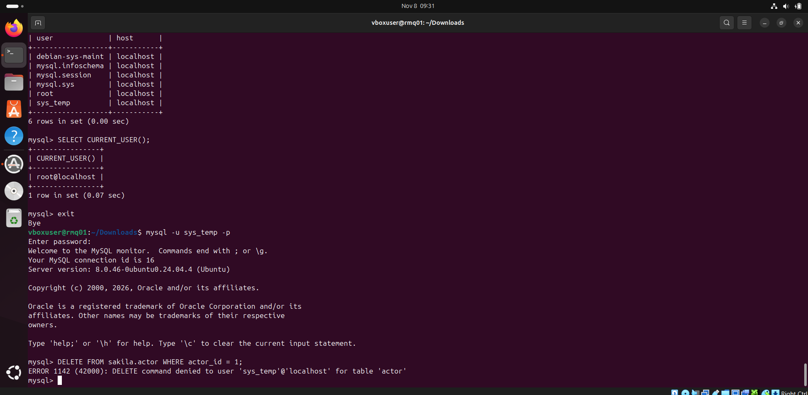
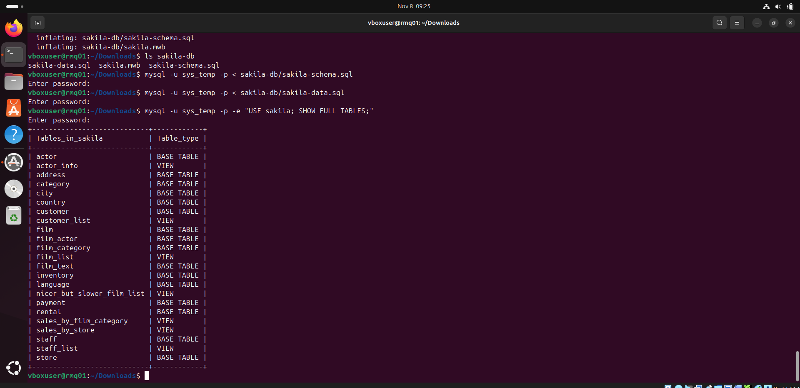
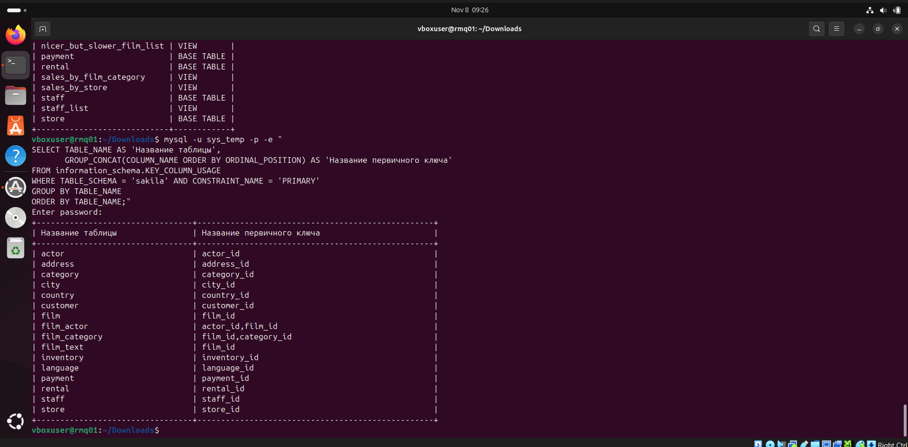

# Домашнее задание к занятию «Работа с данными (DDL/DML)» — Илембетов Василь Ражапович

[English version](README_EN.md)

Стенд: виртуальная машина VirtualBox с Ubuntu 24.04, MySQL 8.0 из репозитория Ubuntu, работа в командной строке.

---

## Задание 1

### 1.1. Установка MySQL

```bash
sudo apt update
sudo apt install -y mysql-server
mysql --version
```

Подключение под root. В Ubuntu root входит через `sudo` без пароля, используется плагин `auth_socket`:

```bash
sudo mysql
```

### 1.2. Создание учётной записи sys_temp

```sql
CREATE USER 'sys_temp'@'localhost' IDENTIFIED BY 'password';
```

### 1.3. Список пользователей

```sql
SELECT user, host FROM mysql.user;
```



На скриншоте в списке есть созданный пользователь `sys_temp`.

### 1.4. Выдача всех прав пользователю sys_temp

```sql
GRANT ALL PRIVILEGES ON *.* TO 'sys_temp'@'localhost';
```

### 1.5. Список прав пользователя sys_temp

```sql
SHOW GRANTS FOR 'sys_temp'@'localhost';
```

### 1.6. Переподключение под sys_temp

Меняем тип аутентификации с `caching_sha2_password` на `mysql_native_password`, чтобы к серверу могли подключаться клиенты, которые не поддерживают новый метод:

```sql
ALTER USER 'sys_temp'@'localhost' IDENTIFIED WITH mysql_native_password BY 'password';
```

Подключение под новым пользователем:

```bash
mysql -u sys_temp -p
```

```sql
SELECT CURRENT_USER();
```

### 1.7. Скачивание дампа

```bash
sudo apt install -y unzip
wget https://downloads.mysql.com/docs/sakila-db.zip
unzip sakila-db.zip
```

Архив содержит два файла:
- `sakila-schema.sql` — структура базы (таблицы, представления, триггеры, процедуры);
- `sakila-data.sql` — данные.

### 1.8. Восстановление дампа

Сначала структура, потом данные:

```bash
mysql -u sys_temp -p < sakila-db/sakila-schema.sql
mysql -u sys_temp -p < sakila-db/sakila-data.sql
```

База `sakila` создаётся самим скриптом (`CREATE SCHEMA sakila`).

### 1.9. Таблицы базы данных

Список таблиц в командной строке:

```bash
mysql -u sys_temp -p -e "USE sakila; SHOW FULL TABLES;"
```



На скриншоте видно восстановление дампа и список объектов базы: 16 таблиц (`BASE TABLE`) и 7 представлений (`VIEW`).

---

## Задание 2

Первичные ключи получены из системной базы `information_schema`:

```sql
SELECT TABLE_NAME AS 'Название таблицы',
       GROUP_CONCAT(COLUMN_NAME ORDER BY ORDINAL_POSITION) AS 'Название первичного ключа'
FROM information_schema.KEY_COLUMN_USAGE
WHERE TABLE_SCHEMA = 'sakila' AND CONSTRAINT_NAME = 'PRIMARY'
GROUP BY TABLE_NAME
ORDER BY TABLE_NAME;
```

| Название таблицы | Название первичного ключа |
|---|---|
| actor | actor_id |
| address | address_id |
| category | category_id |
| city | city_id |
| country | country_id |
| customer | customer_id |
| film | film_id |
| film_actor | actor_id, film_id |
| film_category | film_id, category_id |
| film_text | film_id |
| inventory | inventory_id |
| language | language_id |
| payment | payment_id |
| rental | rental_id |
| staff | staff_id |
| store | store_id |

У таблиц `film_actor` и `film_category` составной первичный ключ: это связующие таблицы для отношений «многие ко многим» (фильмы — актёры, фильмы — категории). Представления (`actor_info`, `customer_list` и др.) в список не входят, так как у них нет первичных ключей.



---

## Задание 3*

### 3.1. Отзыв прав на внесение, изменение и удаление данных в базе sakila

Права выданы на все базы (`*.*`), поэтому обычный `REVOKE ... ON sakila.*` завершается ошибкой `There is no such grant defined`. Чтобы отозвать глобальное право для одной базы, включаем частичный отзыв прав (`partial_revokes`, доступен с MySQL 8.0.16). Команды выполняются под root:

```sql
SET PERSIST partial_revokes = ON;
REVOKE INSERT, UPDATE, DELETE ON sakila.* FROM 'sys_temp'@'localhost';
```

`SET PERSIST` сохраняет настройку после перезапуска сервера.

### 3.2. Список прав пользователя sys_temp

```sql
SHOW GRANTS FOR 'sys_temp'@'localhost';
```

В выводе появилась строка `REVOKE INSERT, UPDATE, DELETE ON sakila.* FROM sys_temp@localhost`.

Проверка: под `sys_temp` пытаемся удалить строку из `sakila.actor`:

```sql
DELETE FROM sakila.actor WHERE actor_id = 1;
```

Команда завершается ошибкой `ERROR 1142 (42000): DELETE command denied to user 'sys_temp'@'localhost' for table 'actor'`, значит, права на удаление в базе sakila отозваны:


