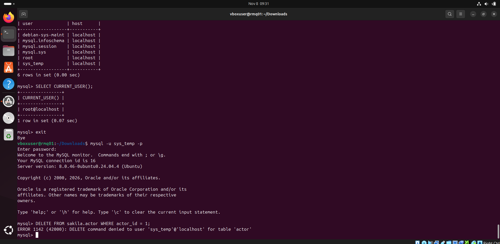
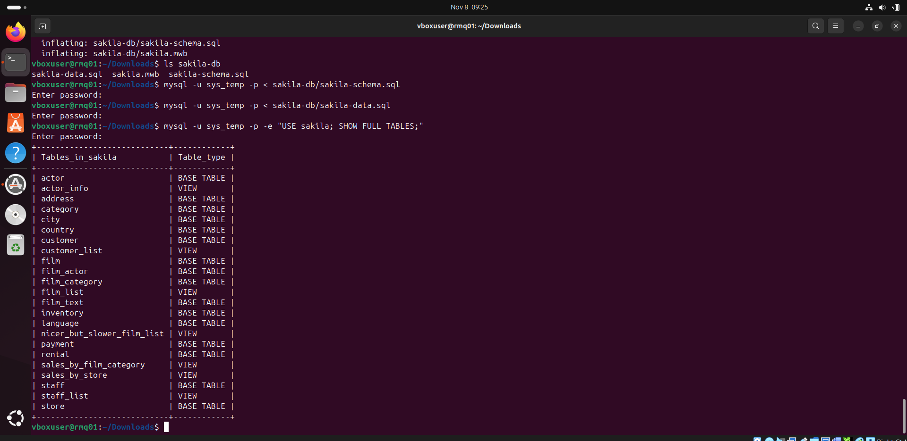
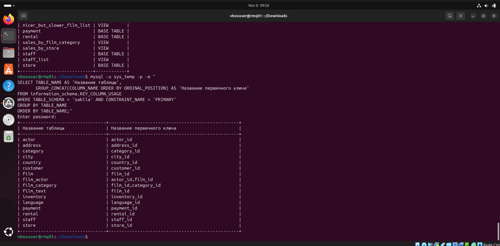

# Homework: Working with Data (DDL/DML) — Ilembetov Vasil Razhapovich

[Русская версия](README.md)

Environment: a VirtualBox virtual machine running Ubuntu 24.04, MySQL 8.0 from the Ubuntu repository, work done in the command line.

---

## Task 1

### 1.1. Installing MySQL

```bash
sudo apt update
sudo apt install -y mysql-server
mysql --version
```

Connecting as root. On Ubuntu, root logs in via `sudo` without a password using the `auth_socket` plugin:

```bash
sudo mysql
```

### 1.2. Creating the sys_temp account

```sql
CREATE USER 'sys_temp'@'localhost' IDENTIFIED BY 'password';
```

### 1.3. Listing users

```sql
SELECT user, host FROM mysql.user;
```



The screenshot shows the newly created `sys_temp` user in the list.

### 1.4. Granting all privileges to sys_temp

```sql
GRANT ALL PRIVILEGES ON *.* TO 'sys_temp'@'localhost';
```

### 1.5. Listing sys_temp privileges

```sql
SHOW GRANTS FOR 'sys_temp'@'localhost';
```

### 1.6. Reconnecting as sys_temp

The authentication method is changed from `caching_sha2_password` to `mysql_native_password` so that clients without support for the newer method can connect:

```sql
ALTER USER 'sys_temp'@'localhost' IDENTIFIED WITH mysql_native_password BY 'password';
```

Connecting as the new user:

```bash
mysql -u sys_temp -p
```

```sql
SELECT CURRENT_USER();
```

### 1.7. Downloading the dump

```bash
sudo apt install -y unzip
wget https://downloads.mysql.com/docs/sakila-db.zip
unzip sakila-db.zip
```

The archive contains two files:
- `sakila-schema.sql` — database structure (tables, views, triggers, procedures);
- `sakila-data.sql` — the data.

### 1.8. Restoring the dump

Structure first, then data:

```bash
mysql -u sys_temp -p < sakila-db/sakila-schema.sql
mysql -u sys_temp -p < sakila-db/sakila-data.sql
```

The `sakila` database is created by the script itself (`CREATE SCHEMA sakila`).

### 1.9. Database tables

List of tables from the command line:

```bash
mysql -u sys_temp -p -e "USE sakila; SHOW FULL TABLES;"
```



The screenshot shows the dump being restored and the list of database objects: 16 tables (`BASE TABLE`) and 7 views (`VIEW`).

---

## Task 2

Primary keys were retrieved from the `information_schema` system database:

```sql
SELECT TABLE_NAME AS 'Table name',
       GROUP_CONCAT(COLUMN_NAME ORDER BY ORDINAL_POSITION) AS 'Primary key'
FROM information_schema.KEY_COLUMN_USAGE
WHERE TABLE_SCHEMA = 'sakila' AND CONSTRAINT_NAME = 'PRIMARY'
GROUP BY TABLE_NAME
ORDER BY TABLE_NAME;
```

| Table name | Primary key |
|---|---|
| actor | actor_id |
| address | address_id |
| category | category_id |
| city | city_id |
| country | country_id |
| customer | customer_id |
| film | film_id |
| film_actor | actor_id, film_id |
| film_category | film_id, category_id |
| film_text | film_id |
| inventory | inventory_id |
| language | language_id |
| payment | payment_id |
| rental | rental_id |
| staff | staff_id |
| store | store_id |

`film_actor` and `film_category` have composite primary keys: they are junction tables for many-to-many relationships (films — actors, films — categories). Views (`actor_info`, `customer_list`, etc.) are not listed because they have no primary keys.



---

## Task 3*

### 3.1. Revoking insert, update and delete privileges on the sakila database

The privileges were granted on all databases (`*.*`), so a plain `REVOKE ... ON sakila.*` fails with `There is no such grant defined`. To revoke a global privilege for a single database, partial revokes (`partial_revokes`, available since MySQL 8.0.16) are enabled. The commands are run as root:

```sql
SET PERSIST partial_revokes = ON;
REVOKE INSERT, UPDATE, DELETE ON sakila.* FROM 'sys_temp'@'localhost';
```

`SET PERSIST` keeps the setting after a server restart.

### 3.2. Listing sys_temp privileges

```sql
SHOW GRANTS FOR 'sys_temp'@'localhost';
```

The output now contains the line `REVOKE INSERT, UPDATE, DELETE ON sakila.* FROM sys_temp@localhost`.

Check: as `sys_temp`, try to delete a row from `sakila.actor`:

```sql
DELETE FROM sakila.actor WHERE actor_id = 1;
```

The command fails with `ERROR 1142 (42000): DELETE command denied to user 'sys_temp'@'localhost' for table 'actor'`, which confirms that delete privileges on sakila have been revoked:


