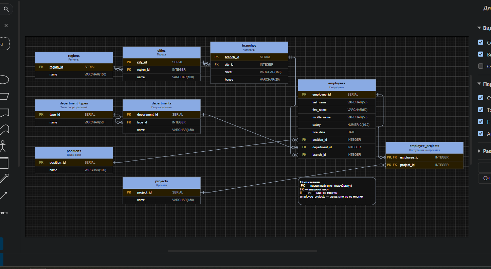
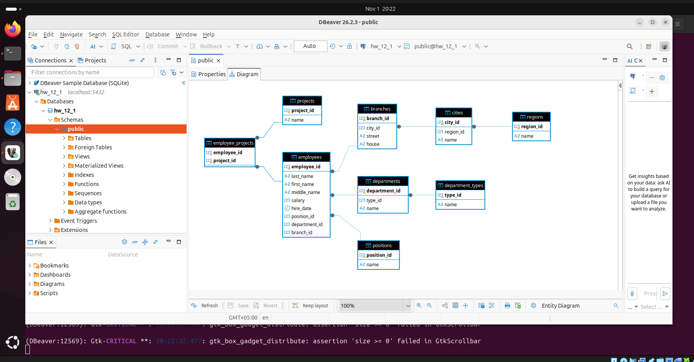
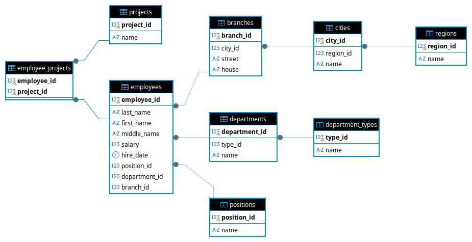

# Домашнее задание: Модель данных по отчёту заказчика.
Студент: Илембетов Василь Ражапович

---

## Задание 1

### Описание таблиц

В базе данных реализована модель, состоящая из **9 таблиц**, описывающих структуру организации, сотрудников и проектов.

---

#### 1. `regions` — Регионы

Хранит список регионов, определяемых из адреса филиала.

| Столбец         | Тип PostgreSQL           | Описание                        |
|-----------------|--------------------------|---------------------------------|
| `region_id`     | `SERIAL PRIMARY KEY`     | Идентификатор региона           |
| `name`          | `VARCHAR(100) NOT NULL`  | Название региона                |

**Первичный ключ:** `region_id`

---

#### 2. `cities` — Города

Хранит список городов, каждый город привязан к одному региону.

| Столбец         | Тип PostgreSQL           | Описание                        |
|-----------------|--------------------------|---------------------------------|
| `city_id`       | `SERIAL PRIMARY KEY`     | Идентификатор города            |
| `region_id`     | `INTEGER NOT NULL`       | Ссылка на регион                |
| `name`          | `VARCHAR(100) NOT NULL`  | Название города                 |

**Первичный ключ:** `city_id`
**Внешний ключ:** `region_id → regions(region_id)`

---

#### 3. `branches` — Филиалы

Хранит адреса филиалов (улица и дом). Регион и город определяются через `city_id`.

| Столбец         | Тип PostgreSQL           | Описание                                          |
|-----------------|--------------------------|---------------------------------------------------|
| `branch_id`     | `SERIAL PRIMARY KEY`     | Идентификатор филиала                             |
| `city_id`       | `INTEGER NOT NULL`       | Ссылка на город                                   |
| `street`        | `VARCHAR(150) NOT NULL`  | Название улицы                                    |
| `house`         | `VARCHAR(20) NOT NULL`   | Номер дома (текст, т.к. бывает «135/2»)           |

**Первичный ключ:** `branch_id`
**Внешний ключ:** `city_id → cities(city_id)`

---

#### 4. `department_types` — Типы подразделений

Хранит типы структурных подразделений: Отдел, Группа, Департамент.

| Столбец         | Тип PostgreSQL           | Описание                        |
|-----------------|--------------------------|---------------------------------|
| `type_id`       | `SERIAL PRIMARY KEY`     | Идентификатор типа              |
| `name`          | `VARCHAR(50) NOT NULL`   | Название типа                   |

**Первичный ключ:** `type_id`

---

#### 5. `departments` — Структурные подразделения

Хранит список структурных подразделений организации.

| Столбец             | Тип PostgreSQL           | Описание                        |
|---------------------|--------------------------|---------------------------------|
| `department_id`     | `SERIAL PRIMARY KEY`     | Идентификатор подразделения     |
| `type_id`           | `INTEGER NOT NULL`       | Ссылка на тип подразделения     |
| `name`              | `VARCHAR(150) NOT NULL`  | Название подразделения          |

**Первичный ключ:** `department_id`
**Внешний ключ:** `type_id → department_types(type_id)`

---

#### 6. `positions` — Должности

Хранит список должностей в организации.

| Столбец           | Тип PostgreSQL           | Описание                        |
|-------------------|--------------------------|---------------------------------|
| `position_id`     | `SERIAL PRIMARY KEY`     | Идентификатор должности         |
| `name`            | `VARCHAR(100) NOT NULL`  | Название должности              |

**Первичный ключ:** `position_id`

---

#### 7. `employees` — Сотрудники

Хранит информацию о сотрудниках: ФИО, зарплата, дата найма, должность, подразделение, филиал.

| Столбец           | Тип PostgreSQL               | Описание                              |
|-------------------|------------------------------|---------------------------------------|
| `employee_id`     | `SERIAL PRIMARY KEY`         | Идентификатор сотрудника              |
| `last_name`       | `VARCHAR(50) NOT NULL`       | Фамилия                               |
| `first_name`      | `VARCHAR(50) NOT NULL`       | Имя                                   |
| `middle_name`     | `VARCHAR(50)`                | Отчество (может не быть)              |
| `salary`          | `NUMERIC(10, 2) NOT NULL`    | Зарплата                              |
| `hire_date`       | `DATE NOT NULL`              | Дата найма                            |
| `position_id`     | `INTEGER NOT NULL`           | Ссылка на должность                   |
| `department_id`   | `INTEGER NOT NULL`           | Ссылка на подразделение               |
| `branch_id`       | `INTEGER NOT NULL`           | Ссылка на филиал                      |

**Первичный ключ:** `employee_id`
**Внешние ключи:**
- `position_id → positions(position_id)`
- `department_id → departments(department_id)`
- `branch_id → branches(branch_id)`

---

#### 8. `projects` — Проекты

Хранит список проектов организации.

| Столбец          | Тип PostgreSQL           | Описание                        |
|------------------|--------------------------|---------------------------------|
| `project_id`     | `SERIAL PRIMARY KEY`     | Идентификатор проекта           |
| `name`           | `VARCHAR(150) NOT NULL`  | Название проекта                |

**Первичный ключ:** `project_id`

---

#### 9. `employee_projects` — Сотрудники-проекты

Связь «многие-ко-многим»: сотрудник может работать на нескольких проектах, на проекте может быть несколько сотрудников.

| Столбец         | Тип PostgreSQL           | Описание                        |
|-----------------|--------------------------|---------------------------------|
| `employee_id`   | `INTEGER NOT NULL`       | Ссылка на сотрудника            |
| `project_id`    | `INTEGER NOT NULL`       | Ссылка на проект                |

**Первичный ключ:** `(employee_id, project_id)` — составной ключ
**Внешние ключи:**
- `employee_id → employees(employee_id)`
- `project_id → projects(project_id)`

---

### Связи между таблицами

| Таблица A        | → Таблица B        | Тип связи           |
|------------------|--------------------|---------------------|
| `cities`         | `regions`          | Многие-к-одному     |
| `branches`       | `cities`           | Многие-к-одному     |
| `departments`    | `department_types` | Многие-к-одному     |
| `employees`      | `positions`        | Многие-к-одному     |
| `employees`      | `departments`      | Многие-к-одному     |
| `employees`      | `branches`         | Многие-к-одному     |
| `employee_projects` | `employees`     | Многие-к-одному     |
| `employee_projects` | `projects`      | Многие-к-одному     |

---

### Диаграмма базы данных

**Задание 1:**



---

## Задание 2* — Развёртывание PostgreSQL

### SQL-скрипт

SQL-скрипт для создания модели данных находится в файле:

```
scripts/schema.sql
```

### Создание базы данных

```sql
-- 1. Создать базу данных
CREATE DATABASE company_db;

-- 2. Подключиться к базе
\c company_db;

-- 3. Выполнить скрипт создания моделей
\i scripts/schema.sql
```

### Диаграмма

**Задание 2*:**





---

## Структура проекта

```
Databases/
├── img/
│   ├── schema-1.png      # Схема БД (Задание 1)
│   ├── schema-2.png      # ER-диаграмма (Задание 2*)
│   └── schema-2_1.png    # ER-диаграмма (альтернатива)
├── scripts/
│   └── schema.sql        # SQL-скрипт создания моделей
└── README.md             # Этот файл
```

---

## Рекомендации

1. Для работы с PostgreSQL рекомендуется использовать **DBeaver** — бесплатный универсальный клиент для баз данных.

2. Для редактирования и создания диаграмм можно использовать [diagrams.net](https://app.diagrams.net/).

3. Для развёртывания PostgreSQL в контейнере Docker:
   ```bash
   docker run --name postgres-db -e POSTGRES_PASSWORD=yourpassword -e POSTGRES_DB=company_db -p 5432:5432 -d postgres:latest
   ```
