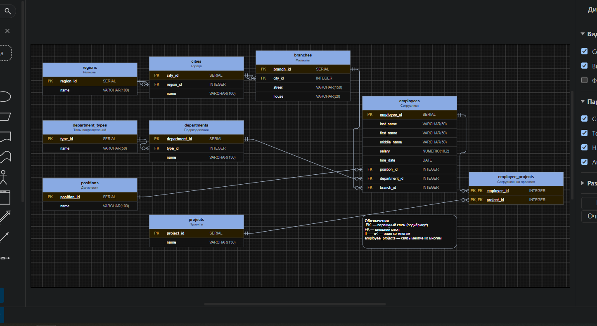
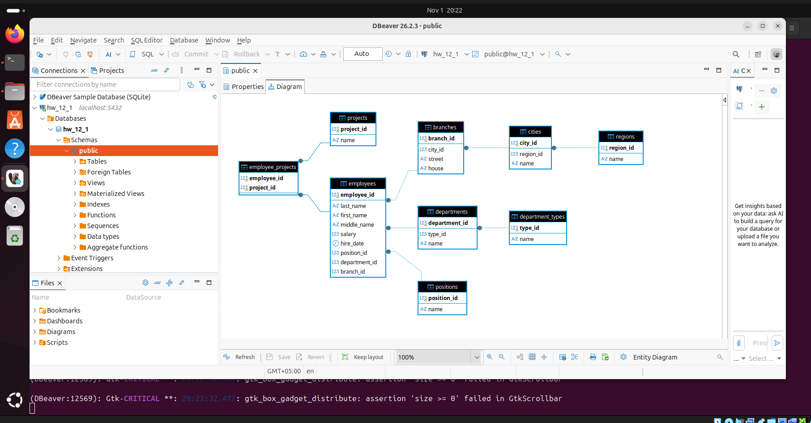
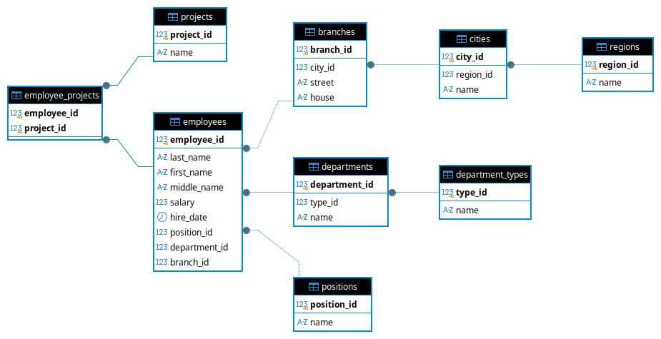

# Homework: Database Model from Customer Report
Student: Ilembetov Vasil Razhapovich
---

## Task 1

### Tables Description

The database model consists of **9 tables** describing the organization structure, employees, and projects.

---

#### 1. `regions` — Regions

Stores a list of regions derived from branch addresses.

| Column        | PostgreSQL Type          | Description                     |
|---------------|--------------------------|---------------------------------|
| `region_id`   | `SERIAL PRIMARY KEY`     | Region identifier               |
| `name`        | `VARCHAR(100) NOT NULL`  | Region name                     |

**Primary Key:** `region_id`

---

#### 2. `cities` — Cities

Stores a list of cities, each city linked to one region.

| Column        | PostgreSQL Type          | Description                     |
|---------------|--------------------------|---------------------------------|
| `city_id`     | `SERIAL PRIMARY KEY`     | City identifier                 |
| `region_id`   | `INTEGER NOT NULL`       | Reference to region             |
| `name`        | `VARCHAR(100) NOT NULL`  | City name                       |

**Primary Key:** `city_id`
**Foreign Key:** `region_id → regions(region_id)`

---

#### 3. `branches` — Branches

Stores branch addresses (street and house). Region and city are determined via `city_id`.

| Column        | PostgreSQL Type          | Description                                     |
|---------------|--------------------------|-------------------------------------------------|
| `branch_id`   | `SERIAL PRIMARY KEY`     | Branch identifier                               |
| `city_id`     | `INTEGER NOT NULL`       | Reference to city                               |
| `street`      | `VARCHAR(150) NOT NULL`  | Street name                                     |
| `house`       | `VARCHAR(20) NOT NULL`   | House number (text, e.g. "135/2")               |

**Primary Key:** `branch_id`
**Foreign Key:** `city_id → cities(city_id)`

---

#### 4. `department_types` — Department Types

Stores types of structural departments: Department, Group, Division.

| Column        | PostgreSQL Type          | Description                     |
|---------------|--------------------------|---------------------------------|
| `type_id`     | `SERIAL PRIMARY KEY`     | Type identifier                 |
| `name`        | `VARCHAR(50) NOT NULL`   | Type name                       |

**Primary Key:** `type_id`

---

#### 5. `departments` — Departments

Stores a list of organizational departments.

| Column            | PostgreSQL Type          | Description                     |
|-------------------|--------------------------|---------------------------------|
| `department_id`   | `SERIAL PRIMARY KEY`     | Department ID                   |
| `type_id`         | `INTEGER NOT NULL`       | Reference to department type    |
| `name`            | `VARCHAR(150) NOT NULL`  | Department name                 |

**Primary Key:** `department_id`
**Foreign Key:** `type_id → department_types(type_id)`

---

#### 6. `positions` — Positions

Stores a list of job positions in the organization.

| Column          | PostgreSQL Type          | Description                     |
|-----------------|--------------------------|---------------------------------|
| `position_id`   | `SERIAL PRIMARY KEY`     | Position ID                     |
| `name`          | `VARCHAR(100) NOT NULL`  | Position name                   |

**Primary Key:** `position_id`

---

#### 7. `employees` — Employees

Stores employee information: name, salary, hire date, position, department, branch.

| Column          | PostgreSQL Type              | Description                           |
|-----------------|------------------------------|---------------------------------------|
| `employee_id`   | `SERIAL PRIMARY KEY`         | Employee ID                           |
| `last_name`     | `VARCHAR(50) NOT NULL`       | Last name                             |
| `first_name`    | `VARCHAR(50) NOT NULL`       | First name                            |
| `middle_name`   | `VARCHAR(50)`                | Middle name (optional)                |
| `salary`        | `NUMERIC(10, 2) NOT NULL`    | Salary                                |
| `hire_date`     | `DATE NOT NULL`              | Hire date                             |
| `position_id`   | `INTEGER NOT NULL`           | Reference to position                 |
| `department_id` | `INTEGER NOT NULL`           | Reference to department               |
| `branch_id`     | `INTEGER NOT NULL`           | Reference to branch                   |

**Primary Key:** `employee_id`
**Foreign Keys:**
- `position_id → positions(position_id)`
- `department_id → departments(department_id)`
- `branch_id → branches(branch_id)`

---

#### 8. `projects` — Projects

Stores a list of organizational projects.

| Column         | PostgreSQL Type          | Description                     |
|----------------|--------------------------|---------------------------------|
| `project_id`   | `SERIAL PRIMARY KEY`     | Project ID                      |
| `name`         | `VARCHAR(150) NOT NULL`  | Project name                    |

**Primary Key:** `project_id`

---

#### 9. `employee_projects` — Employee-Projects

Many-to-many relationship: an employee can work on multiple projects, and a project can have multiple employees.

| Column        | PostgreSQL Type          | Description                     |
|---------------|--------------------------|---------------------------------|
| `employee_id` | `INTEGER NOT NULL`       | Reference to employee           |
| `project_id`  | `INTEGER NOT NULL`       | Reference to project            |

**Primary Key:** `(employee_id, project_id)` — composite key
**Foreign Keys:**
- `employee_id → employees(employee_id)`
- `project_id → projects(project_id)`

---

### Relationships Between Tables

| Table A           | → Table B        | Relationship Type |
|-------------------|------------------|-------------------|
| `cities`          | `regions`        | Many-to-One       |
| `branches`        | `cities`         | Many-to-One       |
| `departments`     | `department_types` | Many-to-One     |
| `employees`       | `positions`      | Many-to-One       |
| `employees`       | `departments`    | Many-to-One       |
| `employees`       | `branches`       | Many-to-One       |
| `employee_projects` | `employees`    | Many-to-One       |
| `employee_projects` | `projects`     | Many-to-One       |

---

### Database Schema Diagram

**Task 1:**



---

## Task 2* — PostgreSQL Deployment

### SQL Script

The SQL script for creating the data model is located at:

```
scripts/schema.sql
```

### Creating the Database

```sql
-- 1. Create database
CREATE DATABASE company_db;

-- 2. Connect to database
\c company_db;

-- 3. Execute model creation script
\i scripts/schema.sql
```

### Diagram

**Task 2*:**





---

### Project Structure

```
Databases/
├── img/
│   ├── schema-1.png      # Database schema (Task 1)
│   ├── schema-2.png      # ER diagram (Task 2*)
│   └── schema-2_1.png    # ER diagram (alternative)
├── scripts/
│   └── schema.sql        # SQL script for creating models
└── README_en.md          # This file
```

---

### Recommendations

1. For working with PostgreSQL, **DBeaver** is recommended — a free universal database client.

2. For editing and creating diagrams, use [diagrams.net](https://app.diagrams.net/).

3. For deploying PostgreSQL in a Docker container:
   ```bash
   docker run --name postgres-db -e POSTGRES_PASSWORD=yourpassword -e POSTGRES_DB=company_db -p 5432:5432 -d postgres:latest
   ```
