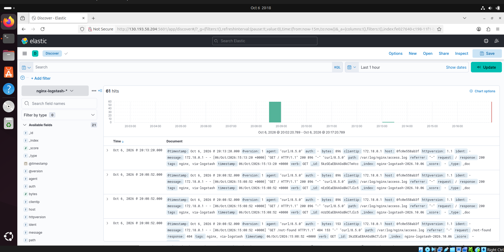
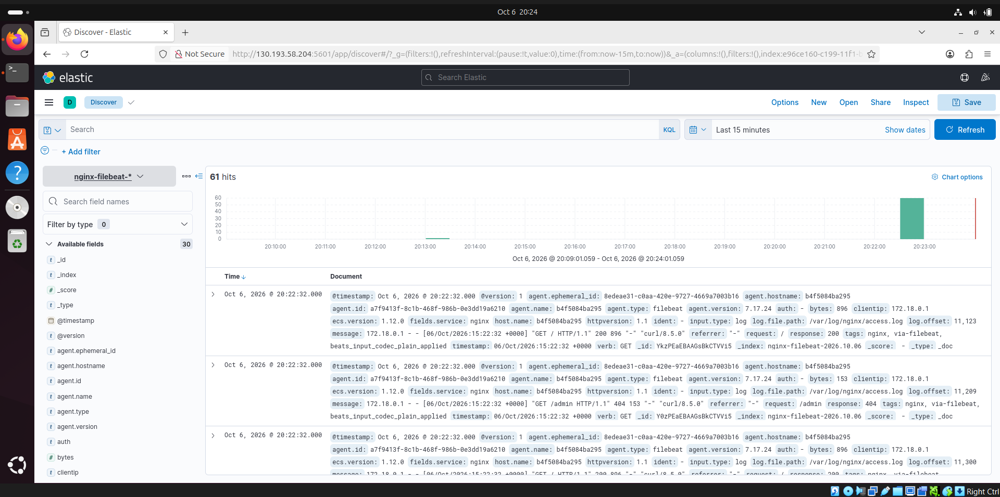

# Домашнее задание к занятию «ELK» — `Илембетов Василь Ражапович`

Весь стек развёрнут в Docker Compose на одном сервере (Ubuntu):

| Компонент | Версия | Порт |
|---|---|---|
| Elasticsearch | 7.17.24 | 9200 |
| Kibana | 7.17.24 | 5601 |
| Logstash | 7.17.24 | 5044 (beats) |
| Filebeat | 7.17.24 | — |
| Nginx | stable | 18080 |

## Структура репозитория

```
.
├── .env                            # версия стека, имя кластера, выбор пайплайна Logstash
├── docker-compose.yml
├── nginx/nginx.conf                # access-лог пишется в файл в формате combined
├── logstash/
│   ├── config/logstash.yml
│   ├── pipeline-task3/nginx.conf   # задание 3: Logstash читает access.log сам
│   └── pipeline-task4/beats.conf   # задание 4: Logstash принимает данные от Filebeat
├── filebeat/filebeat.yml           # задание 4: Filebeat → Logstash:5044
├── logs/nginx/                     # каталог логов Nginx (монтируется в контейнеры)
└── img/                            # скриншоты
```

## Подготовка сервера

```bash
# Без этого Elasticsearch не стартует (vm.max_map_count [65530] is too low)
sudo sysctl -w vm.max_map_count=262144
echo 'vm.max_map_count=262144' | sudo tee /etc/sysctl.d/99-elastic.conf
```

---

## Задание 1. Elasticsearch

> Установите и запустите Elasticsearch, после чего поменяйте параметр cluster_name на случайный.
> Приведите скриншот команды `curl -X GET 'localhost:9200/_cluster/health?pretty'`, сделанной на сервере с установленным Elasticsearch. Где будет виден нестандартный cluster_name.

### Решение

Имя кластера задано в `.env` и передаётся в контейнер через переменную окружения:

```env
CLUSTER_NAME=netology-cluster-7f3k9q
```

```yaml
elasticsearch:
  image: docker.elastic.co/elasticsearch/elasticsearch:${ELK_VERSION}
  environment:
    - cluster.name=${CLUSTER_NAME}
    - node.name=es-node-1
    - discovery.type=single-node
    - xpack.security.enabled=false
    - ES_JAVA_OPTS=-Xms512m -Xmx512m
```

Запуск и проверка:

```bash
docker compose up -d elasticsearch
curl -X GET 'localhost:9200/_cluster/health?pretty'
```


---

## Задание 2. Kibana

> Установите и запустите Kibana.
> Приведите скриншот интерфейса Kibana на странице `http://<ip вашего сервера>:5601/app/dev_tools#/console`, где будет выполнен запрос `GET /_cluster/health?pretty`.

### Решение

```yaml
kibana:
  image: docker.elastic.co/kibana/kibana:${ELK_VERSION}
  environment:
    - ELASTICSEARCH_HOSTS=http://elasticsearch:9200
  ports:
    - "5601:5601"
  depends_on:
    elasticsearch:
      condition: service_healthy
```

```bash
docker compose up -d kibana
```

В Dev Tools выполнен запрос `GET /_cluster/health?pretty`:


---

## Задание 3. Logstash

> Установите и запустите Logstash и Nginx. С помощью Logstash отправьте access-лог Nginx в Elasticsearch.
> Приведите скриншот интерфейса Kibana, на котором видны логи Nginx.

### Решение

Nginx пишет access-лог в файл `/var/log/nginx/access.log` (каталог смонтирован с хоста, т.к. в образе nginx этот файл по умолчанию — симлинк на stdout). Этот же каталог смонтирован в Logstash только на чтение.

Пайплайн Logstash ([logstash/pipeline-task3/nginx.conf](logstash/pipeline-task3/nginx.conf)):

```ruby
input {
  file {
    path => "/var/log/nginx/access.log"
    start_position => "beginning"
    sincedb_path => "/dev/null"
  }
}

filter {
  grok {
    match => { "message" => "%{COMBINEDAPACHELOG}" }
  }
  date {
    match => [ "timestamp", "dd/MMM/yyyy:HH:mm:ss Z" ]
    target => "@timestamp"
  }
  mutate {
    convert => { "response" => "integer" "bytes" => "integer" }
  }
}

output {
  elasticsearch {
    hosts => ["http://elasticsearch:9200"]
    index => "nginx-logstash-%{+YYYY.MM.dd}"
  }
}
```

Запуск и генерация трафика:

```bash
# в .env: LS_PIPELINE=pipeline-task3
docker compose up -d nginx logstash

for i in $(seq 1 30); do
  curl -s localhost:18080/ > /dev/null
  curl -s localhost:18080/not-found > /dev/null
done

curl 'localhost:9200/_cat/indices/nginx-*?v'
```

В Kibana создан index pattern `nginx-logstash-*`, логи открыты в Discover. Строка лога разобрана на поля `clientip`, `verb`, `request`, `response`, `bytes`, `agent`:



---

## Задание 4. Filebeat

> Установите и запустите Filebeat. Переключите поставку логов Nginx с Logstash на Filebeat.
> Приведите скриншот интерфейса Kibana, на котором видны логи Nginx, которые были отправлены через Filebeat.

### Решение

Теперь файл лога читает Filebeat и отправляет события в Logstash на порт 5044. Logstash больше не читает файл сам — он переключён на пайплайн с входом `beats`, разбирает строку и пишет в отдельный индекс `nginx-filebeat-*`.

Конфигурация Filebeat ([filebeat/filebeat.yml](filebeat/filebeat.yml)):

```yaml
filebeat.inputs:
  - type: log
    enabled: true
    paths:
      - /var/log/nginx/access.log
    fields:
      service: nginx
    tags: ["nginx", "via-filebeat"]

output.logstash:
  hosts: ["logstash:5044"]
```

Пайплайн Logstash ([logstash/pipeline-task4/beats.conf](logstash/pipeline-task4/beats.conf)):

```ruby
input {
  beats {
    port => 5044
  }
}

filter {
  if [fields][service] == "nginx" {
    grok {
      match => { "message" => "%{COMBINEDAPACHELOG}" }
    }
    date {
      match => [ "timestamp", "dd/MMM/yyyy:HH:mm:ss Z" ]
      target => "@timestamp"
    }
  }
}

output {
  elasticsearch {
    hosts => ["http://elasticsearch:9200"]
    index => "nginx-filebeat-%{+YYYY.MM.dd}"
  }
}
```

Переключение и запуск:

```bash
sed -i 's/^LS_PIPELINE=.*/LS_PIPELINE=pipeline-task4/' .env
docker compose up -d --force-recreate logstash
docker compose --profile task4 up -d filebeat

for i in $(seq 1 30); do
  curl -s localhost:18080/ > /dev/null
  curl -s localhost:18080/admin > /dev/null
done

curl 'localhost:9200/_cat/indices/nginx-*?v'
```

В Kibana создан index pattern `nginx-filebeat-*`. В Discover видно, что события пришли через Filebeat: поле `agent.type` = `filebeat`, в `tags` — `via-filebeat`:



---

## Задание 5*. Доставка данных

Не выполнялось.

---

## Возникшие проблемы и их решение

| Проблема | Решение |
|---|---|
| Порты 8080 и 8081 на сервере уже заняты другими сервисами (`address already in use`) | Nginx опубликован на свободном порту 18080 |
| Все контейнеры остановились с кодом `Exited (255)` после перезапуска Docker/VM | Повторно выставлен `vm.max_map_count`, стек поднят заново через `docker compose up -d` |

## Остановка стенда

```bash
docker compose --profile task4 down -v
```
