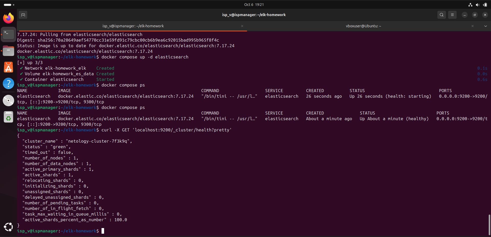
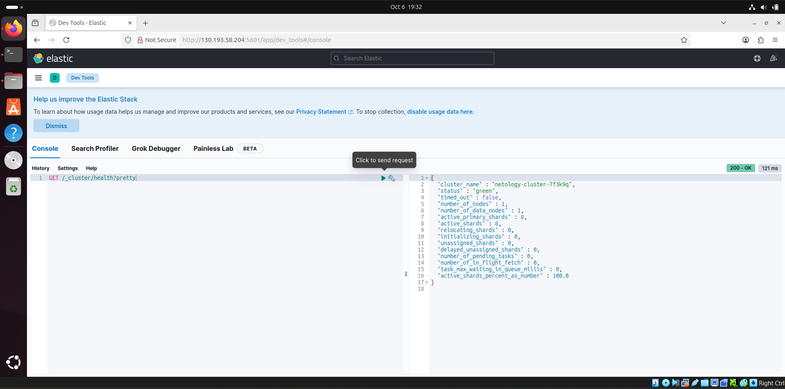

# Homework for "ELK" Course — `Ilembetov Vasil Razhapovich`

The entire stack is deployed using Docker Compose on a single server (Ubuntu):

| Component | Version | Port |
|---|---|---|
| Elasticsearch | 7.17.24 | 9200 |
| Kibana | 7.17.24 | 5601 |
| Logstash | 7.17.24 | 5044 (beats) |
| Filebeat | 7.17.24 | — |
| Nginx | stable | 18080 |

## Repository Structure

```
.
├── .env                            # stack version, cluster name, Logstash pipeline selection
├── docker-compose.yml
├── nginx/nginx.conf                # access-log written to file in combined format
├── logstash/
│   ├── config/logstash.yml
│   ├── pipeline-task3/nginx.conf   # task 3: Logstash reads access.log itself
│   └── pipeline-task4/beats.conf   # task 4: Logstash receives data from Filebeat
├── filebeat/filebeat.yml           # task 4: Filebeat → Logstash:5044
├── logs/nginx/                     # Nginx logs directory (mounted into containers)
└── img/                            # screenshots
```

## Server Preparation

```bash
# Without this, Elasticsearch won't start (vm.max_map_count [65530] is too low)
sudo sysctl -w vm.max_map_count=262144
echo 'vm.max_map_count=262144' | sudo tee /etc/sysctl.d/99-elastic.conf
```

---

## Task 1. Elasticsearch

> Install and run Elasticsearch, then change the cluster_name parameter to a random value.
> Provide a screenshot of the command `curl -X GET 'localhost:9200/_cluster/health?pretty'` executed on the server with Elasticsearch installed, showing the non-standard cluster_name.

### Solution

The cluster name is set in `.env` and passed to the container via environment variable:

```env
CLUSTER_NAME=netology-cluster-7f3k9q
```

```yaml
elasticsearch:
  image: docker.elastic.co/elasticsearch/elasticsearch:${ELK_VERSION}
  environment:
    - cluster.name=${CLUSTER_NAME}
    - node.name=es-node-1
    - discovery.type=single-node
    - xpack.security.enabled=false
    - ES_JAVA_OPTS=-Xms512m -Xmx512m
```

Startup and verification:

```bash
docker compose up -d elasticsearch
curl -X GET 'localhost:9200/_cluster/health?pretty'
```



---

## Task 2. Kibana

> Install and run Kibana.
> Provide a screenshot of the Kibana interface on the page `http://<your server ip>:5601/app/dev_tools#/console`, where the request `GET /_cluster/health?pretty` has been executed.

### Solution

```yaml
kibana:
  image: docker.elastic.co/kibana/kibana:${ELK_VERSION}
  environment:
    - ELASTICSEARCH_HOSTS=http://elasticsearch:9200
  ports:
    - "5601:5601"
  depends_on:
    elasticsearch:
      condition: service_healthy
```

```bash
docker compose up -d kibana
```

The request `GET /_cluster/health?pretty` was executed in Dev Tools:



---

## Task 3. Logstash

> Install and run Logstash and Nginx. Use Logstash to send Nginx access log to Elasticsearch.
> Provide a screenshot of the Kibana interface showing Nginx logs.

### Solution

Nginx writes its access log to `/var/log/nginx/access.log` (the directory is mounted from the host, since in the nginx image this file is by default a symlink to stdout). The same directory is mounted into Logstash in read-only mode.

Logstash pipeline ([logstash/pipeline-task3/nginx.conf](logstash/pipeline-task3/nginx.conf)):

```ruby
input {
  file {
    path => "/var/log/nginx/access.log"
    start_position => "beginning"
    sincedb_path => "/dev/null"
  }
}

filter {
  grok {
    match => { "message" => "%{COMBINEDAPACHELOG}" }
  }
  date {
    match => [ "timestamp", "dd/MMM/yyyy:HH:mm:ss Z" ]
    target => "@timestamp"
  }
  mutate {
    convert => { "response" => "integer" "bytes" => "integer" }
  }
}

output {
  elasticsearch {
    hosts => ["http://elasticsearch:9200"]
    index => "nginx-logstash-%{+YYYY.MM.dd}"
  }
}
```

Startup and traffic generation:

```bash
# in .env: LS_PIPELINE=pipeline-task3
docker compose up -d nginx logstash

for i in $(seq 1 30); do
  curl -s localhost:18080/ > /dev/null
  curl -s localhost:18080/not-found > /dev/null
done

curl 'localhost:9200/_cat/indices/nginx-*?v'
```

An index pattern `nginx-logstash-*` was created in Kibana, logs are opened in Discover. Log lines are parsed into fields `clientip`, `verb`, `request`, `response`, `bytes`, `agent`:


---

## Task 4. Filebeat

> Install and run Filebeat. Switch log delivery from Nginx from Logstash to Filebeat.
> Provide a screenshot of the Kibana interface showing Nginx logs that were sent via Filebeat.

### Solution

Now Filebeat reads the log file and sends events to Logstash on port 5044. Logstash no longer reads the file itself — it has been switched to a pipeline with `beats` input, parses the line, and writes to a separate index `nginx-filebeat-*`.

Filebeat configuration ([filebeat/filebeat.yml](filebeat/filebeat.yml)):

```yaml
filebeat.inputs:
  - type: log
    enabled: true
    paths:
      - /var/log/nginx/access.log
    fields:
      service: nginx
    tags: ["nginx", "via-filebeat"]

output.logstash:
  hosts: ["logstash:5044"]
```

Logstash pipeline ([logstash/pipeline-task4/beats.conf](logstash/pipeline-task4/beats.conf)):

```ruby
input {
  beats {
    port => 5044
  }
}

filter {
  if [fields][service] == "nginx" {
    grok {
      match => { "message" => "%{COMBINEDAPACHELOG}" }
    }
    date {
      match => [ "timestamp", "dd/MMM/yyyy:HH:mm:ss Z" ]
      target => "@timestamp"
    }
  }
}

output {
  elasticsearch {
    hosts => ["http://elasticsearch:9200"]
    index => "nginx-filebeat-%{+YYYY.MM.dd}"
  }
}
```

Switching and startup:

```bash
sed -i 's/^LS_PIPELINE=.*/LS_PIPELINE=pipeline-task4/' .env
docker compose up -d --force-recreate logstash
docker compose --profile task4 up -d filebeat

for i in $(seq 1 30); do
  curl -s localhost:18080/ > /dev/null
  curl -s localhost:18080/admin > /dev/null
done

curl 'localhost:9200/_cat/indices/nginx-*?v'
```

An index pattern `nginx-filebeat-*` was created in Kibana. In Discover it is visible that events came via Filebeat: the `agent.type` field = `filebeat`, and `tags` contains `via-filebeat`:


---

## Task 5*. Data Delivery

Not completed.

---

## Issues Encountered and Solutions

| Issue | Solution |
|---|---|
| Ports 8080 and 8081 on the server were already in use by other services (`address already in use`) | Nginx is published on the free port 18080 |
| All containers stopped with code `Exited (255)` after Docker/VM restart | `vm.max_map_count` was set again, the stack was restarted with `docker compose up -d` |

## Stopping the Stand

```bash
docker compose --profile task4 down -v
```
