# Домашнее задание к занятию «Защита хоста» — Илембетов Василь Ражапович

[English version](README_EN.md)

Стенд: виртуальная машина VirtualBox `rmq01` с Ubuntu 24.04.

---

## Задание 1. eCryptfs

### Установка и пользователь

```bash
sudo apt install -y ecryptfs-utils rsync lsof
sudo modprobe ecryptfs
sudo adduser cryptouser
```

`rsync` и `lsof` нужны скрипту миграции: первый копирует данные, второй проверяет, что файлы пользователя не открыты.

### Исходные данные

В домашнем каталоге `cryptouser` созданы тестовые файлы — они хранятся открытым текстом и читаются root без пароля пользователя:

```bash
sudo -u cryptouser bash -c 'echo "Секретные данные cryptouser" > ~/secret.txt; mkdir ~/docs; echo "Отчёт" > ~/docs/report.txt'
sudo ls -la /home/cryptouser /home/cryptouser/docs
sudo cat /home/cryptouser/secret.txt
```

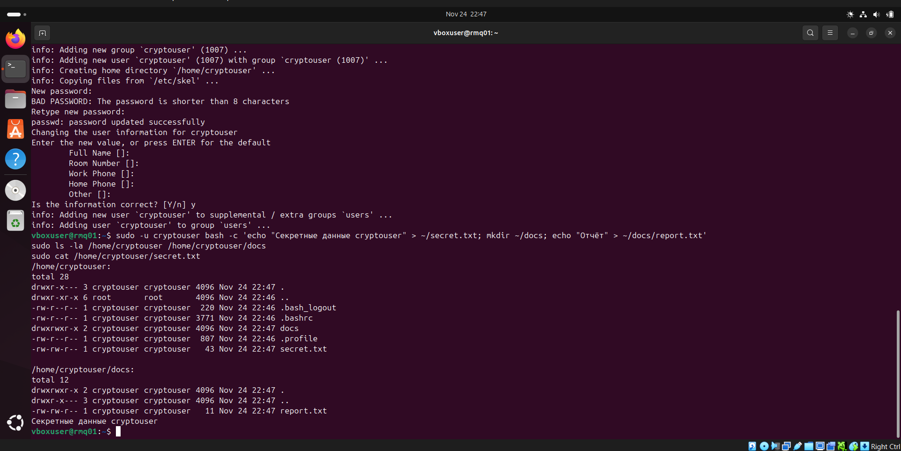

### Шифрование домашнего каталога

```bash
sudo ecryptfs-migrate-home -u cryptouser
```

Скрипт запрашивает пароль `cryptouser`, создаёт зашифрованное хранилище `/home/.ecryptfs/cryptouser/.Private` и копирует в него данные пользователя. Ключ шифрования (mount passphrase) генерируется случайно и сам зашифрован паролем пользователя.

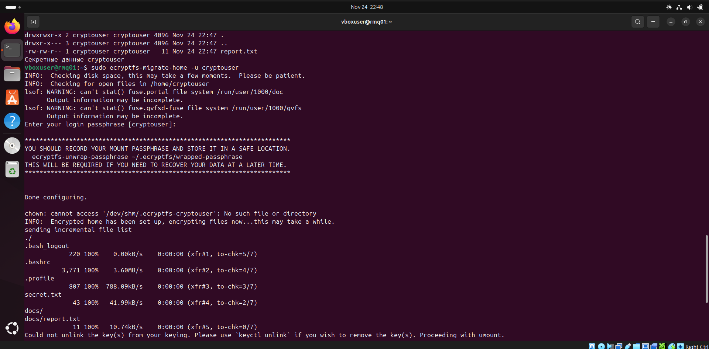

Миграция завершается при первом входе пользователя — до перезагрузки:

```bash
su - cryptouser
```

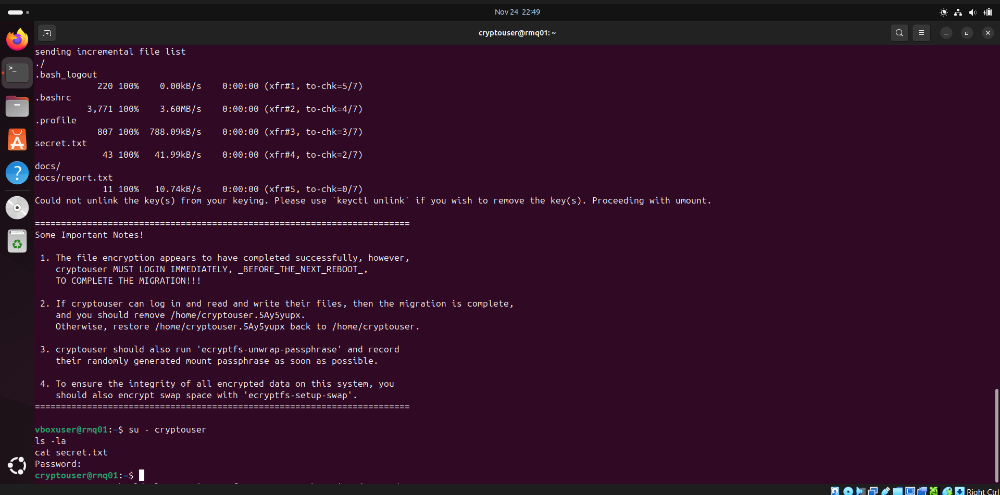

После входа каталог автоматически расшифровывается и монтируется, и пользователь работает со своими файлами как обычно:

```bash
ls -la
cat secret.txt
```

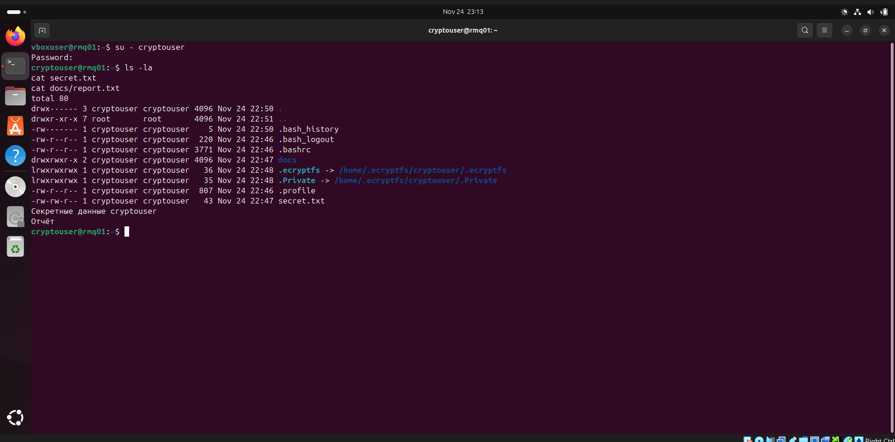

### Зашифрованные данные

Когда `cryptouser` не в системе, его каталог не смонтирован:

```bash
sudo ls -la /home/cryptouser
sudo ls -la /home/.ecryptfs/cryptouser/.Private
```

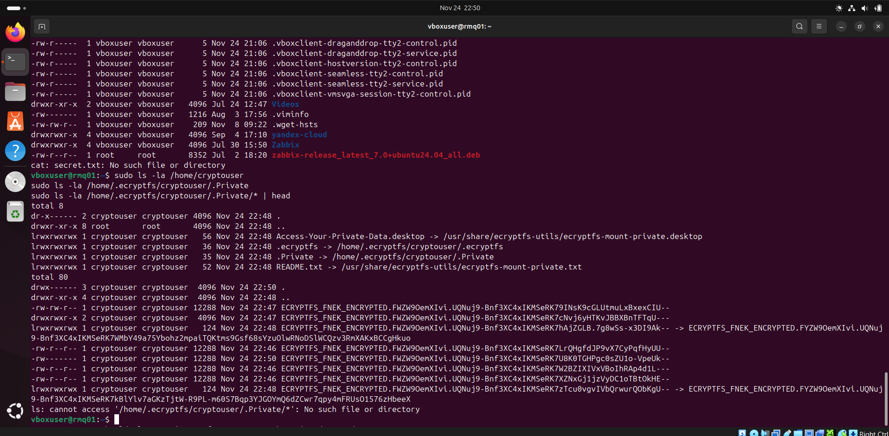

- В `/home/cryptouser` вместо файлов остались только ссылки `Access-Your-Private-Data.desktop`, `README.txt`, `.ecryptfs` и `.Private`.
- В `.Private` лежат те же файлы, но имена зашифрованы (`ECRYPTFS_FNEK_ENCRYPTED.FWZW9OemXIvi...`), а содержимое — шифротекст. Без пароля пользователя данные не прочитать даже root.

Незашифрованная резервная копия, оставленная скриптом, удалена:

```bash
sudo rm -rf /home/cryptouser.5Ay5yupx
```

---

## Задание 2. LUKS

### Раздел

Для эксперимента к ВМ подключён отдельный виртуальный диск 200 МБ (`/dev/sdb`), на нём создан раздел 100 МБ:

```bash
sudo apt install -y cryptsetup
lsblk
sudo parted /dev/sdb --script mklabel gpt mkpart secret 1MiB 101MiB
lsblk /dev/sdb
```

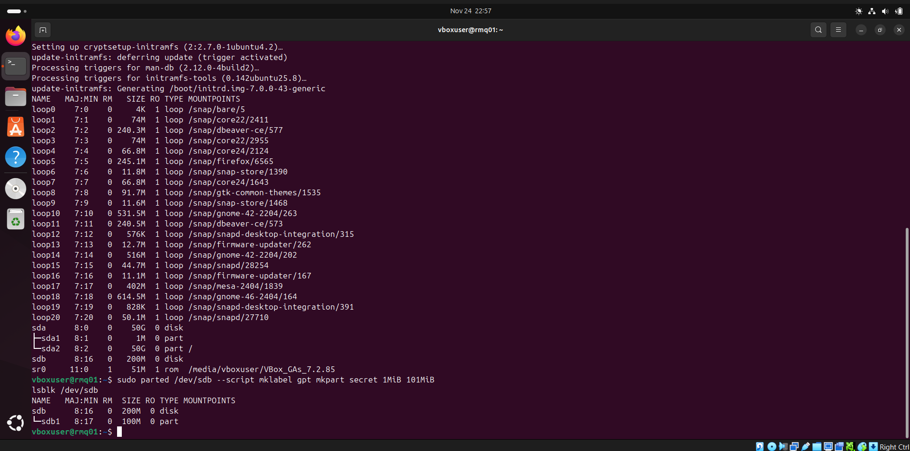

### Шифрование раздела

```bash
sudo cryptsetup luksFormat /dev/sdb1
sudo cryptsetup luksDump /dev/sdb1 | head -20
```

`luksFormat` требует подтверждения словом `YES` заглавными буквами — первая попытка с `yes` была отменена. После форматирования в заголовке видны версия LUKS2, шифр `aes-xts-plain64` и занятый слот ключа `0: luks2` с ключом 512 бит.

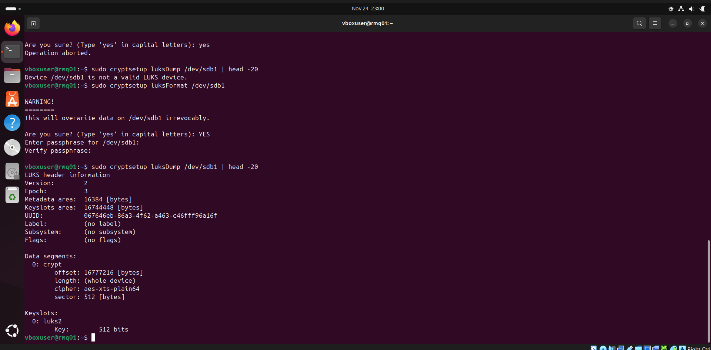

### Работа с зашифрованным разделом

```bash
sudo cryptsetup luksOpen /dev/sdb1 secret
sudo mkfs.ext4 /dev/mapper/secret
sudo mkdir -p /mnt/secret
sudo mount /dev/mapper/secret /mnt/secret
echo "Данные на зашифрованном разделе" | sudo tee /mnt/secret/test.txt
df -h /mnt/secret
lsblk /dev/sdb
```

`luksOpen` по паролю расшифровывает раздел и создаёт устройство `/dev/mapper/secret`. Файловая система создаётся на нём, а на диск данные попадают уже зашифрованными. В `lsblk` видна цепочка `sdb1 → secret` с типом `crypt`.

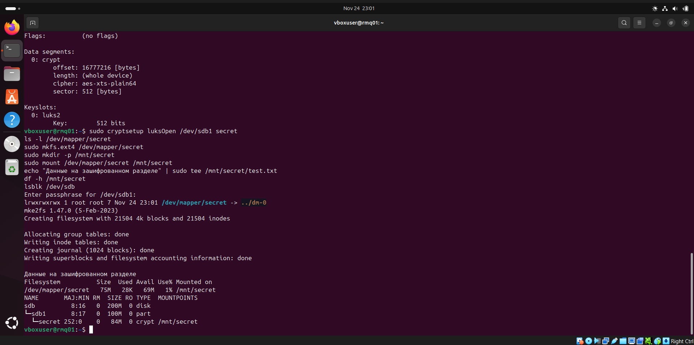

### Закрытие раздела

```bash
sudo umount /mnt/secret
sudo cryptsetup luksClose secret
sudo blkid /dev/sdb1
sudo mount /dev/sdb1 /mnt/secret
```

После закрытия `blkid` показывает тип `crypto_LUKS`, а смонтировать раздел напрямую нельзя (`unknown filesystem type 'crypto_LUKS'`) — без пароля данные недоступны.

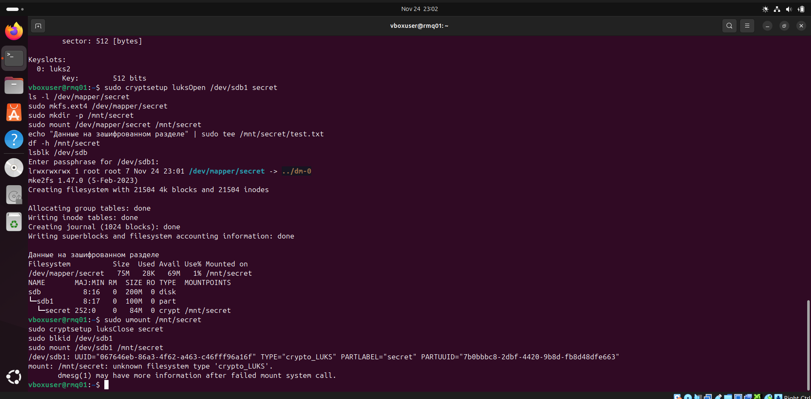

---

## Задание 3*. AppArmor

### Установка и статус

```bash
sudo apt install -y apparmor apparmor-utils
sudo aa-status | head -15
sudo aa-status | grep man
```

AppArmor уже установлен в Ubuntu, дополнительно поставлены утилиты `apparmor-utils`. Загружено 160 профилей, 64 из них в режиме `enforce`, среди них профиль `/usr/bin/man`.

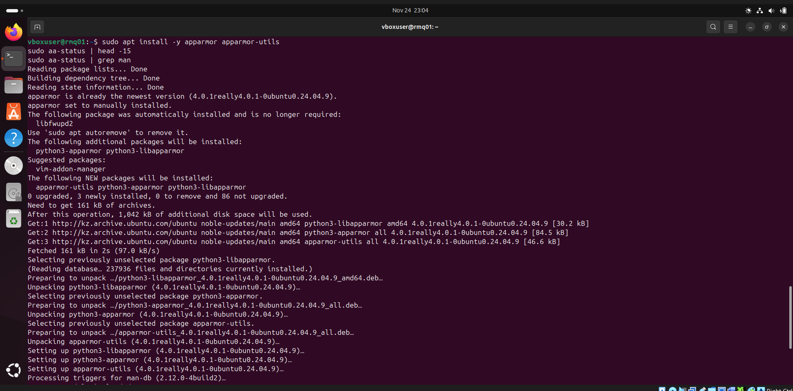

### Эксперимент: ping под именем man

Профиль AppArmor привязан к пути программы. Профиль `/usr/bin/man` разрешает только то, что нужно для чтения справки. Подменим `man` программой `ping`:

```bash
sudo cp /usr/bin/man /usr/bin/man.orig
sudo cp /usr/bin/ping /usr/bin/man
sudo man -c 2 127.0.0.1
sudo dmesg | grep -i apparmor | grep -i denied | tail -5
```

`ping`, запущенный как `/usr/bin/man`, получает ошибку `socket: Permission denied` — даже от root. В журнале ядра видны записи `apparmor="DENIED" ... profile="/usr/bin/man"`: профиль запретил создание сетевых сокетов (`inet`/`inet6`, `raw`/`dgram`).

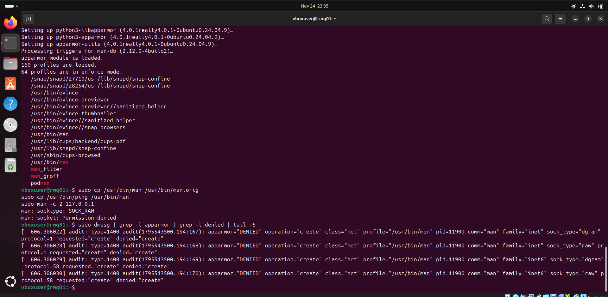

После перевода профиля в режим `complain` AppArmor только журналирует нарушения, и тот же `ping` работает:

```bash
sudo aa-complain /usr/bin/man
sudo man -c 2 127.0.0.1
```

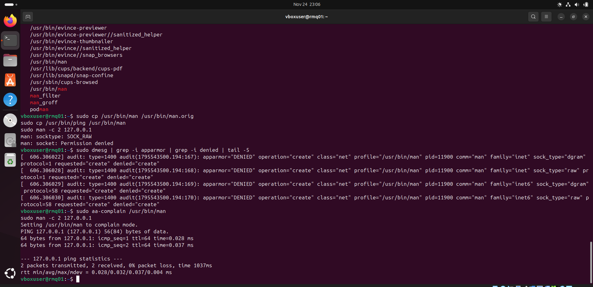

Возврат исходного состояния:

```bash
sudo aa-enforce /usr/bin/man
sudo mv /usr/bin/man.orig /usr/bin/man
```

### Отключение AppArmor

Пакет `apparmor` в Ubuntu не удаляется: от него зависит `snapd`, а с ним Firefox и Центр приложений. Поэтому AppArmor отключён — профили выгружены, служба остановлена и убрана из автозагрузки:

```bash
sudo systemctl stop apparmor
sudo aa-teardown
sudo systemctl disable apparmor
sudo aa-status
systemctl status apparmor --no-pager | head -5
```

Ни один процесс не работает под профилем (`0 processes are in enforce mode`), служба `apparmor` — `disabled`, `inactive (dead)`.

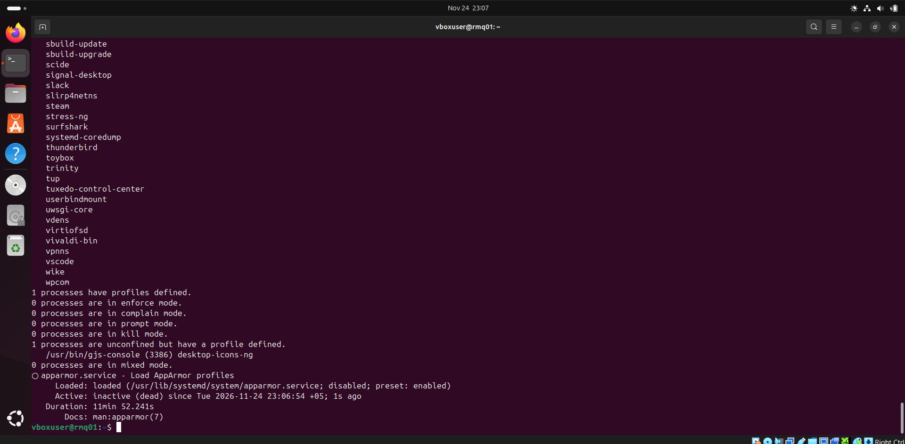
