# Homework: Host Protection — Ilembetov Vasil Razhapovich

[Русская версия](README.md)

Environment: VirtualBox virtual machine `rmq01` running Ubuntu 24.04.

---

## Task 1. eCryptfs

### Installation and user

```bash
sudo apt install -y ecryptfs-utils rsync lsof
sudo modprobe ecryptfs
sudo adduser cryptouser
```

The migration script needs `rsync` and `lsof`: the first copies the data, the second checks that the user's files are not open.

### Original data

Test files are created in `cryptouser`'s home directory — they are stored as plain text and root can read them without the user's password:

```bash
sudo -u cryptouser bash -c 'echo "Секретные данные cryptouser" > ~/secret.txt; mkdir ~/docs; echo "Отчёт" > ~/docs/report.txt'
sudo ls -la /home/cryptouser /home/cryptouser/docs
sudo cat /home/cryptouser/secret.txt
```

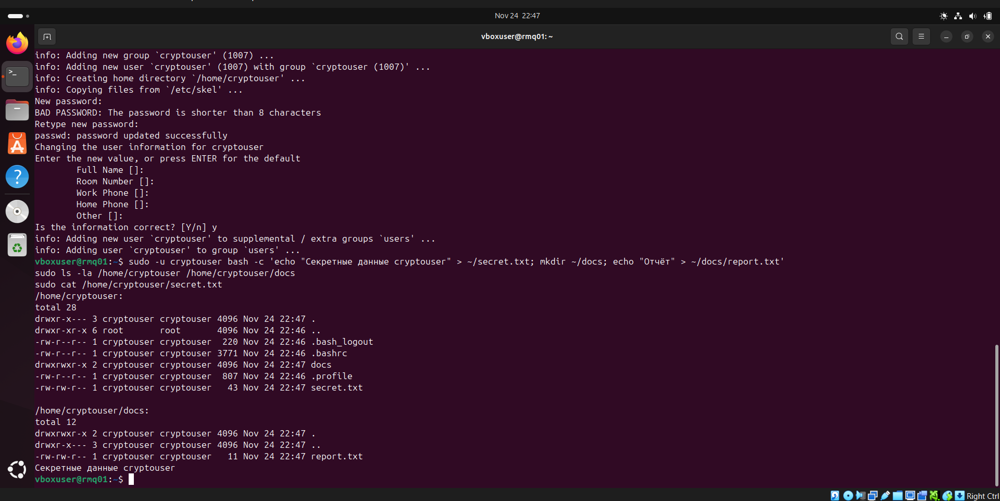

### Encrypting the home directory

```bash
sudo ecryptfs-migrate-home -u cryptouser
```

The script asks for `cryptouser`'s password, creates the encrypted store `/home/.ecryptfs/cryptouser/.Private` and copies the user's data into it. The encryption key (mount passphrase) is generated randomly and is itself encrypted with the user's password.

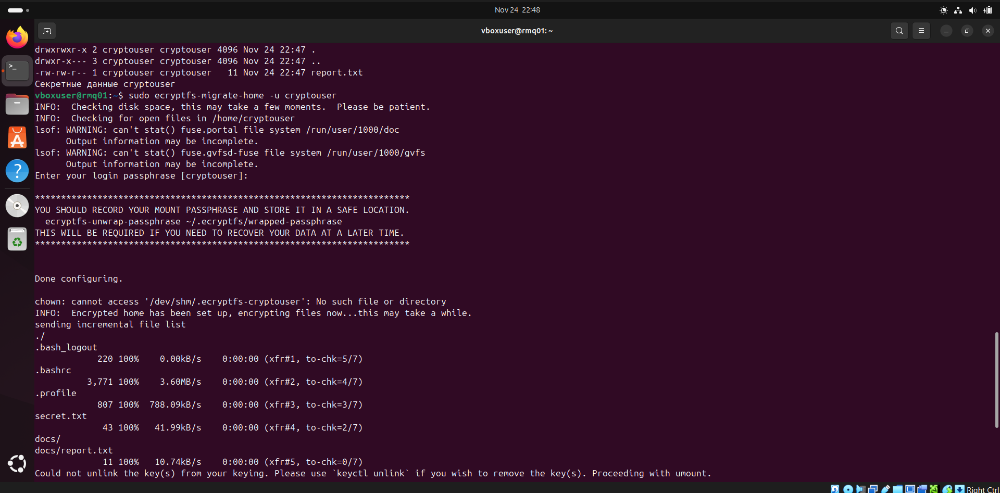

The migration completes on the user's first login, before any reboot:

```bash
su - cryptouser
```

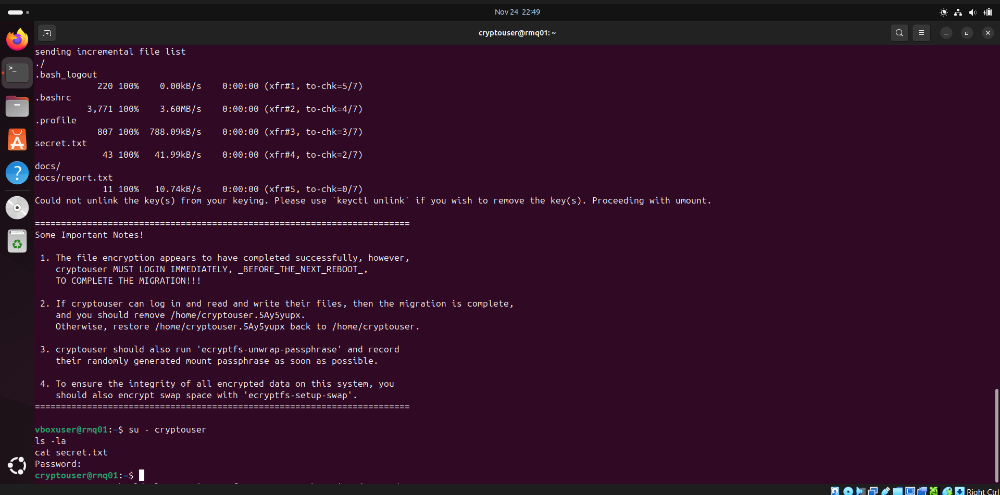

After login the directory is decrypted and mounted automatically, and the user works with their files as usual:

```bash
ls -la
cat secret.txt
```

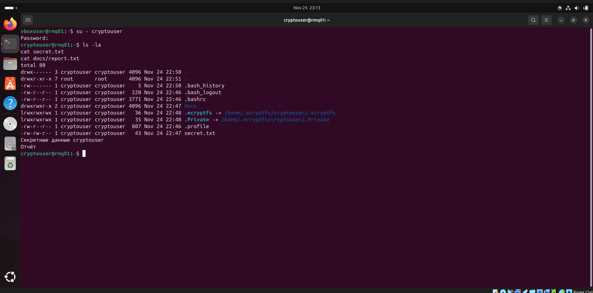

### Encrypted data

When `cryptouser` is not logged in, the directory is not mounted:

```bash
sudo ls -la /home/cryptouser
sudo ls -la /home/.ecryptfs/cryptouser/.Private
```

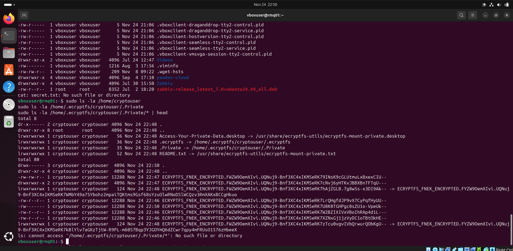

- Instead of the files, `/home/cryptouser` only contains the links `Access-Your-Private-Data.desktop`, `README.txt`, `.ecryptfs` and `.Private`.
- `.Private` holds the same files, but with encrypted names (`ECRYPTFS_FNEK_ENCRYPTED.FWZW9OemXIvi...`) and ciphertext content. Without the user's password even root cannot read the data.

The unencrypted backup left by the script was removed:

```bash
sudo rm -rf /home/cryptouser.5Ay5yupx
```

---

## Task 2. LUKS

### Partition

A separate 200 MB virtual disk (`/dev/sdb`) was attached to the VM for the experiment, and a 100 MB partition was created on it:

```bash
sudo apt install -y cryptsetup
lsblk
sudo parted /dev/sdb --script mklabel gpt mkpart secret 1MiB 101MiB
lsblk /dev/sdb
```

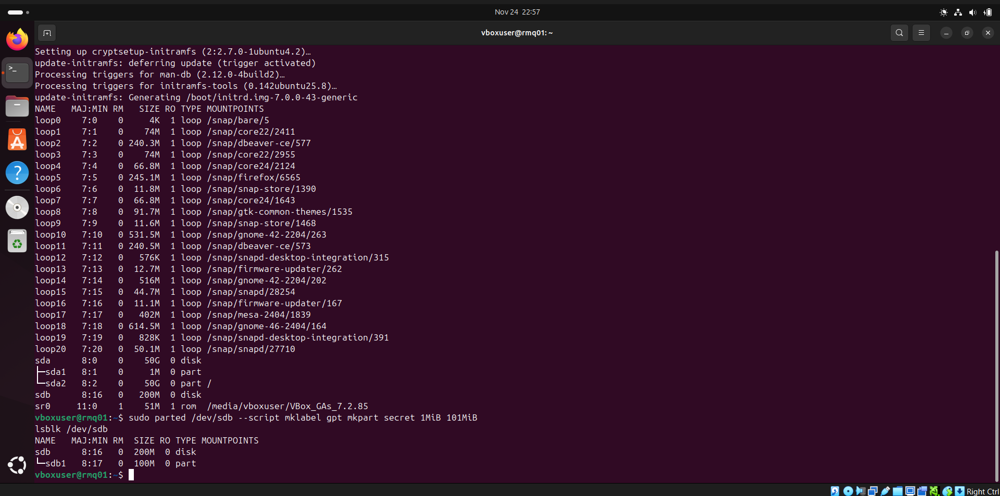

### Encrypting the partition

```bash
sudo cryptsetup luksFormat /dev/sdb1
sudo cryptsetup luksDump /dev/sdb1 | head -20
```

`luksFormat` requires confirmation with `YES` in capital letters — the first attempt with `yes` was aborted. After formatting, the header shows LUKS2, the `aes-xts-plain64` cipher and the used key slot `0: luks2` with a 512-bit key.

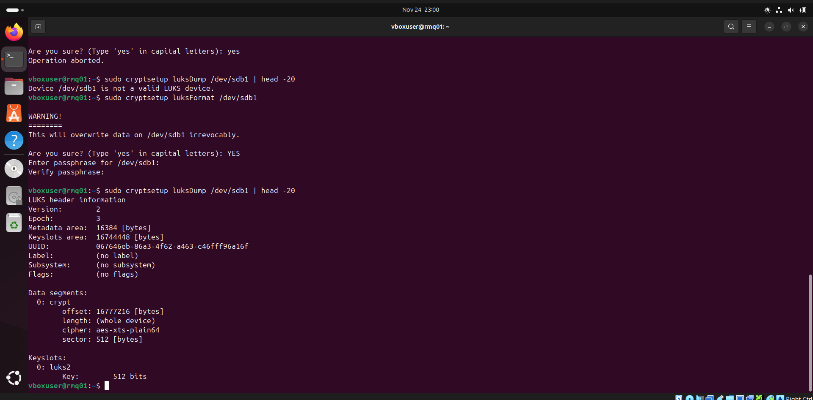

### Using the encrypted partition

```bash
sudo cryptsetup luksOpen /dev/sdb1 secret
sudo mkfs.ext4 /dev/mapper/secret
sudo mkdir -p /mnt/secret
sudo mount /dev/mapper/secret /mnt/secret
echo "Данные на зашифрованном разделе" | sudo tee /mnt/secret/test.txt
df -h /mnt/secret
lsblk /dev/sdb
```

`luksOpen` decrypts the partition with the passphrase and creates the device `/dev/mapper/secret`. The file system is created on it, and data reaches the disk already encrypted. `lsblk` shows the chain `sdb1 → secret` of type `crypt`.

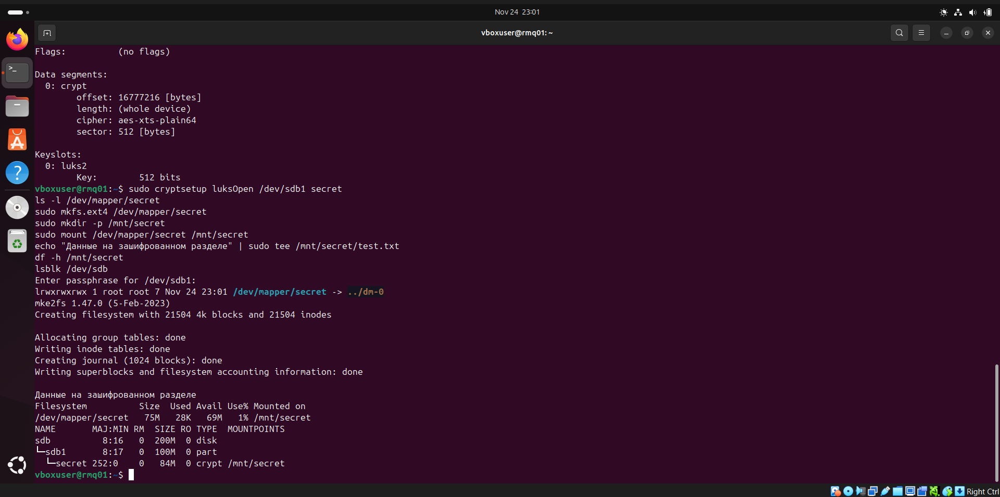

### Closing the partition

```bash
sudo umount /mnt/secret
sudo cryptsetup luksClose secret
sudo blkid /dev/sdb1
sudo mount /dev/sdb1 /mnt/secret
```

After closing, `blkid` reports type `crypto_LUKS`, and the partition cannot be mounted directly (`unknown filesystem type 'crypto_LUKS'`) — the data is inaccessible without the passphrase.

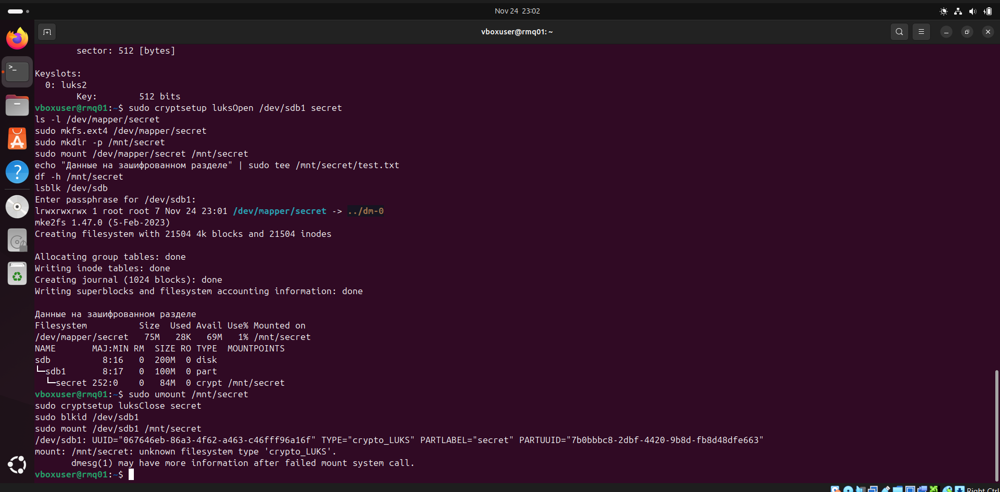

---

## Task 3*. AppArmor

### Installation and status

```bash
sudo apt install -y apparmor apparmor-utils
sudo aa-status | head -15
sudo aa-status | grep man
```

AppArmor is already installed on Ubuntu; the `apparmor-utils` tools were added. 160 profiles are loaded, 64 of them in `enforce` mode, including the `/usr/bin/man` profile.

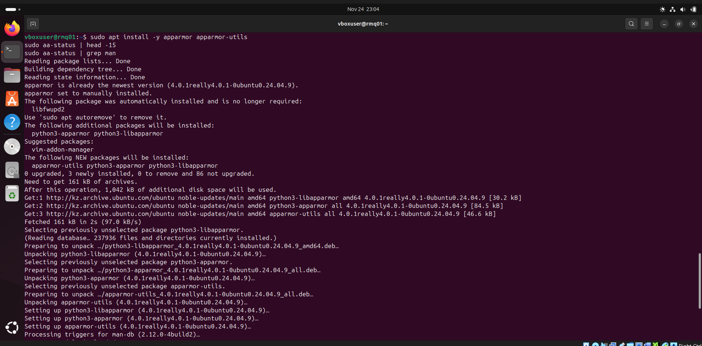

### Experiment: ping disguised as man

An AppArmor profile is bound to the program's path. The `/usr/bin/man` profile only allows what is needed to read manual pages. Let's replace `man` with `ping`:

```bash
sudo cp /usr/bin/man /usr/bin/man.orig
sudo cp /usr/bin/ping /usr/bin/man
sudo man -c 2 127.0.0.1
sudo dmesg | grep -i apparmor | grep -i denied | tail -5
```

`ping`, run as `/usr/bin/man`, fails with `socket: Permission denied` — even as root. The kernel log shows `apparmor="DENIED" ... profile="/usr/bin/man"` entries: the profile blocked creating network sockets (`inet`/`inet6`, `raw`/`dgram`).

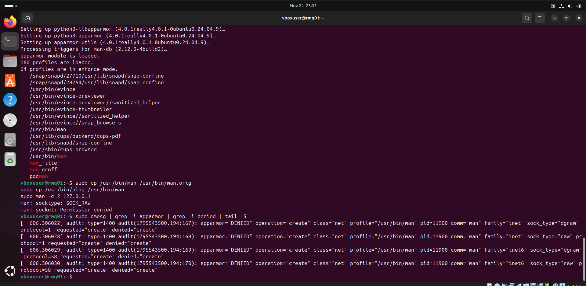

After switching the profile to `complain` mode, AppArmor only logs violations, and the same `ping` works:

```bash
sudo aa-complain /usr/bin/man
sudo man -c 2 127.0.0.1
```

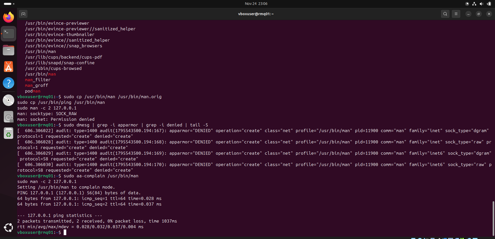

Restoring the original state:

```bash
sudo aa-enforce /usr/bin/man
sudo mv /usr/bin/man.orig /usr/bin/man
```

### Disabling AppArmor

The `apparmor` package cannot be removed on Ubuntu: `snapd` depends on it, and Firefox and the App Center depend on `snapd`. So AppArmor is disabled instead — profiles are unloaded, the service is stopped and removed from startup:

```bash
sudo systemctl stop apparmor
sudo aa-teardown
sudo systemctl disable apparmor
sudo aa-status
systemctl status apparmor --no-pager | head -5
```

No process runs under a profile (`0 processes are in enforce mode`), and the `apparmor` service is `disabled`, `inactive (dead)`.

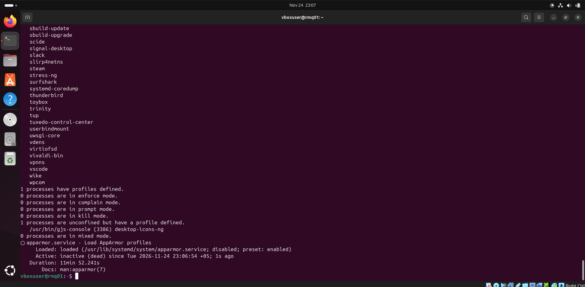
