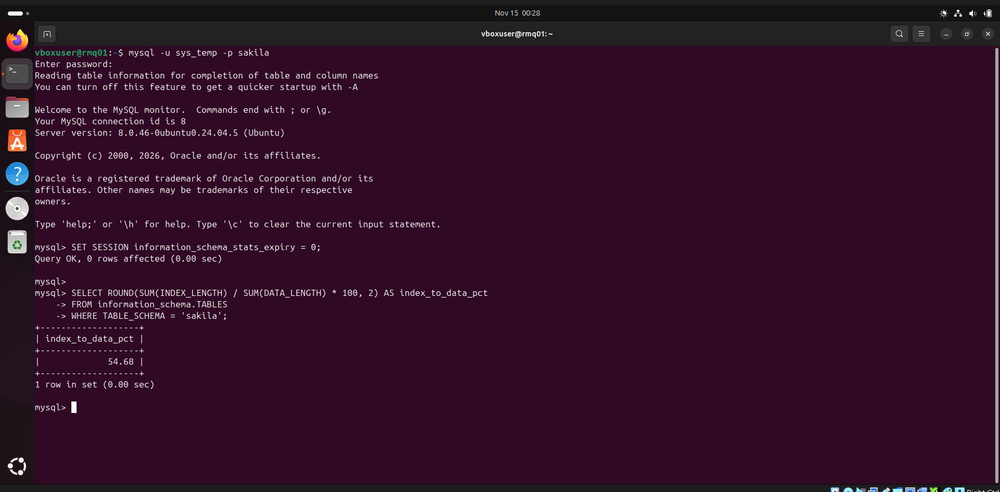
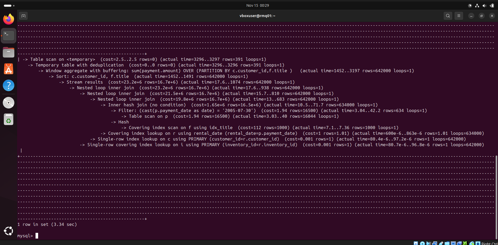
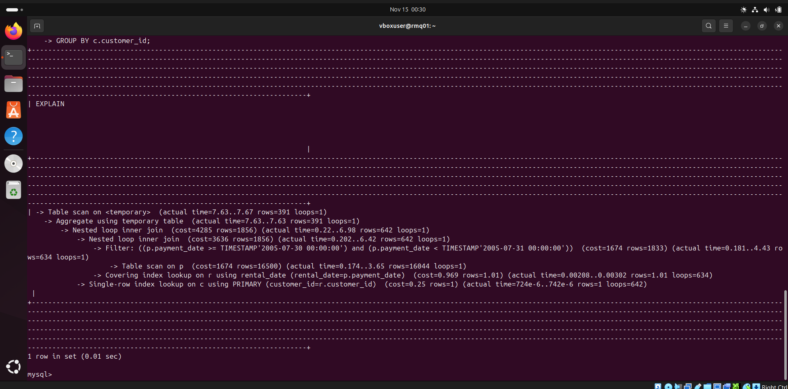
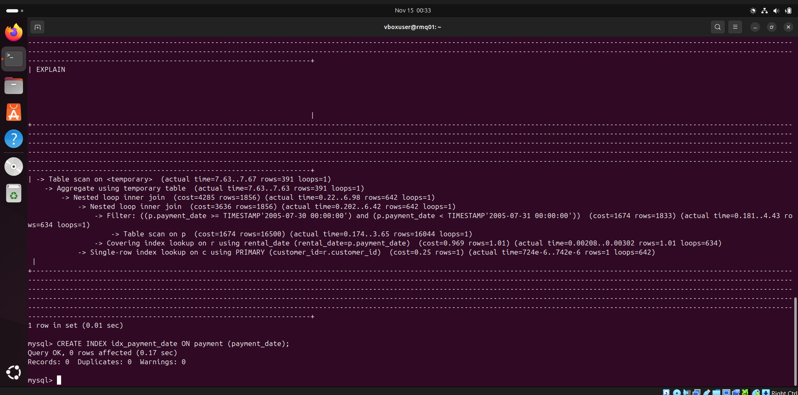
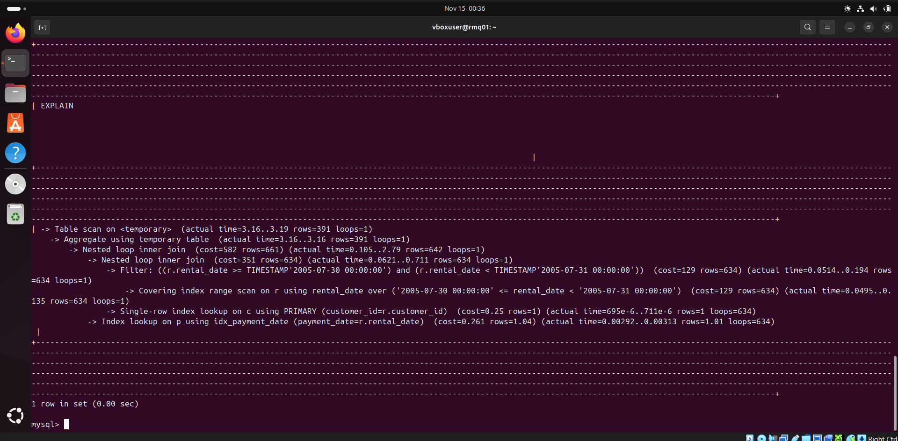

# Домашнее задание к занятию «Индексы» — Илембетов Василь Ражапович

[English version](README_EN.md)

Запросы выполнены в командной строке MySQL 8.0 к базе `sakila`:

```bash
mysql -u sys_temp -p sakila
```

---

## Задание 1

Процентное отношение общего размера всех индексов к общему размеру всех таблиц:

```sql
SET SESSION information_schema_stats_expiry = 0;

SELECT ROUND(SUM(INDEX_LENGTH) / SUM(DATA_LENGTH) * 100, 2) AS index_to_data_pct
FROM information_schema.TABLES
WHERE TABLE_SCHEMA = 'sakila';
```

- `DATA_LENGTH` — размер данных таблицы, `INDEX_LENGTH` — размер её вторичных индексов (в InnoDB первичный ключ хранится вместе с данными и входит в `DATA_LENGTH`).
- MySQL кэширует эту статистику; `information_schema_stats_expiry = 0` заставляет брать актуальные значения.

Результат: размер индексов составляет **54.68 %** от размера таблиц.



---

## Задание 2

### Исходный запрос

```sql
EXPLAIN ANALYZE
select distinct concat(c.last_name, ' ', c.first_name), sum(p.amount) over (partition by c.customer_id, f.title)
from payment p, rental r, customer c, inventory i, film f
where date(p.payment_date) = '2005-07-30' and p.payment_date = r.rental_date and r.customer_id = c.customer_id and i.inventory_id = r.inventory_id;
```

Время выполнения: **3.34 сек**, результат — 391 строка.



### Узкие места

1. **Таблица `film` не связана с остальными.** В плане это `Inner hash join (no condition)`: 634 найденных платежа умножаются на 1000 фильмов, получается 634 000 строк, а после остальных соединений — 642 000. Это декартово произведение — основная причина медленной работы.
2. **Оконная функция с `PARTITION BY c.customer_id, f.title` и `DISTINCT`.** Чтобы посчитать окно, MySQL сортирует все 642 000 строк (`Sort`, ~1.5 сек), считает сумму (`Window aggregate`, ~1.7 сек), записывает результат во временную таблицу и затем удаляет дубликаты (`Temporary table with deduplication`), оставляя 391 строку. Почти вся работа выбрасывается.
3. **Функция над столбцом в условии `date(p.payment_date) = '2005-07-30'`.** В плане это `Filter: (cast(p.payment_date as date) = ...)` поверх `Table scan on p`: функция вычисляется для всех 16 044 строк, индекс по такому условию использовать нельзя.
4. **Нет индекса по `payment.payment_date`** — фильтр по дате выполняется полным просмотром таблицы.
5. **Лишнее соединение с `inventory`** — таблица не участвует ни в фильтрах, ни в результате, но выполняется 642 000 поисков по её первичному ключу.
6. **Неявные соединения через запятую** — условия связи смешаны с фильтрами, из-за чего и была пропущена связь с `film`.

### Оптимизированный запрос

```sql
EXPLAIN ANALYZE
SELECT CONCAT(c.last_name, ' ', c.first_name) AS customer_name,
       SUM(p.amount)                          AS total_amount
FROM payment p
JOIN rental   r ON r.rental_date = p.payment_date
JOIN customer c ON c.customer_id = r.customer_id
WHERE p.payment_date >= '2005-07-30'
  AND p.payment_date <  '2005-07-31'
GROUP BY c.customer_id;
```

Изменения:
- убраны таблицы `film` и `inventory`, которые не влияют на результат;
- оконная функция и `DISTINCT` заменены на `GROUP BY` — одна строка на покупателя сразу;
- `date(payment_date) = ...` заменено на диапазон `>= '2005-07-30' AND < '2005-07-31'` — условие то же, но допускает использование индекса;
- соединения записаны явно через `JOIN ... ON`.

Запрос возвращает те же 391 строку с теми же суммами (результаты исходного и нового запросов сверены). Условие связи `p.payment_date = r.rental_date` сохранено из исходного запроса, чтобы результат не изменился.

Время выполнения: **7.67 мс** вместо 3.34 сек — примерно в 430 раз быстрее. Через соединения проходит 642 строки вместо 642 000.



### Индекс

В плане оптимизированного запроса осталось одно узкое место — `Table scan on p`: для отбора 634 платежей за день читаются все 16 044 строки. Добавлен индекс по дате платежа:

```sql
CREATE INDEX idx_payment_date ON payment (payment_date);
```

Для соединения с `rental` индекс уже есть (`rental_date` по `(rental_date, inventory_id, customer_id)`, в плане — `Covering index lookup on r using rental_date`).



План после создания индекса:



Оптимизатор использует связь `p.payment_date = r.rental_date` и переносит фильтр по дате на таблицу `rental`:
- `Covering index range scan on r using rental_date` — 634 аренды за 30 июля выбираются по диапазону индекса `rental_date`, без чтения всей таблицы;
- `Index lookup on p using idx_payment_date` — для каждой аренды платёж находится по новому индексу;
- `Single-row index lookup on c using PRIMARY` — покупатель находится по первичному ключу.

Полных просмотров таблиц в плане больше нет. Время выполнения: **3.19 мс** (без индекса — 7.67 мс, исходный запрос — 3.34 сек).

| Вариант | Время | Строк в соединениях |
|---|---|---|
| Исходный запрос | 3.34 сек | 642 000 |
| Оптимизированный запрос | 7.67 мс | 642 |
| Оптимизированный запрос + индекс | 3.19 мс | 642 |

---

## Задание 3*

В PostgreSQL есть шесть встроенных типов индексов: B-tree, Hash, GiST, SP-GiST, GIN, BRIN. В MySQL (InnoDB) используются B-tree, полнотекстовые (FULLTEXT) и пространственные (SPATIAL, R-tree) индексы.

Индексы, которые есть в PostgreSQL, но отсутствуют в MySQL:

| Тип | Назначение |
|---|---|
| **Hash** | только сравнение на равенство (`=`). В MySQL hash-индексы поддерживает лишь движок MEMORY; для таблиц InnoDB их создать нельзя. |
| **GiST** | обобщённое дерево поиска: геометрические данные, диапазонные типы, поиск ближайших соседей, полнотекстовый поиск. |
| **SP-GiST** | дерево с разбиением пространства на непересекающиеся области (quad-tree, k-d tree, префиксное дерево): точки, IP-адреса, строки с общими префиксами. |
| **GIN** | обратный индекс для составных значений: массивы, `jsonb`, полнотекстовый поиск (`tsvector`). |
| **BRIN** | блочный индекс: хранит минимальное и максимальное значения для диапазонов страниц. Очень компактный, подходит для больших таблиц с естественно упорядоченными данными (например, логи по времени). |

Кроме того, в PostgreSQL есть **частичные индексы** — индекс строится только по строкам, удовлетворяющим условию (`CREATE INDEX ... WHERE ...`). В MySQL такой возможности нет.
