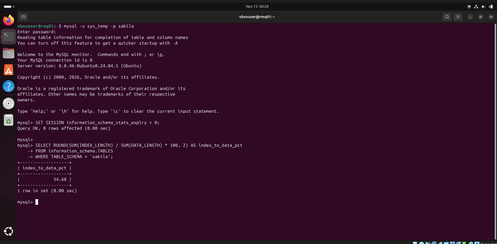
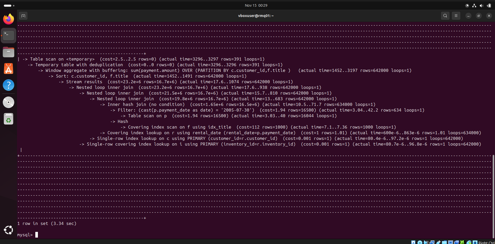
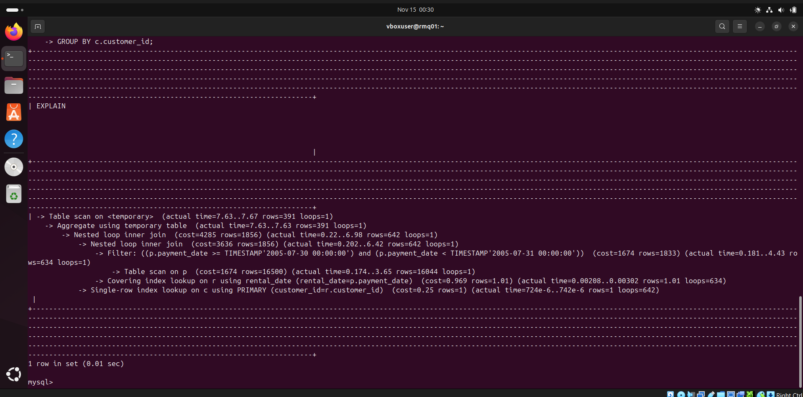
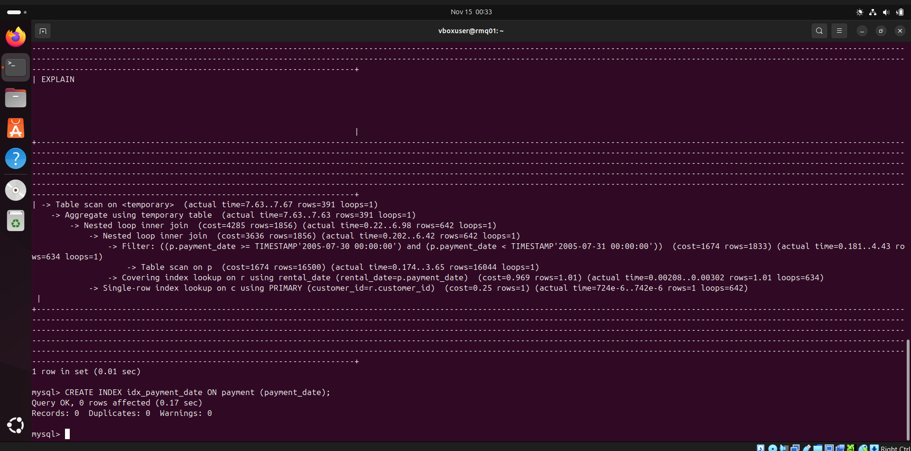
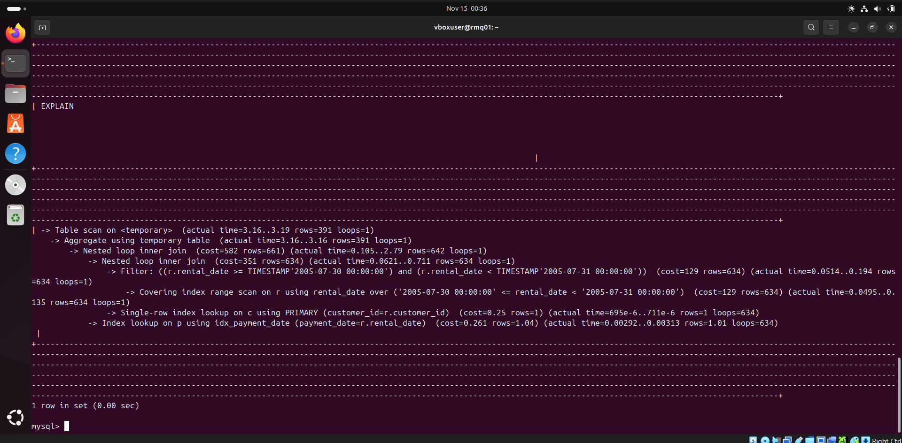

# Homework: Indexes — Ilembetov Vasil

[Русская версия](README.md)

Queries were run in the MySQL 8.0 command-line client against the `sakila` database:

```bash
mysql -u sys_temp -p sakila
```

---

## Task 1

Total size of all indexes as a percentage of the total size of all tables:

```sql
SET SESSION information_schema_stats_expiry = 0;

SELECT ROUND(SUM(INDEX_LENGTH) / SUM(DATA_LENGTH) * 100, 2) AS index_to_data_pct
FROM information_schema.TABLES
WHERE TABLE_SCHEMA = 'sakila';
```

- `DATA_LENGTH` is the size of the table data, `INDEX_LENGTH` is the size of its secondary indexes (in InnoDB the primary key is stored together with the data and is counted in `DATA_LENGTH`).
- MySQL caches these statistics; `information_schema_stats_expiry = 0` forces up-to-date values.

Result: indexes take **54.68%** of the table size.



---

## Task 2

### Original query

```sql
EXPLAIN ANALYZE
select distinct concat(c.last_name, ' ', c.first_name), sum(p.amount) over (partition by c.customer_id, f.title)
from payment p, rental r, customer c, inventory i, film f
where date(p.payment_date) = '2005-07-30' and p.payment_date = r.rental_date and r.customer_id = c.customer_id and i.inventory_id = r.inventory_id;
```

Execution time: **3.34 s**, result: 391 rows.



### Bottlenecks

1. **The `film` table is not joined to the others.** In the plan this is `Inner hash join (no condition)`: 634 matching payments are multiplied by 1,000 films, giving 634,000 rows, and 642,000 after the remaining joins. This Cartesian product is the main cause of the slowness.
2. **Window function with `PARTITION BY c.customer_id, f.title` plus `DISTINCT`.** To compute the window, MySQL sorts all 642,000 rows (`Sort`, ~1.5 s), computes the sum (`Window aggregate`, ~1.7 s), writes the result to a temporary table and then removes duplicates (`Temporary table with deduplication`), leaving 391 rows. Almost all of the work is thrown away.
3. **A function on the column in `date(p.payment_date) = '2005-07-30'`.** In the plan this is `Filter: (cast(p.payment_date as date) = ...)` on top of `Table scan on p`: the function is evaluated for all 16,044 rows, and no index can be used for such a condition.
4. **No index on `payment.payment_date`** — the date filter is done with a full table scan.
5. **Unnecessary join with `inventory`** — the table is used neither in filters nor in the output, yet 642,000 primary key lookups are performed on it.
6. **Implicit comma joins** — join conditions are mixed with filters, which is how the join to `film` was missed.

### Optimized query

```sql
EXPLAIN ANALYZE
SELECT CONCAT(c.last_name, ' ', c.first_name) AS customer_name,
       SUM(p.amount)                          AS total_amount
FROM payment p
JOIN rental   r ON r.rental_date = p.payment_date
JOIN customer c ON c.customer_id = r.customer_id
WHERE p.payment_date >= '2005-07-30'
  AND p.payment_date <  '2005-07-31'
GROUP BY c.customer_id;
```

Changes:
- removed the `film` and `inventory` tables, which do not affect the result;
- replaced the window function and `DISTINCT` with `GROUP BY` — one row per customer straight away;
- replaced `date(payment_date) = ...` with the range `>= '2005-07-30' AND < '2005-07-31'` — the same condition, but it allows an index to be used;
- joins are written explicitly with `JOIN ... ON`.

The query returns the same 391 rows with the same totals (the results of the original and new queries were compared). The join condition `p.payment_date = r.rental_date` is kept from the original query so that the result does not change.

Execution time: **7.67 ms** instead of 3.34 s — about 430 times faster. 642 rows go through the joins instead of 642,000.



### Index

One bottleneck remains in the optimized plan — `Table scan on p`: all 16,044 rows are read to select 634 payments for one day. An index on the payment date is added:

```sql
CREATE INDEX idx_payment_date ON payment (payment_date);
```

The join with `rental` already has an index (`rental_date` on `(rental_date, inventory_id, customer_id)`, shown in the plan as `Covering index lookup on r using rental_date`).



Plan after creating the index:



The optimizer uses the condition `p.payment_date = r.rental_date` and applies the date filter to the `rental` table:
- `Covering index range scan on r using rental_date` — the 634 rentals for July 30 are selected by a range of the `rental_date` index, without reading the whole table;
- `Index lookup on p using idx_payment_date` — for each rental, the payment is found through the new index;
- `Single-row index lookup on c using PRIMARY` — the customer is found by primary key.

There are no full table scans left in the plan. Execution time: **3.19 ms** (7.67 ms without the index, 3.34 s for the original query).

| Version | Time | Rows in joins |
|---|---|---|
| Original query | 3.34 s | 642,000 |
| Optimized query | 7.67 ms | 642 |
| Optimized query + index | 3.19 ms | 642 |

---

## Task 3*

PostgreSQL has six built-in index types: B-tree, Hash, GiST, SP-GiST, GIN, BRIN. MySQL (InnoDB) uses B-tree, full-text (FULLTEXT) and spatial (SPATIAL, R-tree) indexes.

Indexes available in PostgreSQL but not in MySQL:

| Type | Purpose |
|---|---|
| **Hash** | equality comparisons only (`=`). In MySQL hash indexes are supported only by the MEMORY engine; they cannot be created on InnoDB tables. |
| **GiST** | generalized search tree: geometric data, range types, nearest-neighbour search, full-text search. |
| **SP-GiST** | space-partitioned tree with non-overlapping regions (quad-tree, k-d tree, radix tree): points, IP addresses, strings with common prefixes. |
| **GIN** | inverted index for composite values: arrays, `jsonb`, full-text search (`tsvector`). |
| **BRIN** | block range index: stores the minimum and maximum values for ranges of pages. Very compact, suited to large tables with naturally ordered data (e.g. time-ordered logs). |

PostgreSQL also has **partial indexes** — an index built only over rows that match a condition (`CREATE INDEX ... WHERE ...`). MySQL has no such feature.
