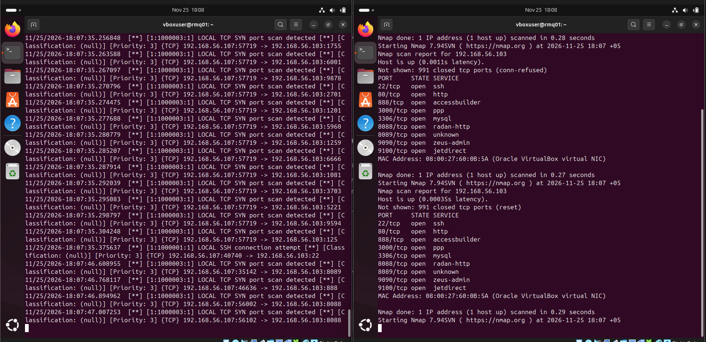
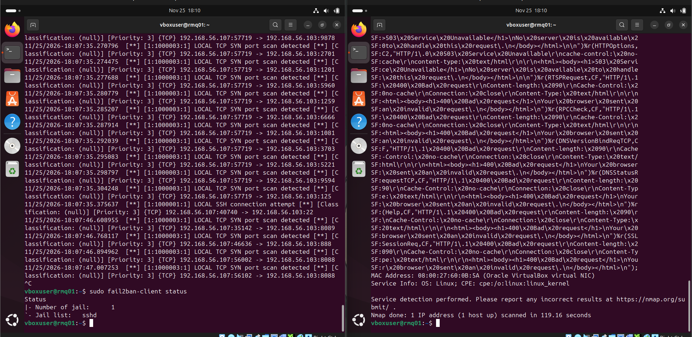
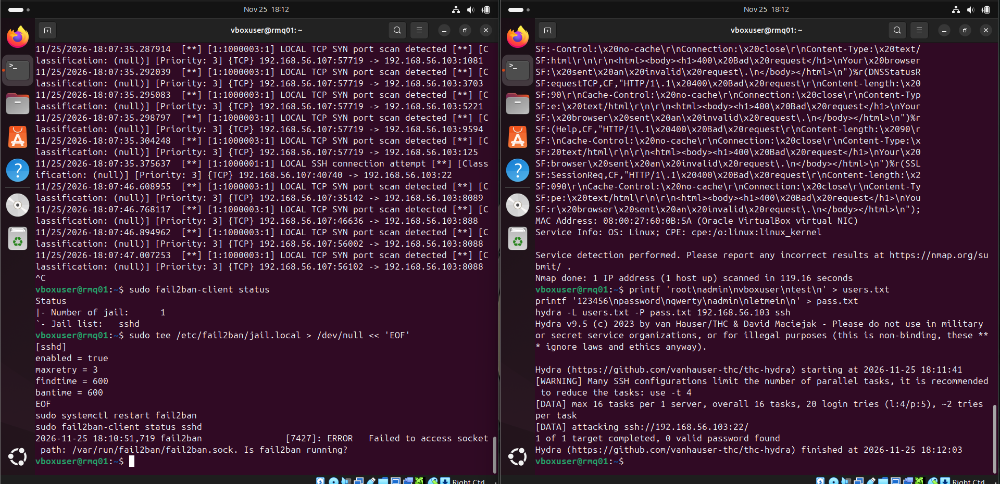
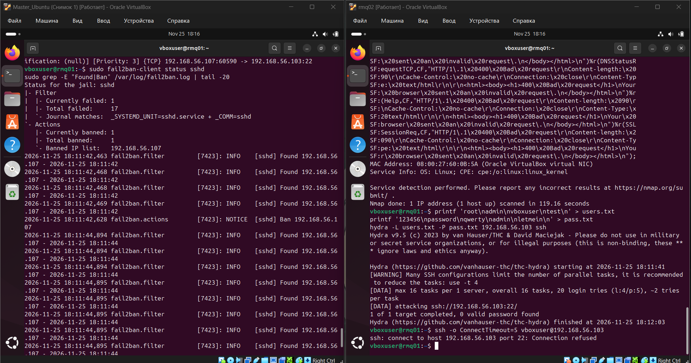

# Домашнее задание к занятию «Защита сети» — Илембетов Василь Ражапович

[English version](README_EN.md)

## Стенд

Две виртуальные машины VirtualBox в изолированной сети host-only `192.168.56.0/24`.

| ВМ | IP | Роль |
|---|---|---|
| Master_Ubuntu | 192.168.56.103 | защищаемая система: Suricata (IDS), Fail2Ban, SSH |
| rmq02 | 192.168.56.107 | злоумышленник: nmap, thc-hydra |

### Подготовка

Защищаемая система:
```bash
sudo apt install -y suricata fail2ban openssh-server
sudo systemctl enable --now ssh
```

Система злоумышленника:
```bash
sudo apt install -y nmap hydra
```

### Настройка Suricata

Полный набор правил Emerging Threats (53 тысячи) не поместился в память виртуальной машины — самопроверка Suricata завершалась ошибкой. Поэтому использован небольшой свой набор правил, который надёжно обнаруживает сканирование и атаку на SSH:

```bash
sudo tee /var/lib/suricata/rules/local.rules > /dev/null << 'EOF'
alert icmp any any -> $HOME_NET any (msg:"LOCAL ICMP ping detected"; itype:8; sid:1000002; rev:1;)
alert tcp any any -> $HOME_NET 22 (msg:"LOCAL SSH connection attempt"; flow:to_server; flags:S; sid:1000001; rev:1;)
alert tcp any any -> $HOME_NET any (msg:"LOCAL TCP SYN port scan detected"; flags:S; flow:to_server; threshold:type threshold, track by_src, count 20, seconds 10; sid:1000003; rev:1;)
EOF

sudo suricata -i enp0s8 -S /var/lib/suricata/rules/local.rules -D
```

Ключ `-S` подключает единственный файл правил, `-i enp0s8` — интерфейс сети host-only. Третье правило срабатывает, когда с одного адреса приходит более 20 SYN-пакетов за 10 секунд, — это признак сканирования портов.

---

## Задание 1. Разведка nmap

Сканирование защищаемой системы с машины злоумышленника:

```bash
sudo nmap -sA 192.168.56.103   # ACK-скан: проверка фильтрации портов
sudo nmap -sT 192.168.56.103   # полное TCP-соединение
sudo nmap -sS 192.168.56.103   # SYN-скан (полуоткрытый)
sudo nmap -sV 192.168.56.103   # определение версий служб
```

nmap обнаружил открытые службы: SSH (22), HTTP (80), MySQL (3306) и другие.

### События в Suricata

```bash
sudo tail -f /var/log/suricata/fast.log
```

Suricata зафиксировала сканирование: множество событий `LOCAL TCP SYN port scan detected` с адреса `192.168.56.107`, а также `LOCAL SSH connection attempt` при обращении к порту 22.



### Fail2Ban при сканировании

```bash
sudo fail2ban-client status
```

Fail2Ban активен (jail `sshd`), но банов нет.



**Вывод по заданию 1.** Suricata и Fail2Ban решают разные задачи. Suricata — это система обнаружения вторжений (IDS): она анализирует весь трафик и видит сканирование портов. Fail2Ban анализирует журналы служб и реагирует на неудачные попытки аутентификации, поэтому на сканирование портов (без попыток входа) он не реагирует.

---

## Задание 2. Подбор пароля SSH

### Включение защиты SSH в Fail2Ban

Создан файл `/etc/fail2ban/jail.local` (это надёжнее правки `jail.conf`: при обновлении пакета настройки не затрутся):

```ini
[sshd]
enabled = true
maxretry = 3
findtime = 600
bantime = 600
```

```bash
sudo systemctl restart fail2ban
```

После 3 неудачных входов за 10 минут адрес блокируется на 10 минут.

### Атака

```bash
printf 'root\nadmin\nvboxuser\ntest\n' > users.txt
printf '123456\npassword\nqwerty\nadmin\nletmein\n' > pass.txt
hydra -L users.txt -P pass.txt 192.168.56.103 ssh
```

Hydra перебирает пары логин-пароль (20 комбинаций). Suricata фиксирует шквал подключений к порту 22 как `LOCAL SSH connection attempt`.



### Результат: блокировка в Fail2Ban

```bash
sudo fail2ban-client status sshd
sudo grep -E "Found|Ban" /var/log/fail2ban.log
```

Fail2Ban обнаружил серию неудачных входов (`Total failed: 17`) с адреса `192.168.56.107` и заблокировал его:

```
fail2ban.filter  [sshd] Found 192.168.56.107
fail2ban.actions [sshd] Ban 192.168.56.107
```

```
Status for the jail: sshd
|- Filter
|  |- Total failed:  17
`- Actions
   |- Currently banned: 1
   `- Banned IP list:   192.168.56.107
```

Проверка с машины злоумышленника показывает, что SSH теперь недоступен — соединение блокируется через iptables, хотя до атаки порт был открыт:

```bash
ssh -o ConnectTimeout=5 vboxuser@192.168.56.103
# ssh: connect to host 192.168.56.103 port 22: Connection refused
```



**Вывод по заданию 2.** Fail2Ban по журналу `sshd` увидел серию неудачных входов с одного адреса и заблокировал его на уровне межсетевого экрана (iptables). Suricata независимо зафиксировала аномальную активность на порту SSH. Две системы дополняют друг друга: Suricata обнаруживает атаку, Fail2Ban её блокирует.
