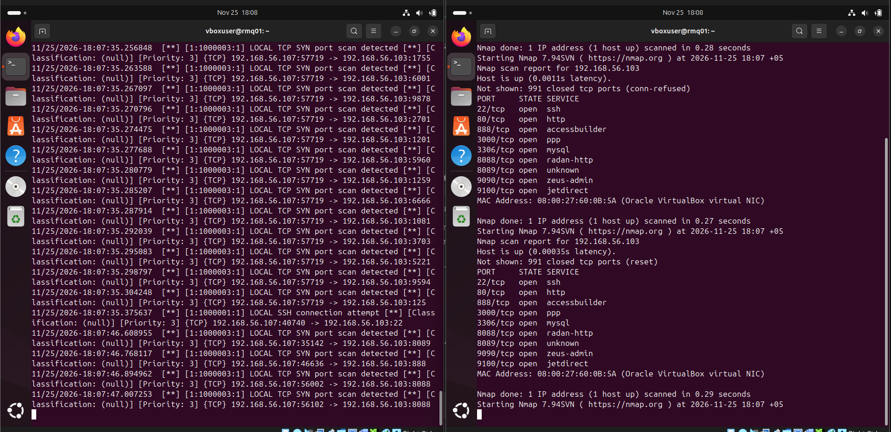
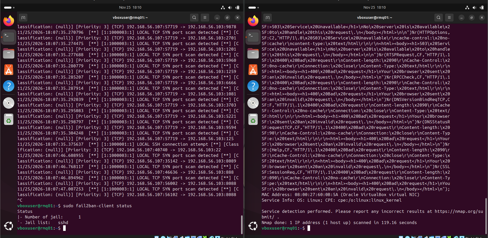
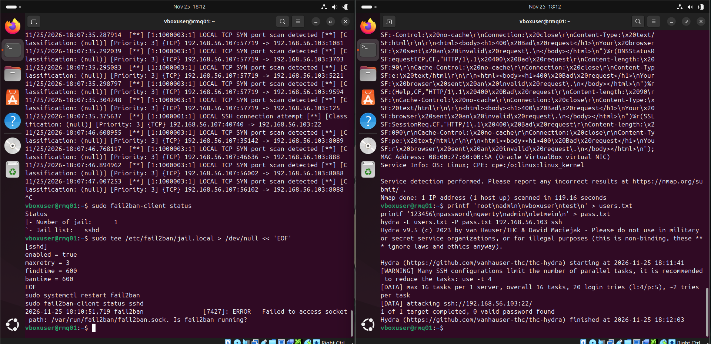
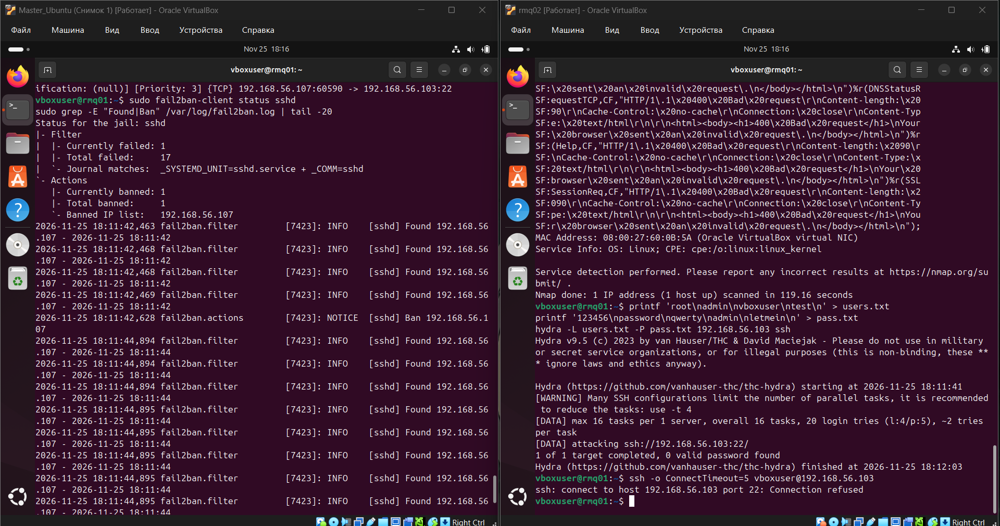

# Homework: Network Protection — Ilembetov Vasil Razhapovich

[Русская версия](README.md)

## Environment

Two VirtualBox virtual machines in an isolated host-only network `192.168.56.0/24`.

| VM | IP | Role |
|---|---|---|
| Master_Ubuntu | 192.168.56.103 | defended system: Suricata (IDS), Fail2Ban, SSH |
| rmq02 | 192.168.56.107 | attacker: nmap, thc-hydra |

### Preparation

Defended system:
```bash
sudo apt install -y suricata fail2ban openssh-server
sudo systemctl enable --now ssh
```

Attacker system:
```bash
sudo apt install -y nmap hydra
```

### Suricata configuration

The full Emerging Threats ruleset (53,000 rules) did not fit in the VM's memory — Suricata's self-test failed. So a small custom ruleset that reliably detects scanning and SSH attacks was used:

```bash
sudo tee /var/lib/suricata/rules/local.rules > /dev/null << 'EOF'
alert icmp any any -> $HOME_NET any (msg:"LOCAL ICMP ping detected"; itype:8; sid:1000002; rev:1;)
alert tcp any any -> $HOME_NET 22 (msg:"LOCAL SSH connection attempt"; flow:to_server; flags:S; sid:1000001; rev:1;)
alert tcp any any -> $HOME_NET any (msg:"LOCAL TCP SYN port scan detected"; flags:S; flow:to_server; threshold:type threshold, track by_src, count 20, seconds 10; sid:1000003; rev:1;)
EOF

sudo suricata -i enp0s8 -S /var/lib/suricata/rules/local.rules -D
```

`-S` loads only this rule file, `-i enp0s8` is the host-only interface. The third rule fires when more than 20 SYN packets arrive from one source within 10 seconds — a sign of port scanning.

---

## Task 1. nmap reconnaissance

Scanning the defended system from the attacker machine:

```bash
sudo nmap -sA 192.168.56.103   # ACK scan: check port filtering
sudo nmap -sT 192.168.56.103   # full TCP connection
sudo nmap -sS 192.168.56.103   # SYN scan (half-open)
sudo nmap -sV 192.168.56.103   # service version detection
```

nmap found the open services: SSH (22), HTTP (80), MySQL (3306) and others.

### Events in Suricata

```bash
sudo tail -f /var/log/suricata/fast.log
```

Suricata detected the scan: many `LOCAL TCP SYN port scan detected` events from `192.168.56.107`, plus `LOCAL SSH connection attempt` when port 22 was probed.



### Fail2Ban during the scan

```bash
sudo fail2ban-client status
```

Fail2Ban is active (jail `sshd`), but there are no bans.



**Task 1 conclusion.** Suricata and Fail2Ban solve different problems. Suricata is an intrusion detection system (IDS): it analyses all traffic and sees port scanning. Fail2Ban analyses service logs and reacts to failed authentication attempts, so it does not react to port scanning (which involves no login attempts).

---

## Task 2. SSH password brute force

### Enabling SSH protection in Fail2Ban

A `/etc/fail2ban/jail.local` file was created (more robust than editing `jail.conf`: settings survive package updates):

```ini
[sshd]
enabled = true
maxretry = 3
findtime = 600
bantime = 600
```

```bash
sudo systemctl restart fail2ban
```

After 3 failed logins within 10 minutes the address is blocked for 10 minutes.

### Attack

```bash
printf 'root\nadmin\nvboxuser\ntest\n' > users.txt
printf '123456\npassword\nqwerty\nadmin\nletmein\n' > pass.txt
hydra -L users.txt -P pass.txt 192.168.56.103 ssh
```

Hydra tries login/password pairs (20 combinations). Suricata records the burst of connections to port 22 as `LOCAL SSH connection attempt`.



### Result: Fail2Ban block

```bash
sudo fail2ban-client status sshd
sudo grep -E "Found|Ban" /var/log/fail2ban.log
```

Fail2Ban detected a series of failed logins (`Total failed: 17`) from `192.168.56.107` and blocked it:

```
fail2ban.filter  [sshd] Found 192.168.56.107
fail2ban.actions [sshd] Ban 192.168.56.107
```

```
Status for the jail: sshd
|- Filter
|  |- Total failed:  17
`- Actions
   |- Currently banned: 1
   `- Banned IP list:   192.168.56.107
```

A check from the attacker machine shows that SSH is now unreachable — the connection is blocked via iptables, although the port was open before the attack:

```bash
ssh -o ConnectTimeout=5 vboxuser@192.168.56.103
# ssh: connect to host 192.168.56.103 port 22: Connection refused
```



**Task 2 conclusion.** Fail2Ban saw a series of failed logins from one address in the `sshd` log and blocked it at the firewall level (iptables). Suricata independently recorded the abnormal activity on the SSH port. The two systems complement each other: Suricata detects the attack, Fail2Ban blocks it.
