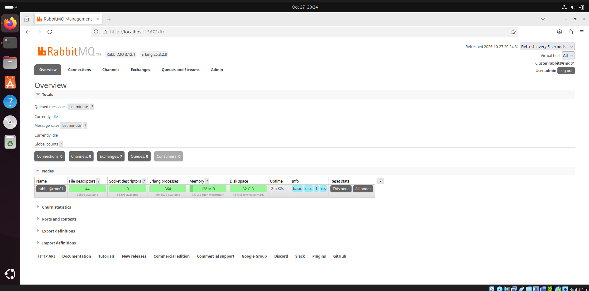
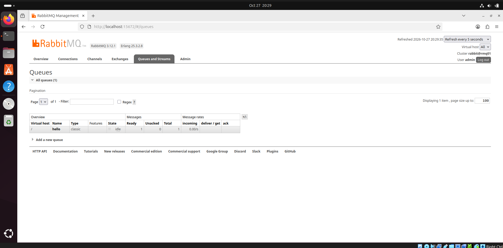
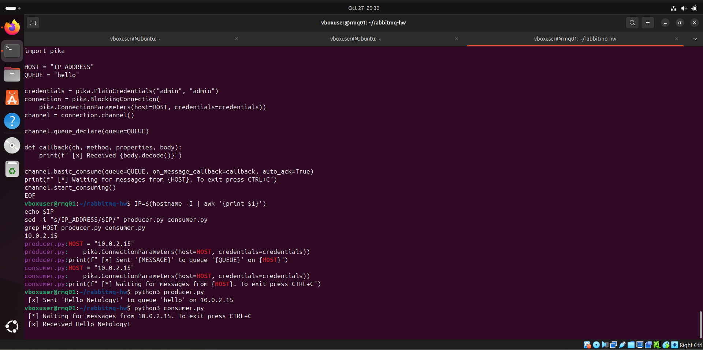
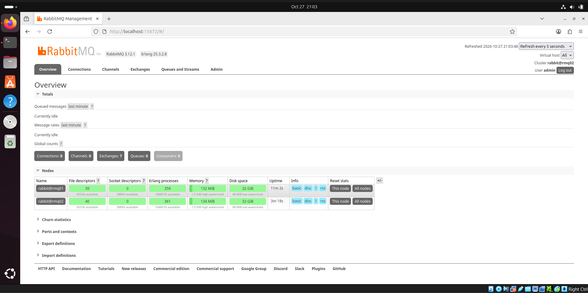
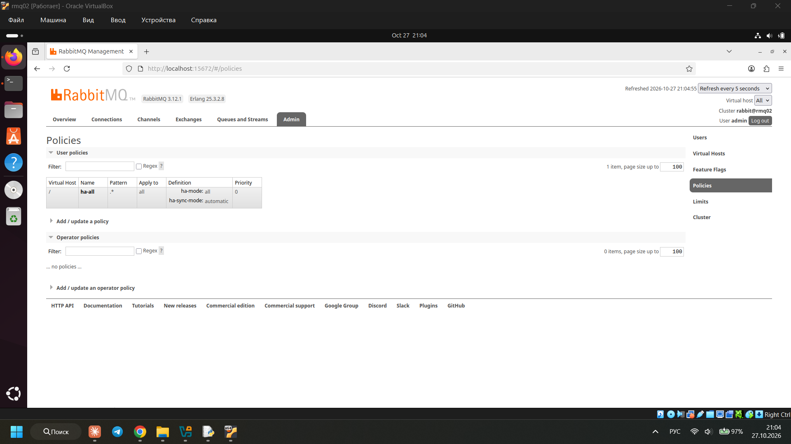
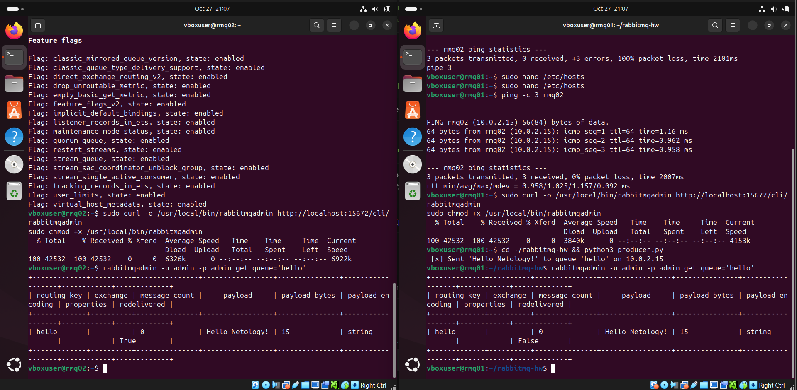
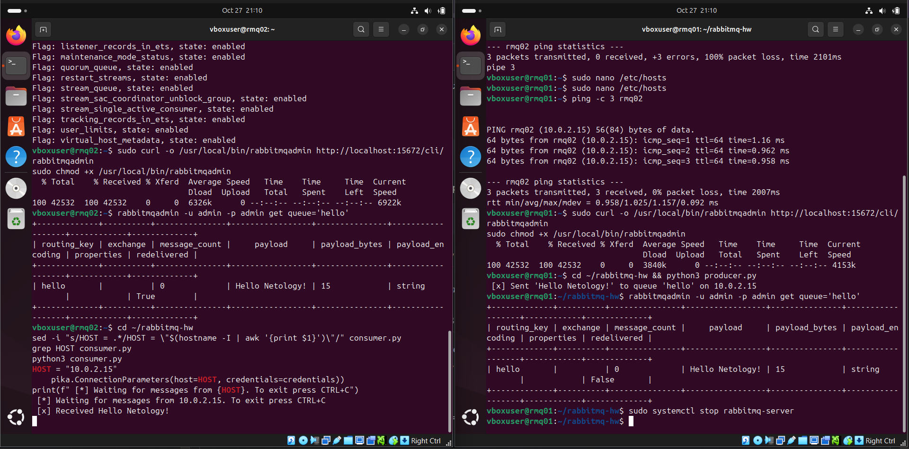

# Домашнее задание к занятию «Очереди RabbitMQ» — Илембетов Василь

## Стенд

Две виртуальные машины в VirtualBox с Ubuntu 24.04 и RabbitMQ 3.12. Машины подключены к одной сети VirtualBox типа «Сеть NAT», поэтому видят друг друга и имеют доступ в интернет.

| Хост  | IP-адрес  | Роль                                  |
|-------|-----------|---------------------------------------|
| rmq01 | 10.0.2.15  | первая нода, на ней создаётся очередь |
| rmq02 | 10.0.2.4  | вторая нода, клон rmq01               |

Скрипты для отправки и получения сообщений:

- [`scripts/producer.py`](scripts/producer.py) — скрипт для отправки сообщений
- [`scripts/consumer.py`](scripts/consumer.py) — скрипт для получения сообщений

Скриншоты находятся в каталоге `img/` (формат: `_<номер>_название_файла`):

| Задание | Скриншот | Файл |
|---------|----------|------|
| 1 | Веб-интерфейс RabbitMQ | `1_RabbitMQ.png` |
| 2 | Producer — очередь hello | `2_producer.png` |
| 2 | Consumer — результат выполнения | `2_consumer.png` |
| 3 | Ноды кластера (Overview → Nodes) | `3_Overview → Nodes.png` |
| 3 | Политика ha-all (Admin → Policies) | `3_Admin → Policies.png` |
| 3 | `rabbitmqadmin get queue='hello'` | `3_message.png` |
| 3 | Consumer после отключения ноды | `3_consumer.png` |

---

## Задание 1. Установка RabbitMQ

Задаём машине имя. RabbitMQ называет ноду по имени хоста (`rabbit@rmq01`), поэтому имя нужно поменять до установки.

```bash
sudo hostnamectl set-hostname rmq01
```

Устанавливаем RabbitMQ и включаем management plug-in, который даёт веб-интерфейс на порту 15672:

```bash
sudo apt update
sudo apt install -y rabbitmq-server
sudo rabbitmq-plugins enable rabbitmq_management
```

Стандартный пользователь `guest` может входить только с localhost. Чтобы подключаться к брокеру по сети, создаём администратора:

```bash
sudo rabbitmqctl add_user admin admin
sudo rabbitmqctl set_user_tags admin administrator
sudo rabbitmqctl set_permissions -p / admin ".*" ".*" ".*"
```

Веб-интерфейс открывается по адресу `http://localhost:15672`:



---

## Задание 2. Отправка и получение сообщений

Ставим библиотеку Pika. В Ubuntu 24.04 `pip install` в системный Python запрещён, поэтому берём пакет из репозитория:

```bash
sudo apt install -y python3-pika
```

В скриптах вместо `localhost` указан IP машины с RabbitMQ. Также добавлен вход под пользователем `admin`:

```python
HOST = "10.0.2.15"
credentials = pika.PlainCredentials("admin", "admin")
```

Отправляем сообщение:

```bash
python3 producer.py
```

Скрипт создаёт очередь `hello` и кладёт в неё сообщение `Hello Netology!`. В веб-интерфейсе видно, что в очереди одно сообщение:



Читаем сообщение:

```bash
python3 consumer.py
```

Consumer забирает сообщение из очереди и выводит его, после этого очередь становится пустой:



---

## Задание 3. HA-кластер

### Вторая машина

Вторую ВМ получил полным клонированием rmq01 в VirtualBox с новыми MAC-адресами. На клоне сгенерировал новый machine-id, чтобы машины не получили одинаковый IP по DHCP, и сменил имя:

```bash
sudo rm /etc/machine-id
sudo systemd-machine-id-setup
sudo hostnamectl set-hostname rmq02
sudo reboot
```

### Файл hosts

На обеих машинах добавил записи, чтобы ноды находили друг друга по имени:

```bash
$ cat /etc/hosts
10.0.2.15 rmq01
10.0.2.4 rmq02
```

Проверка: `ping rmq01` и `ping rmq02` проходят с обеих машин.

### Объединение в кластер

Ноды кластера доверяют друг другу, если у них одинаковая Erlang cookie (`/var/lib/rabbitmq/.erlang.cookie`). Так как rmq02 — клон, cookie уже совпадает.

На rmq02 перезапускаем RabbitMQ под новым именем и присоединяем его к rmq01:

```bash
sudo systemctl restart rabbitmq-server
sudo rabbitmqctl stop_app
sudo rabbitmqctl reset
sudo rabbitmqctl join_cluster rabbit@rmq01
sudo rabbitmqctl start_app
```

`reset` нужен, потому что вступить в кластер может только нода без собственных данных.

### Политика ha-all

```bash
sudo rabbitmqctl set_policy ha-all ".*" '{"ha-mode":"all","ha-sync-mode":"automatic"}'
```

Политика зеркалирует все очереди (`".*"`) на все ноды кластера (`ha-mode: all`), а новые копии синхронизирует автоматически.

Ноды кластера в веб-интерфейсе:



Включённая политика ha-all:




### Проверка зеркалирования

Отправил сообщение на rmq01 через `producer.py` и прочитал очередь на каждой ноде:

```bash
rabbitmqadmin -u admin -p admin get queue='hello'
```

Сообщение есть на обеих нодах. `get` по умолчанию возвращает его обратно в очередь, поэтому на второй ноде оно тоже видно.



### Отказ ноды

Остановил RabbitMQ на rmq01, к которой подключался producer:

```bash
sudo systemctl stop rabbitmq-server
```

В `consumer.py` поменял адрес на rmq02 (`10.0.2.4`) и запустил скрипт:



Сообщение получено. Нода, где создавалась очередь, недоступна, но копия на rmq02 стала главной, и данные не потерялись.
