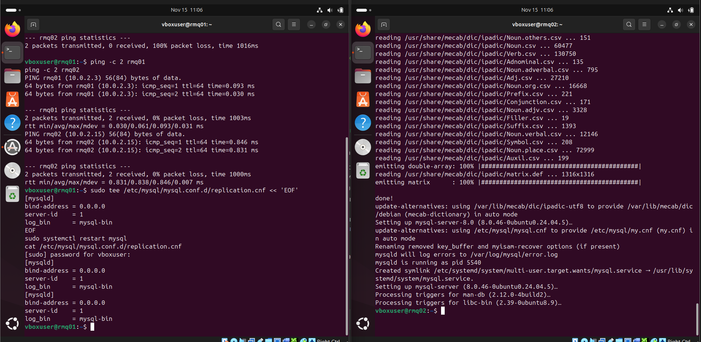
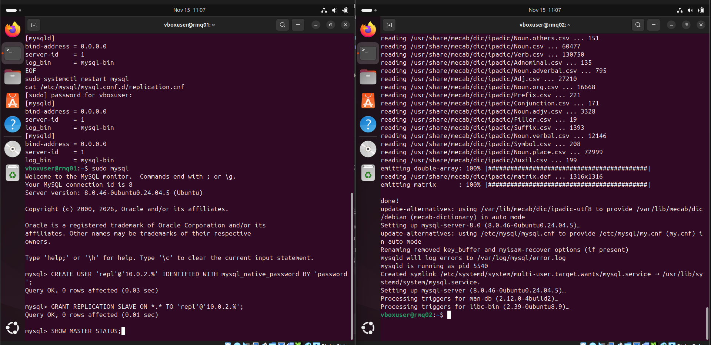
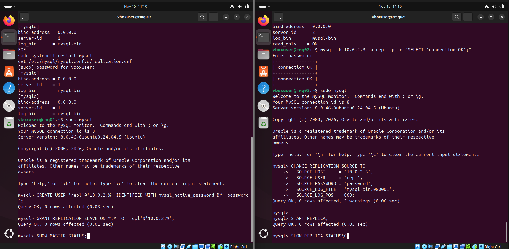
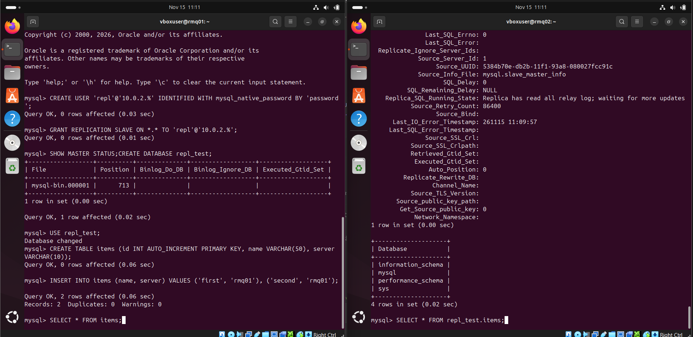
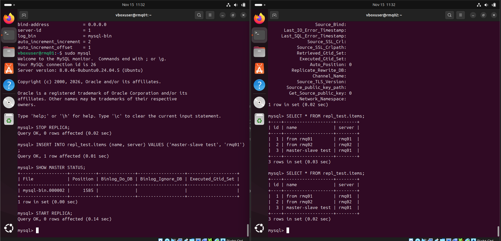
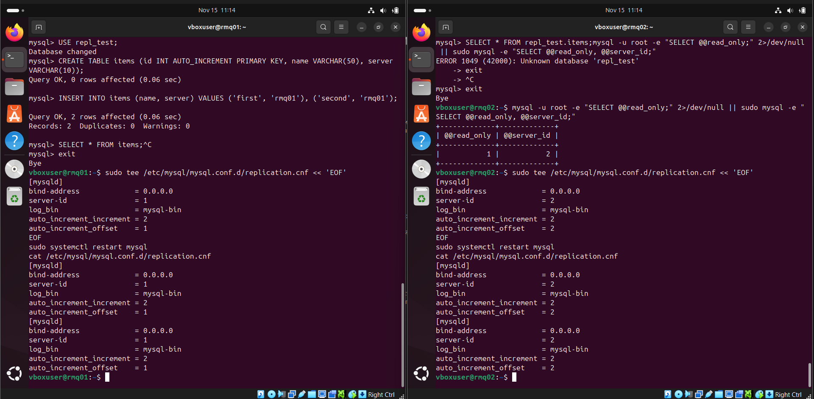
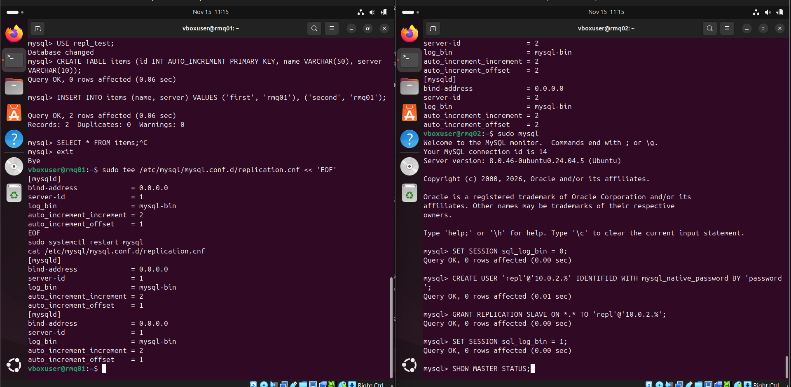
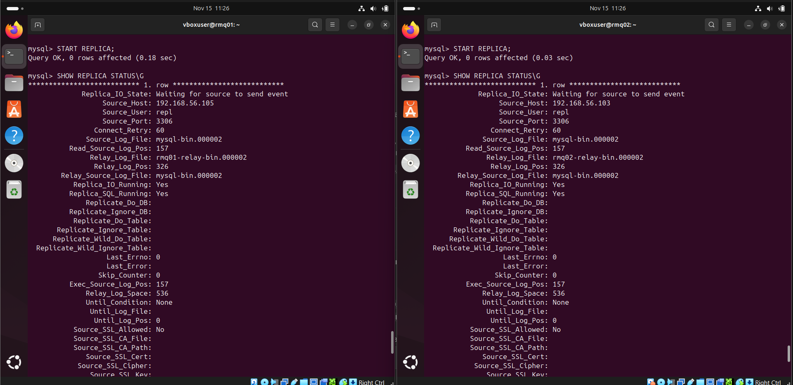
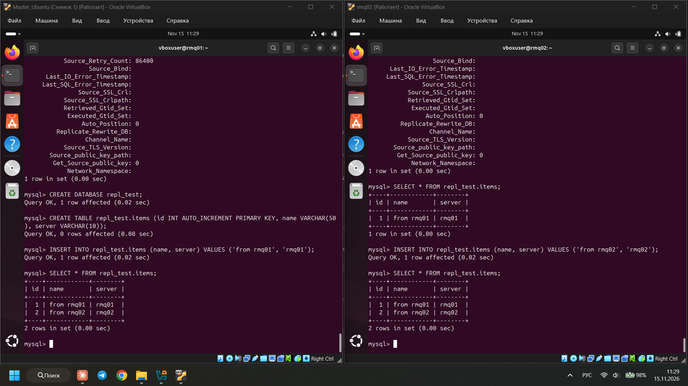

# Домашнее задание к занятию «Репликация и масштабирование. Часть 1» — Илембетов Василь Ражапович

[English version](README_EN.md)

## Стенд

Две виртуальные машины VirtualBox с Ubuntu 24.04 и MySQL 8.0.46.

| ВМ | IP (сеть NAT) | IP (host-only) | server-id |
|---|---|---|---|
| rmq01 | 10.0.2.3 | 192.168.56.103 | 1 |
| rmq02 | 10.0.2.15 | 192.168.56.105 | 2 |

---

## Задание 1

**Master-slave.** Запись выполняется только на одном сервере — master. Все изменения он записывает в бинарный лог (binlog). Slave подключается к master, читает его лог и повторяет у себя те же изменения. Slave работает только на чтение.

- Плюсы: простая настройка; нет конфликтов, так как запись идёт в одно место; чтение можно распределить по нескольким репликам; реплику удобно использовать для резервного копирования и тяжёлых отчётов.
- Минусы: master — единая точка отказа по записи (при его падении реплику нужно вручную назначать новым master); масштабируется только чтение; реплика может отставать от master.

**Master-master.** Каждый сервер одновременно является master и slave для другого. Запись возможна на оба сервера, изменения реплицируются в обе стороны.

- Плюсы: при отказе одного сервера второй продолжает принимать запись; нагрузку на запись можно разделить между серверами.
- Минусы: возможны конфликты при одновременном изменении одних и тех же данных на разных серверах; одинаковые значения `AUTO_INCREMENT` нужно разводить настройками `auto_increment_increment` и `auto_increment_offset`; схема сложнее в настройке и сопровождении. На практике запись часто ведут на один сервер, а второй держат как горячий резерв.

**Главное различие:** в master-slave данные идут в одну сторону и запись возможна на одном сервере, в master-master — в обе стороны и запись возможна на обоих.

---

## Задание 2. Master-slave

### Конфигурация master (rmq01)

```bash
sudo tee /etc/mysql/mysql.conf.d/replication.cnf << 'EOF'
[mysqld]
bind-address = 0.0.0.0
server-id    = 1
log_bin      = mysql-bin
EOF
sudo systemctl restart mysql
```

- `bind-address = 0.0.0.0` — MySQL принимает подключения по сети (по умолчанию в Ubuntu только с `127.0.0.1`);
- `server-id` — уникальный номер сервера в схеме репликации;
- `log_bin` — включает бинарный лог, из которого реплика получает изменения.

На rmq02 в это же время устанавливается MySQL (`sudo apt install -y mysql-server`):



### Пользователь для репликации на master

```sql
CREATE USER 'repl'@'10.0.2.%' IDENTIFIED WITH mysql_native_password BY 'password';
GRANT REPLICATION SLAVE ON *.* TO 'repl'@'10.0.2.%';
SHOW MASTER STATUS;
```

`REPLICATION SLAVE` — единственное право, нужное реплике для чтения бинарного лога. `mysql_native_password` позволяет подключаться без SSL. `SHOW MASTER STATUS` показывает файл лога и позицию, с которой реплика начнёт чтение.



### Конфигурация slave (rmq02) и запуск репликации

```bash
sudo tee /etc/mysql/mysql.conf.d/replication.cnf << 'EOF'
[mysqld]
bind-address = 0.0.0.0
server-id    = 2
log_bin      = mysql-bin
read_only    = ON
EOF
sudo systemctl restart mysql
```

`read_only = ON` запрещает обычным пользователям запись на реплику, чтобы её данные не расходились с master.

Проверка подключения к master и запуск репликации:

```bash
mysql -h 10.0.2.3 -u repl -p -e "SELECT 'connection OK';"
```

```sql
CHANGE REPLICATION SOURCE TO
  SOURCE_HOST     = '10.0.2.3',
  SOURCE_USER     = 'repl',
  SOURCE_PASSWORD = 'password',
  SOURCE_LOG_FILE = 'mysql-bin.000001',
  SOURCE_LOG_POS  = 860;
START REPLICA;
```



### Состояние серверов

`SHOW REPLICA STATUS\G` на slave: `Source_Server_Id: 1`, `Source_UUID` совпадает с UUID master. На master создана тестовая база `repl_test`:



### Проверка master-slave

Для проверки на rmq01 остановлена репликация в обратную сторону (`STOP REPLICA`), так что данные идут только rmq01 → rmq02. На master вставлена строка `master-slave test` — она появилась на slave (rmq02):

```sql
-- rmq01 (master)
STOP REPLICA;
INSERT INTO repl_test.items (name, server) VALUES ('master-slave test', 'rmq01');
SHOW MASTER STATUS;

-- rmq02 (slave)
SELECT * FROM repl_test.items;
```



---

## Задание 3*. Master-master

### Конфигурация

Оба сервера становятся одновременно source и replica. С rmq02 снят `read_only`, а счётчики `AUTO_INCREMENT` разведены, чтобы серверы не выдавали одинаковые id: rmq01 — 1, 3, 5…, rmq02 — 2, 4, 6….

rmq01:

```ini
[mysqld]
bind-address             = 0.0.0.0
server-id                = 1
log_bin                  = mysql-bin
auto_increment_increment = 2
auto_increment_offset    = 1
```

rmq02:

```ini
[mysqld]
bind-address             = 0.0.0.0
server-id                = 2
log_bin                  = mysql-bin
auto_increment_increment = 2
auto_increment_offset    = 2
```



### Пользователь для репликации на rmq02

```sql
SET SESSION sql_log_bin = 0;
CREATE USER 'repl'@'10.0.2.%' IDENTIFIED WITH mysql_native_password BY 'password';
GRANT REPLICATION SLAVE ON *.* TO 'repl'@'10.0.2.%';
SET SESSION sql_log_bin = 1;
```

`sql_log_bin = 0` исключает эти команды из бинарного лога: иначе создание пользователя реплицировалось бы на rmq01, где `repl` уже существует, и репликация остановилась бы с ошибкой.



### Перенастройка на сеть host-only

При первом запуске обратного направления репликация не заработала:
- rmq02 после перезагрузки получил по DHCP адрес `10.0.2.15` вместо `10.0.2.4`, и rmq01 не мог к нему подключиться (`Can't connect to MySQL server on '10.0.2.4' (113)`);
- реплика на rmq02 остановилась с ошибкой `1236 ... binlog truncated in the middle of event` — бинарный лог rmq01 перестал совпадать с уже прочитанной позицией.

Репликация была перенастроена с нуля через сеть host-only `192.168.56.x`, предназначенную для связи между виртуальными машинами. На обоих серверах:

```sql
STOP REPLICA;
RESET REPLICA ALL;

SET SESSION sql_log_bin = 0;
CREATE USER IF NOT EXISTS 'repl'@'192.168.56.%' IDENTIFIED WITH mysql_native_password BY 'password';
GRANT REPLICATION SLAVE ON *.* TO 'repl'@'192.168.56.%';
DROP DATABASE IF EXISTS repl_test;
SET SESSION sql_log_bin = 1;

SHOW MASTER STATUS;
```

rmq02 → реплика rmq01:

```sql
CHANGE REPLICATION SOURCE TO
  SOURCE_HOST = '192.168.56.103', SOURCE_USER = 'repl', SOURCE_PASSWORD = 'password',
  SOURCE_LOG_FILE = 'mysql-bin.000002', SOURCE_LOG_POS = 157;
START REPLICA;
```

rmq01 → реплика rmq02:

```sql
CHANGE REPLICATION SOURCE TO
  SOURCE_HOST = '192.168.56.105', SOURCE_USER = 'repl', SOURCE_PASSWORD = 'password',
  SOURCE_LOG_FILE = 'mysql-bin.000002', SOURCE_LOG_POS = 157;
START REPLICA;
```

### Состояние серверов

На обоих серверах `Replica_IO_Running: Yes`, `Replica_SQL_Running: Yes`, ошибок нет. У rmq01 источник — `192.168.56.105` (rmq02), у rmq02 — `192.168.56.103` (rmq01): каждый сервер реплицирует другой.



### Проверка

На rmq01 создана таблица и вставлена строка `from rmq01`, на rmq02 — строка `from rmq02`. На обоих серверах таблица содержит обе строки — данные реплицируются в обе стороны. Строка с rmq01 получила id 1, с rmq02 — id 2, в соответствии с настройками `auto_increment`.



Зацикливания не происходит: каждое событие в бинарном логе помечено `server_id` сервера, на котором оно возникло, и сервер не применяет повторно собственные события.
