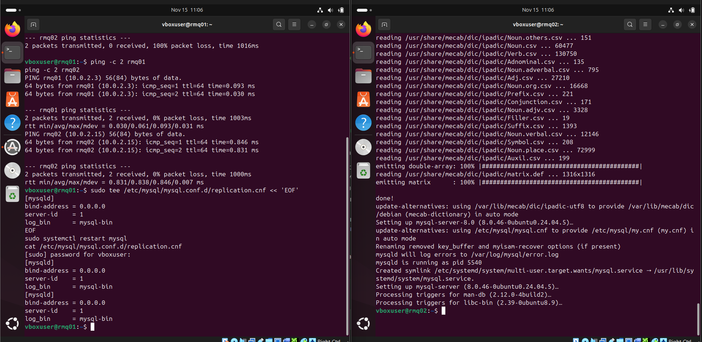
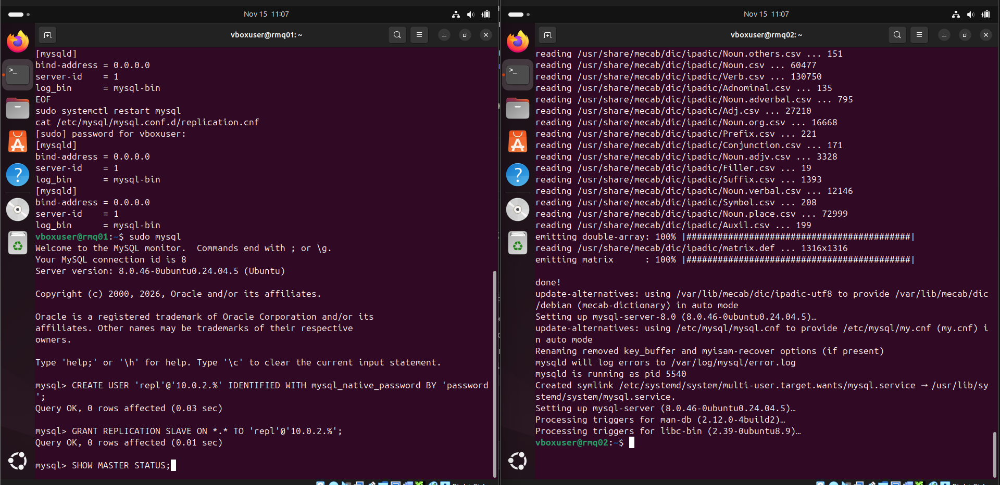
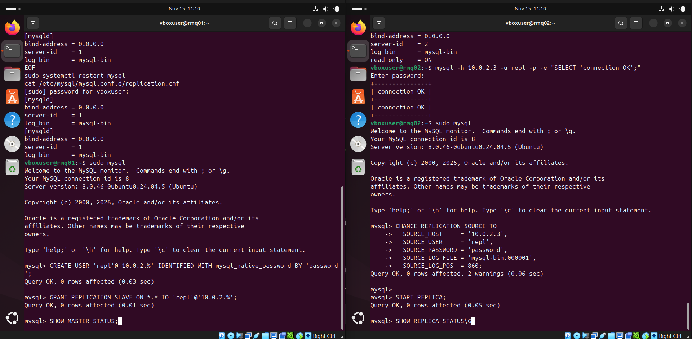
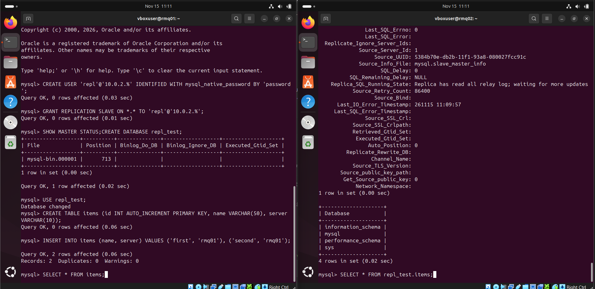
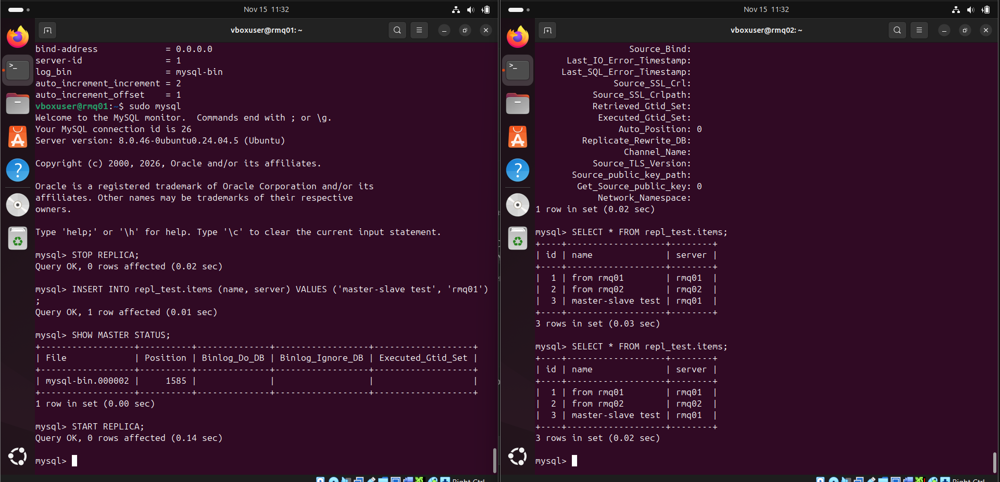
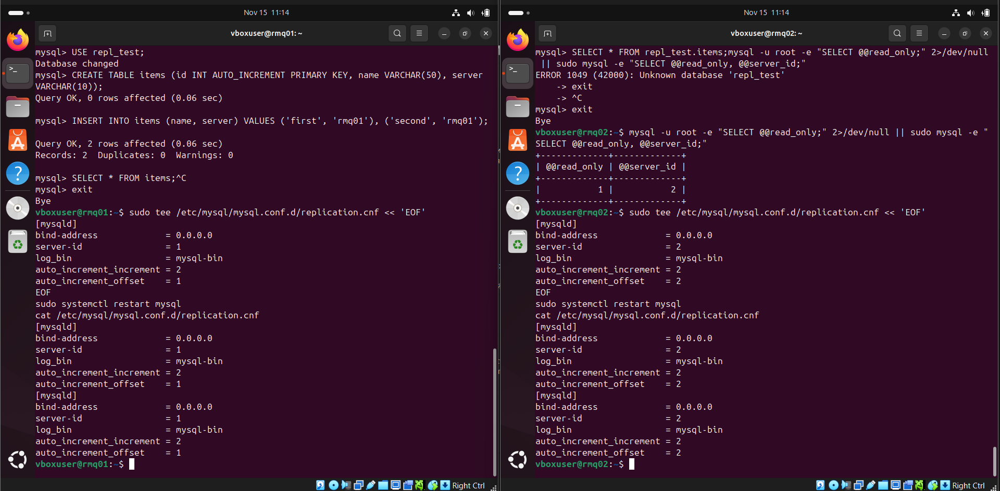
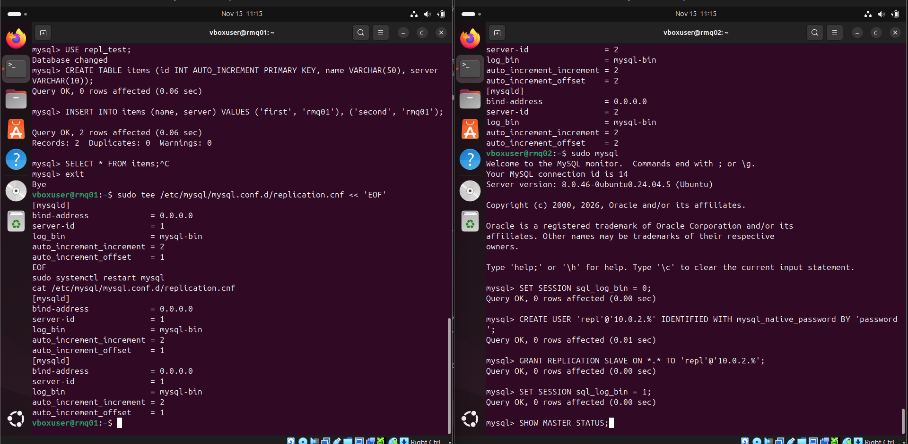
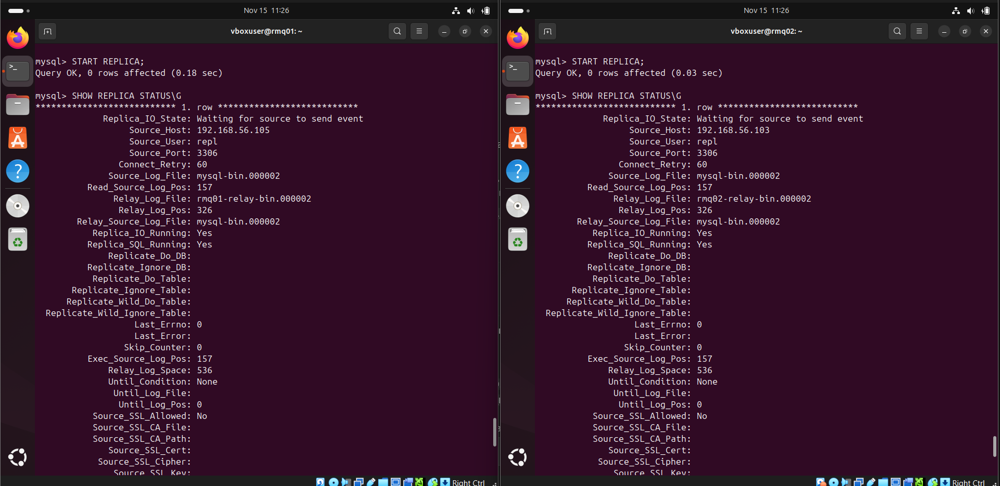
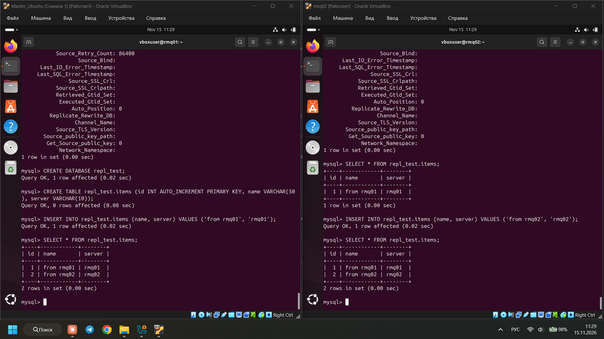

# Homework: Replication and Scaling. Part 1 — Ilembetov Vasil

[Русская версия](README.md)

## Environment

Two VirtualBox virtual machines running Ubuntu 24.04 and MySQL 8.0.46.

| VM | IP (NAT network) | IP (host-only) | server-id |
|---|---|---|---|
| rmq01 | 10.0.2.3 | 192.168.56.103 | 1 |
| rmq02 | 10.0.2.15 | 192.168.56.105 | 2 |

---

## Task 1

**Master-slave.** Writes go to one server only — the master. It records every change in its binary log (binlog). The slave connects to the master, reads its log and replays the same changes. The slave is read-only.

- Pros: simple to set up; no conflicts because all writes go to one place; reads can be spread across several replicas; a replica is handy for backups and heavy reports.
- Cons: the master is a single point of failure for writes (if it fails, a replica has to be promoted manually); only reads scale; a replica may lag behind the master.

**Master-master.** Each server is both a master and a slave of the other. Writes are possible on both servers, and changes replicate in both directions.

- Pros: if one server fails, the other keeps accepting writes; write load can be split between servers.
- Cons: conflicts are possible when the same data is changed on both servers at the same time; `AUTO_INCREMENT` values must be separated with `auto_increment_increment` and `auto_increment_offset`; the setup is harder to configure and maintain. In practice writes often go to one server, and the other is kept as a hot standby.

**Main difference:** in master-slave data flows one way and writes are possible on one server; in master-master data flows both ways and writes are possible on both.

---

## Task 2. Master-slave

### Master configuration (rmq01)

```bash
sudo tee /etc/mysql/mysql.conf.d/replication.cnf << 'EOF'
[mysqld]
bind-address = 0.0.0.0
server-id    = 1
log_bin      = mysql-bin
EOF
sudo systemctl restart mysql
```

- `bind-address = 0.0.0.0` — MySQL accepts network connections (on Ubuntu it only listens on `127.0.0.1` by default);
- `server-id` — a unique server number within the replication topology;
- `log_bin` — enables the binary log the replica reads changes from.

MySQL is being installed on rmq02 at the same time (`sudo apt install -y mysql-server`):



### Replication user on the master

```sql
CREATE USER 'repl'@'10.0.2.%' IDENTIFIED WITH mysql_native_password BY 'password';
GRANT REPLICATION SLAVE ON *.* TO 'repl'@'10.0.2.%';
SHOW MASTER STATUS;
```

`REPLICATION SLAVE` is the only privilege a replica needs to read the binary log. `mysql_native_password` allows connecting without SSL. `SHOW MASTER STATUS` shows the log file and position the replica will start reading from.



### Slave configuration (rmq02) and starting replication

```bash
sudo tee /etc/mysql/mysql.conf.d/replication.cnf << 'EOF'
[mysqld]
bind-address = 0.0.0.0
server-id    = 2
log_bin      = mysql-bin
read_only    = ON
EOF
sudo systemctl restart mysql
```

`read_only = ON` prevents regular users from writing to the replica so its data does not drift from the master.

Checking the connection to the master and starting replication:

```bash
mysql -h 10.0.2.3 -u repl -p -e "SELECT 'connection OK';"
```

```sql
CHANGE REPLICATION SOURCE TO
  SOURCE_HOST     = '10.0.2.3',
  SOURCE_USER     = 'repl',
  SOURCE_PASSWORD = 'password',
  SOURCE_LOG_FILE = 'mysql-bin.000001',
  SOURCE_LOG_POS  = 860;
START REPLICA;
```



### Server state

`SHOW REPLICA STATUS\G` on the slave: `Source_Server_Id: 1`, and `Source_UUID` matches the master's UUID. A test database `repl_test` is created on the master:



### Master-slave check

For the check, replication in the opposite direction is stopped on rmq01 (`STOP REPLICA`), so data flows only rmq01 → rmq02. A `master-slave test` row is inserted on the master, and it appears on the slave (rmq02):

```sql
-- rmq01 (master)
STOP REPLICA;
INSERT INTO repl_test.items (name, server) VALUES ('master-slave test', 'rmq01');
SHOW MASTER STATUS;

-- rmq02 (slave)
SELECT * FROM repl_test.items;
```



---

## Task 3*. Master-master

### Configuration

Both servers become source and replica at the same time. `read_only` is removed from rmq02, and the `AUTO_INCREMENT` counters are separated so the servers never generate the same id: rmq01 — 1, 3, 5…, rmq02 — 2, 4, 6….

rmq01:

```ini
[mysqld]
bind-address             = 0.0.0.0
server-id                = 1
log_bin                  = mysql-bin
auto_increment_increment = 2
auto_increment_offset    = 1
```

rmq02:

```ini
[mysqld]
bind-address             = 0.0.0.0
server-id                = 2
log_bin                  = mysql-bin
auto_increment_increment = 2
auto_increment_offset    = 2
```



### Replication user on rmq02

```sql
SET SESSION sql_log_bin = 0;
CREATE USER 'repl'@'10.0.2.%' IDENTIFIED WITH mysql_native_password BY 'password';
GRANT REPLICATION SLAVE ON *.* TO 'repl'@'10.0.2.%';
SET SESSION sql_log_bin = 1;
```

`sql_log_bin = 0` keeps these commands out of the binary log: otherwise the user creation would replicate to rmq01, where `repl` already exists, and replication would stop with an error.



### Switching to the host-only network

On the first start of the reverse direction, replication did not work:
- after a reboot rmq02 got the address `10.0.2.15` from DHCP instead of `10.0.2.4`, so rmq01 could not connect to it (`Can't connect to MySQL server on '10.0.2.4' (113)`);
- the replica on rmq02 stopped with error `1236 ... binlog truncated in the middle of event` — rmq01's binary log no longer matched the position already read.

Replication was reconfigured from scratch over the host-only network `192.168.56.x`, which is meant for VM-to-VM communication. On both servers:

```sql
STOP REPLICA;
RESET REPLICA ALL;

SET SESSION sql_log_bin = 0;
CREATE USER IF NOT EXISTS 'repl'@'192.168.56.%' IDENTIFIED WITH mysql_native_password BY 'password';
GRANT REPLICATION SLAVE ON *.* TO 'repl'@'192.168.56.%';
DROP DATABASE IF EXISTS repl_test;
SET SESSION sql_log_bin = 1;

SHOW MASTER STATUS;
```

rmq02 → replica of rmq01:

```sql
CHANGE REPLICATION SOURCE TO
  SOURCE_HOST = '192.168.56.103', SOURCE_USER = 'repl', SOURCE_PASSWORD = 'password',
  SOURCE_LOG_FILE = 'mysql-bin.000002', SOURCE_LOG_POS = 157;
START REPLICA;
```

rmq01 → replica of rmq02:

```sql
CHANGE REPLICATION SOURCE TO
  SOURCE_HOST = '192.168.56.105', SOURCE_USER = 'repl', SOURCE_PASSWORD = 'password',
  SOURCE_LOG_FILE = 'mysql-bin.000002', SOURCE_LOG_POS = 157;
START REPLICA;
```

### Server state

Both servers show `Replica_IO_Running: Yes`, `Replica_SQL_Running: Yes` and no errors. rmq01's source is `192.168.56.105` (rmq02), rmq02's source is `192.168.56.103` (rmq01): each server replicates the other.



### Check

A table is created and a `from rmq01` row is inserted on rmq01, and a `from rmq02` row is inserted on rmq02. On both servers the table contains both rows — data replicates in both directions. The rmq01 row got id 1 and the rmq02 row got id 2, as set by the `auto_increment` settings.



There is no replication loop: every event in the binary log is tagged with the `server_id` of the server where it originated, and a server does not re-apply its own events.
