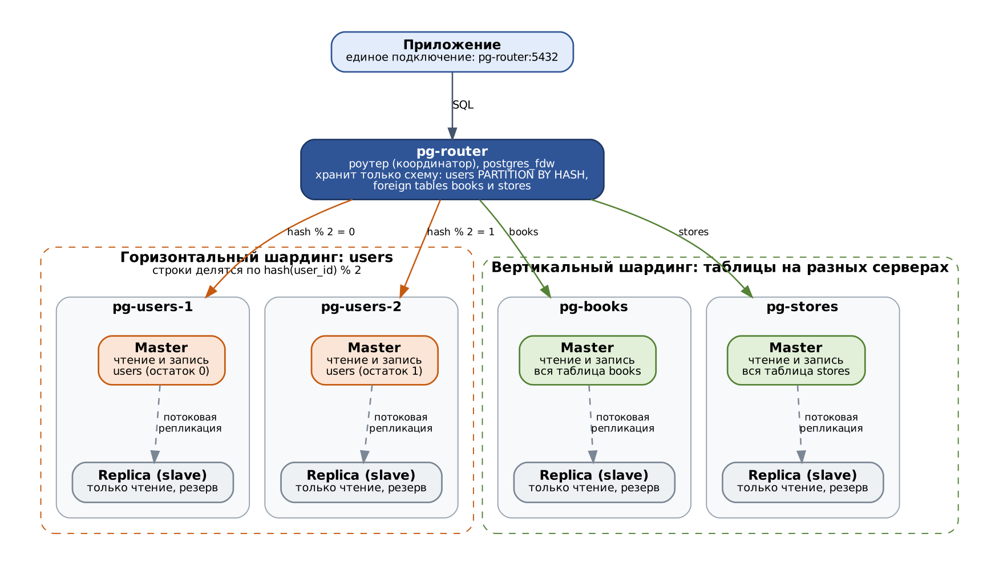
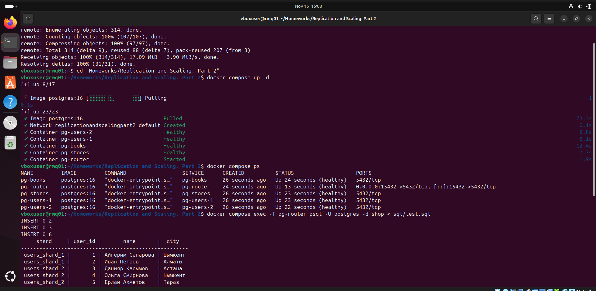
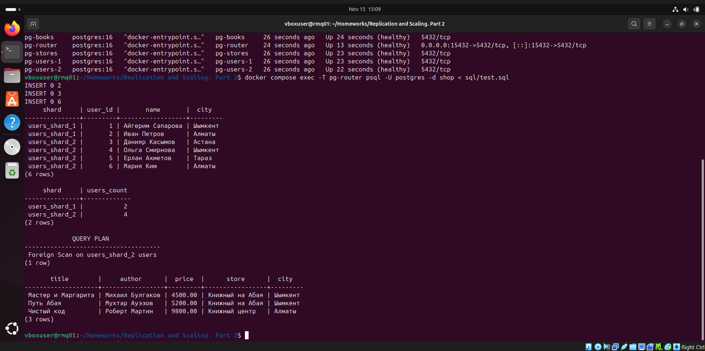
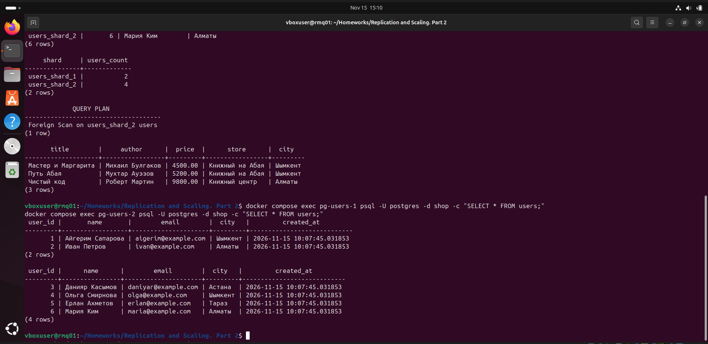

# Домашнее задание к занятию «Репликация и масштабирование. Часть 2» — Илембетов Василь Ражапович

[English version](README_EN.md)

---

## Задание 1

### Активный master и пассивный slave

Slave получает все изменения с master, но клиентов не обслуживает — это «горячий резерв».

- **Отказоустойчивость.** На slave всегда лежит почти актуальная копия данных. Если master упал, slave назначается новым master (failover), простой — минуты, потеря данных — минимальная.
- **Резервное копирование без нагрузки на master.** Бэкап снимается с реплики, master в это время продолжает работать в обычном режиме.
- **Обслуживание без простоя.** Обновление ОС или СУБД можно сделать сначала на slave, затем переключить роли и обновить бывший master.
- **Простота.** Запись идёт только в одно место, конфликтов нет, приложение работает с одним сервером.

Ограничение: ресурсы slave простаивают, производительность системы не растёт — схема даёт надёжность, а не скорость.

### Master и несколько slave

Запись идёт на master, чтение распределяется по репликам.

- **Масштабирование чтения.** Большинство нагрузок — это чтение. Запросы `SELECT` распределяются между несколькими репликами через балансировщик (HAProxy, ProxySQL), и производительность по чтению растёт почти линейно с числом реплик.
- **Разделение нагрузки по назначению.** Отдельные реплики можно выделить под тяжёлую аналитику и отчёты, под бэкапы, под разные сервисы — они не мешают основному трафику.
- **Географическое распределение.** Реплики можно разместить ближе к пользователям в разных регионах и уменьшить задержки.
- **Высокая доступность.** При отказе одной реплики чтение продолжают обслуживать остальные; при отказе master любую из реплик можно повысить до master.

Ограничения: запись по-прежнему упирается в один master; реплики отстают от master, поэтому сразу после записи на реплике можно прочитать устаревшие данные.

---

## Задание 2. План шардинга

### Таблицы

| Таблица | Столбцы |
|---|---|
| `users` — пользователи | `user_id`, `name`, `email`, `city`, `created_at` |
| `books` — книги | `book_id`, `title`, `author`, `isbn`, `price`, `store_id` |
| `stores` — магазины | `store_id`, `name`, `city`, `address` |

### Вертикальный шардинг — разбиение по таблицам

Каждая таблица выносится на свой сервер:

- `pg-books` — каталог книг. Нагрузка в основном на чтение (поиск, просмотр), таблица большая.
- `pg-stores` — магазины. Таблица маленькая и редко меняется.
- `users` — пользователи, о них ниже.

Таблицы с разным профилем нагрузки не конкурируют за ресурсы одного сервера, каждый сервер можно настраивать и масштабировать отдельно.

### Горизонтальный шардинг — разбиение строк

`users` — самая быстрорастущая таблица, поэтому её строки делятся между несколькими серверами по ключу шардирования `user_id`:

- шард выбирается по `hash(user_id) % N`, где N — число шардов (в решении N = 2: `pg-users-1` и `pg-users-2`);
- хеш даёт равномерное распределение и не создаёт «горячих» шардов, в отличие от деления по диапазону id, где все новые пользователи попадали бы на последний шард;
- запрос к конкретному пользователю (`WHERE user_id = …`) уходит только на один шард;
- на всех шардах одинаковая структура таблицы, различаются только строки.

Альтернатива — шардинг по региону (`city`): данные ближе к пользователям, но шарды получаются неравномерными.

### Роутер

Приложение подключается только к роутеру `pg-router`. Роутер знает, где лежат данные, и сам направляет запросы:

- `users` → на шард по `hash(user_id)`;
- `books` → на `pg-books`;
- `stores` → на `pg-stores`.

Роутер не хранит данные, только схему и правила маршрутизации, поэтому его легко продублировать за балансировщиком.

### Блок-схема



### Режимы работы серверов

| Сервер | Режим |
|---|---|
| `pg-router` | роутер (координатор): принимает все запросы на чтение и запись, данных не хранит |
| `pg-users-1`, `pg-users-2` | шарды: master (чтение и запись) + replica (только чтение, горячий резерв) |
| `pg-books` | вертикальный шард: master + replica; реплики можно использовать для разгрузки чтения каталога |
| `pg-stores` | вертикальный шард: master + replica |

Каждый шард работает по схеме master-slave из задания 1: потоковая репликация на реплику защищает данные шарда при отказе сервера.

### Ограничения схемы

- Внешний ключ `books.store_id → stores.store_id` между разными серверами создать нельзя — целостность связи проверяет приложение.
- Соединение таблиц с разных серверов (`books JOIN stores`) выполняется через роутер и медленнее, чем на одном сервере. Маленькую таблицу `stores` можно держать копией на каждом сервере (справочная таблица), чтобы такие запросы выполнялись локально.
- Транзакция, затрагивающая несколько шардов, не атомарна без двухфазного коммита.
- Добавление шарда требует перераспределения строк `users`; чтобы это было проще, можно заранее создать больше логических разделов, чем серверов.

---

## Задание 3*. Реализация

Шардинг реализован на PostgreSQL 16 в Docker Compose с помощью расширения `postgres_fdw`:

- на роутере `users` — секционированная таблица `PARTITION BY HASH (user_id)`, а её секции — внешние таблицы (foreign tables) на `pg-users-1` и `pg-users-2`;
- `books` и `stores` на роутере — внешние таблицы, указывающие на `pg-books` и `pg-stores`.

Репликация внутри шардов показана на схеме и в лабораторной не разворачивается, чтобы не перегружать стенд.

### Файлы

| Файл | Где выполняется | Назначение |
|---|---|---|
| [docker-compose.yml](docker-compose.yml) | — | 5 контейнеров PostgreSQL 16 |
| [sql/shard_users.sql](sql/shard_users.sql) | `pg-users-1`, `pg-users-2` | таблица `users` |
| [sql/books.sql](sql/books.sql) | `pg-books` | таблица `books` |
| [sql/stores.sql](sql/stores.sql) | `pg-stores` | таблица `stores` |
| [sql/router.sql](sql/router.sql) | `pg-router` | подключение шардов через `postgres_fdw`, секционирование `users` |
| [sql/test.sql](sql/test.sql) | `pg-router` | тестовые данные и проверочные запросы |

Скрипты схемы выполняются автоматически при первом запуске контейнеров (`/docker-entrypoint-initdb.d`).

### Запуск

```bash
docker compose up -d
docker compose ps
```



### Проверка

Все запросы отправляются на роутер:

```bash
docker compose exec -T pg-router psql -U postgres -d shop < sql/test.sql
```

- шесть пользователей распределились между `users_shard_1` и `users_shard_2`;
- запрос `WHERE user_id = 4` в плане выполняется одним `Foreign Scan` — только на нужном шарде;
- соединение `books JOIN stores` выполняется между двумя разными серверами.



Прямой запрос к каждому шарду показывает, что строки физически лежат на разных серверах:

```bash
docker compose exec pg-users-1 psql -U postgres -d shop -c "SELECT * FROM users;"
docker compose exec pg-users-2 psql -U postgres -d shop -c "SELECT * FROM users;"
```


