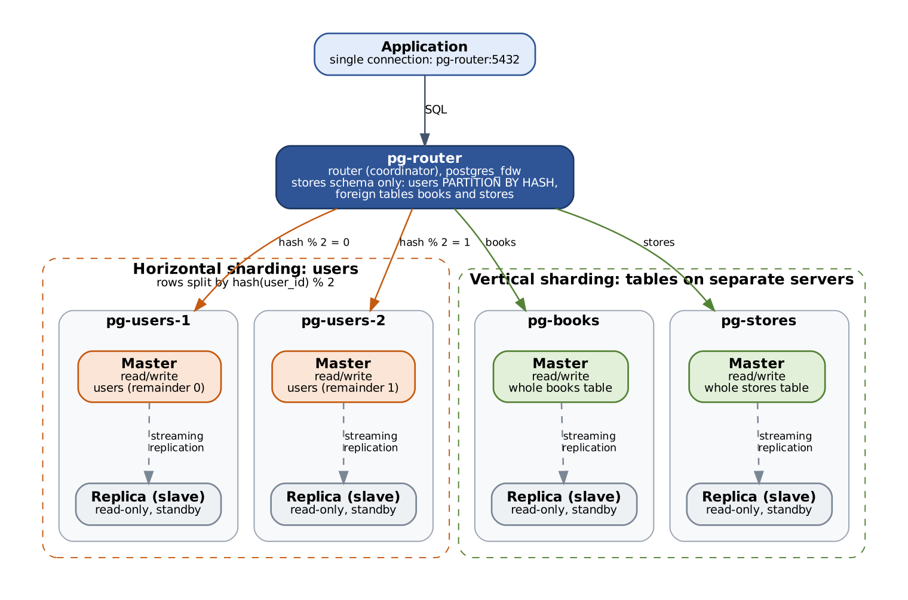
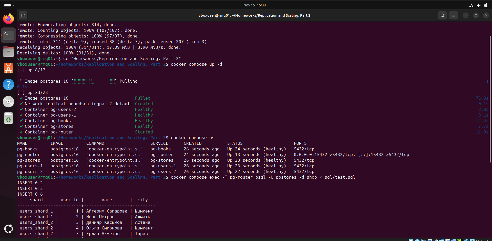
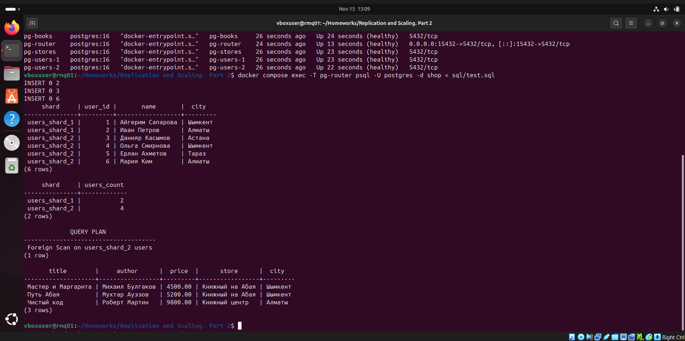
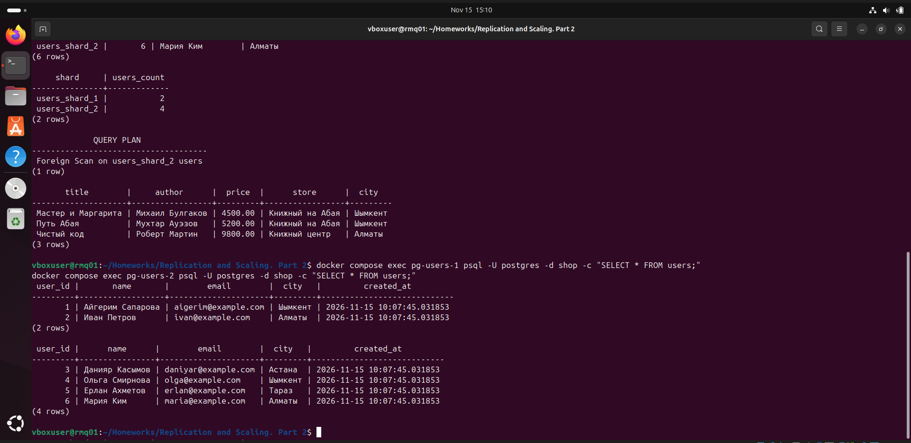

# Homework: Replication and Scaling. Part 2 — Ilembetov Vasil Razhapovich

[Русская версия](README.md)

---

## Task 1

### Active master and passive slave

The slave receives every change from the master but does not serve clients — it is a hot standby.

- **Fault tolerance.** The slave always holds an almost up-to-date copy of the data. If the master fails, the slave is promoted to master (failover) with minutes of downtime and minimal data loss.
- **Backups without loading the master.** Backups are taken from the replica while the master keeps working normally.
- **Maintenance without downtime.** The OS or DBMS can be upgraded on the slave first, then the roles are switched and the former master is upgraded.
- **Simplicity.** All writes go to one place, there are no conflicts, and the application works with a single server.

Limitation: the slave's resources sit idle and system performance does not grow — this setup gives reliability, not speed.

### Master and several slaves

Writes go to the master, reads are spread across the replicas.

- **Read scaling.** Most workloads are read-heavy. `SELECT` queries are distributed among several replicas through a load balancer (HAProxy, ProxySQL), and read throughput grows almost linearly with the number of replicas.
- **Workload separation.** Dedicated replicas can serve heavy analytics and reports, backups or separate services without affecting the main traffic.
- **Geographic distribution.** Replicas can be placed closer to users in different regions to reduce latency.
- **High availability.** If one replica fails, the others keep serving reads; if the master fails, any replica can be promoted.

Limitations: writes are still bound to a single master; replicas lag behind the master, so a read from a replica right after a write may return stale data.

---

## Task 2. Sharding plan

### Tables

| Table | Columns |
|---|---|
| `users` | `user_id`, `name`, `email`, `city`, `created_at` |
| `books` | `book_id`, `title`, `author`, `isbn`, `price`, `store_id` |
| `stores` | `store_id`, `name`, `city`, `address` |

### Vertical sharding — split by table

Each table moves to its own server:

- `pg-books` — the book catalog. Mostly read load (search, browsing), a large table.
- `pg-stores` — stores. A small table that rarely changes.
- `users` — see below.

Tables with different load profiles no longer compete for one server's resources, and each server can be tuned and scaled separately.

### Horizontal sharding — split by rows

`users` is the fastest-growing table, so its rows are split across several servers by the shard key `user_id`:

- the shard is chosen by `hash(user_id) % N`, where N is the number of shards (N = 2 here: `pg-users-1` and `pg-users-2`);
- hashing gives an even distribution and no "hot" shards, unlike splitting by id range, where all new users would land on the last shard;
- a query for a specific user (`WHERE user_id = …`) goes to exactly one shard;
- all shards have the same table structure, only the rows differ.

An alternative is sharding by region (`city`): data sits closer to users, but shards end up uneven.

### Router

The application connects only to the router `pg-router`. The router knows where the data lives and routes queries itself:

- `users` → to a shard by `hash(user_id)`;
- `books` → to `pg-books`;
- `stores` → to `pg-stores`.

The router stores no data, only the schema and routing rules, so it is easy to duplicate behind a load balancer.

### Block diagram



### Server modes

| Server | Mode |
|---|---|
| `pg-router` | router (coordinator): accepts all reads and writes, stores no data |
| `pg-users-1`, `pg-users-2` | shards: master (read/write) + replica (read-only, hot standby) |
| `pg-books` | vertical shard: master + replica; replicas can offload catalog reads |
| `pg-stores` | vertical shard: master + replica |

Each shard uses the master-slave setup from Task 1: streaming replication to a replica protects the shard's data if a server fails.

### Limitations

- A foreign key `books.store_id → stores.store_id` cannot span servers — the application checks referential integrity.
- Joining tables on different servers (`books JOIN stores`) goes through the router and is slower than on one server. The small `stores` table can be copied to every server (a reference table) so such queries run locally.
- A transaction touching several shards is not atomic without two-phase commit.
- Adding a shard requires redistributing `users` rows; creating more logical partitions than servers in advance makes this easier.

---

## Task 3*. Implementation

Sharding is implemented with PostgreSQL 16 in Docker Compose using the `postgres_fdw` extension:

- on the router, `users` is a partitioned table `PARTITION BY HASH (user_id)` whose partitions are foreign tables on `pg-users-1` and `pg-users-2`;
- `books` and `stores` on the router are foreign tables pointing to `pg-books` and `pg-stores`.

Replication inside the shards is shown in the diagram but not deployed in the lab, to keep the setup light.

### Files

| File | Runs on | Purpose |
|---|---|---|
| [docker-compose.yml](docker-compose.yml) | — | 5 PostgreSQL 16 containers |
| [sql/shard_users.sql](sql/shard_users.sql) | `pg-users-1`, `pg-users-2` | `users` table |
| [sql/books.sql](sql/books.sql) | `pg-books` | `books` table |
| [sql/stores.sql](sql/stores.sql) | `pg-stores` | `stores` table |
| [sql/router.sql](sql/router.sql) | `pg-router` | connecting shards via `postgres_fdw`, partitioning `users` |
| [sql/test.sql](sql/test.sql) | `pg-router` | test data and check queries |

The schema scripts run automatically on the first container start (`/docker-entrypoint-initdb.d`).

### Start

```bash
docker compose up -d
docker compose ps
```



### Check

All queries are sent to the router:

```bash
docker compose exec -T pg-router psql -U postgres -d shop < sql/test.sql
```

- six users are distributed between `users_shard_1` and `users_shard_2`;
- the `WHERE user_id = 4` query is a single `Foreign Scan` in the plan — only on the right shard;
- `books JOIN stores` is joined across two different servers.



Querying each shard directly shows the rows physically live on different servers:

```bash
docker compose exec pg-users-1 psql -U postgres -d shop -c "SELECT * FROM users;"
docker compose exec pg-users-2 psql -U postgres -d shop -c "SELECT * FROM users;"
```


