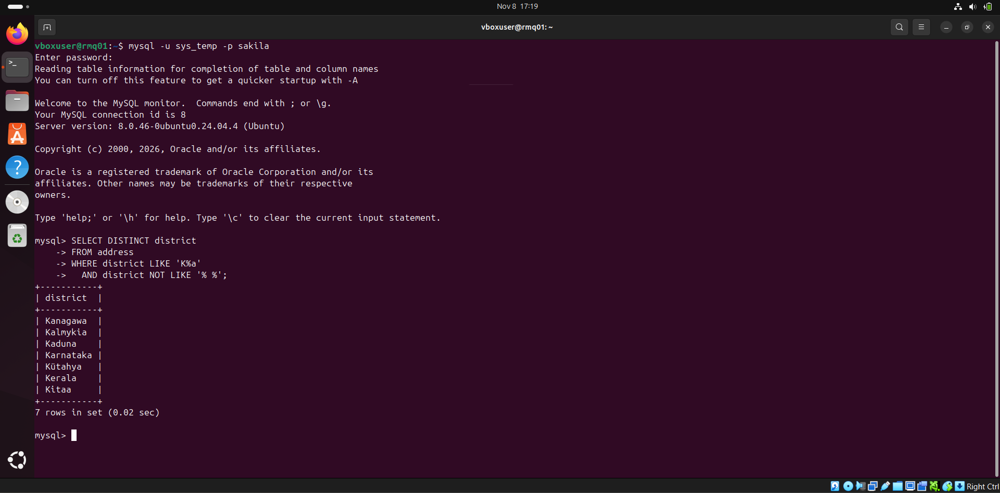
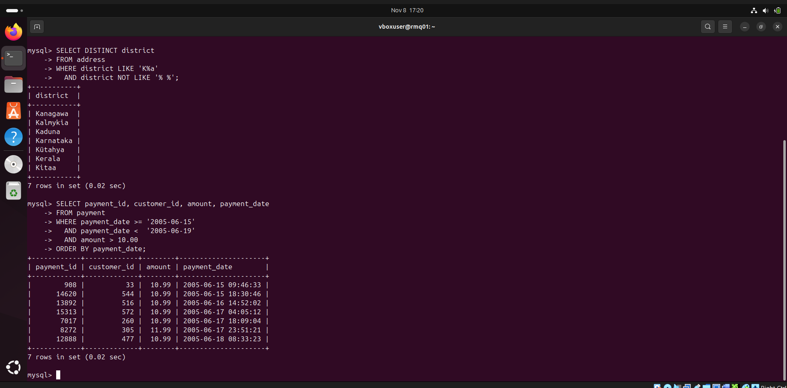
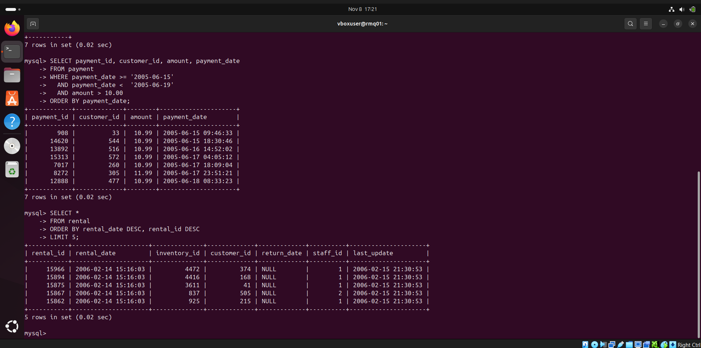
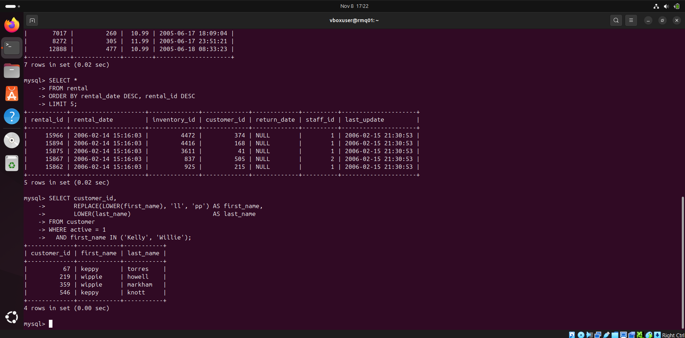
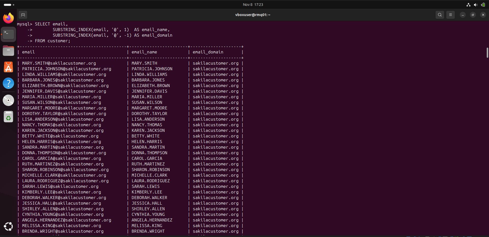
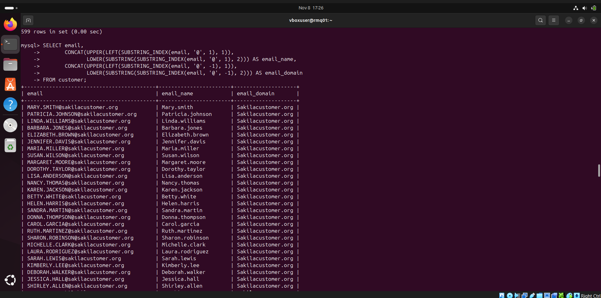

# Домашнее задание к занятию «SQL. Часть 1» — Фамилия Имя

[English version](README_EN.md)

Запросы выполнены в командной строке MySQL 8.0 к базе `sakila`:

```bash
mysql -u sys_temp -p sakila
```

---

## Задание 1

Уникальные названия районов, которые начинаются на «K», заканчиваются на «a» и не содержат пробелов:

```sql
SELECT DISTINCT district
FROM address
WHERE district LIKE 'K%a'
  AND district NOT LIKE '% %';
```

- `DISTINCT` убирает повторяющиеся районы;
- `LIKE 'K%a'` — начинается на `K`, заканчивается на `a`, `%` означает любое количество любых символов;
- `NOT LIKE '% %'` исключает значения, в которых есть пробел.

Результат: 7 районов — Kanagawa, Kalmykia, Kaduna, Karnataka, Kütahya, Kerala, Kitaa.



---

## Задание 2

Платежи с 15 по 18 июня 2005 года включительно на сумму больше 10.00:

```sql
SELECT payment_id, customer_id, amount, payment_date
FROM payment
WHERE payment_date >= '2005-06-15'
  AND payment_date <  '2005-06-19'
  AND amount > 10.00
ORDER BY payment_date;
```

Столбец `payment_date` хранит дату и время. Условие `BETWEEN '2005-06-15' AND '2005-06-18'` отсекло бы платежи 18 июня после 00:00:00, поэтому верхняя граница задана как «меньше 19 июня».

Результат: 7 платежей, последний из них — 18 июня в 08:33:23.



---

## Задание 3

Последние пять аренд фильмов:

```sql
SELECT *
FROM rental
ORDER BY rental_date DESC, rental_id DESC
LIMIT 5;
```

Аренды сортируются от новых к старым, `LIMIT 5` оставляет первые пять строк. У 182 аренд одинаковая последняя дата `2006-02-14 15:16:03`, поэтому добавлена вторая сортировка по `rental_id`: без неё набор из пяти строк не был бы однозначным.



---

## Задание 4

Активные покупатели с именами Kelly или Willie; имя и фамилия в нижнем регистре, `ll` в имени заменено на `pp`:

```sql
SELECT customer_id,
       REPLACE(LOWER(first_name), 'll', 'pp') AS first_name,
       LOWER(last_name)                       AS last_name
FROM customer
WHERE active = 1
  AND first_name IN ('Kelly', 'Willie');
```

- `active = 1` — только активные покупатели;
- `IN ('Kelly', 'Willie')` — одно из двух имён;
- сначала `LOWER` переводит имя в нижний регистр (`KELLY` → `kelly`), затем `REPLACE` меняет `ll` на `pp`. В обратном порядке замена не сработала бы, так как в базе имена хранятся заглавными буквами.

Результат: 4 покупателя — keppy torres, wippie howell, wippie markham, keppy knott.



---

## Задание 5*

Email, разделённый на две колонки — до и после `@`:

```sql
SELECT email,
       SUBSTRING_INDEX(email, '@', 1)  AS email_name,
       SUBSTRING_INDEX(email, '@', -1) AS email_domain
FROM customer;
```

`SUBSTRING_INDEX(строка, '@', 1)` возвращает часть до первого `@`, а с `-1` — часть после последнего `@`.



---

## Задание 6*

Те же колонки, где первая буква заглавная, а остальные строчные:

```sql
SELECT email,
       CONCAT(UPPER(LEFT(SUBSTRING_INDEX(email, '@', 1), 1)),
              LOWER(SUBSTRING(SUBSTRING_INDEX(email, '@', 1), 2))) AS email_name,
       CONCAT(UPPER(LEFT(SUBSTRING_INDEX(email, '@', -1), 1)),
              LOWER(SUBSTRING(SUBSTRING_INDEX(email, '@', -1), 2))) AS email_domain
FROM customer;
```

Значение собирается из двух частей: `UPPER(LEFT(x, 1))` — первая буква заглавная, `LOWER(SUBSTRING(x, 2))` — остальные строчные, `CONCAT` склеивает их. Например, `MARY.SMITH@sakilacustomer.org` → `Mary.smith` и `Sakilacustomer.org`.


