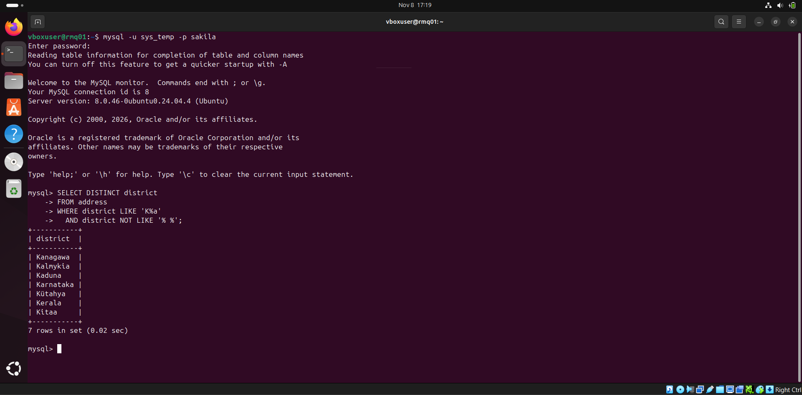
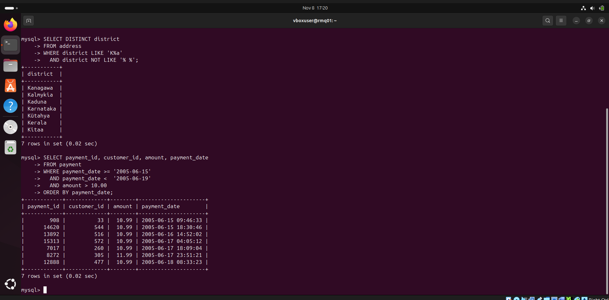
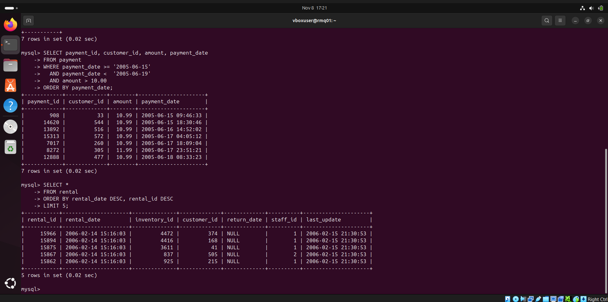
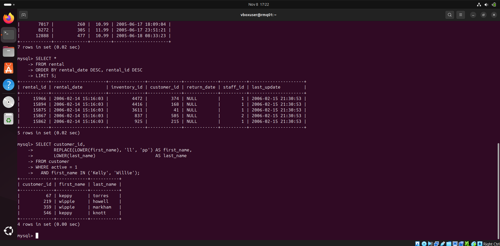
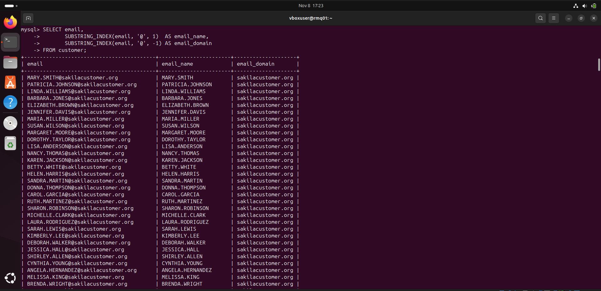
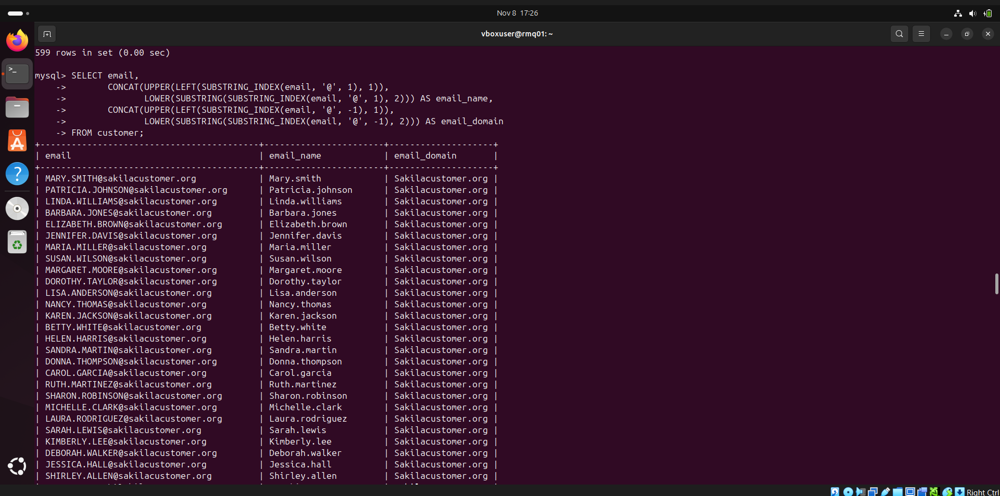

# Homework: SQL. Part 1 — First Name Last Name

[Русская версия](README.md)

Queries were run in the MySQL 8.0 command-line client against the `sakila` database:

```bash
mysql -u sys_temp -p sakila
```

---

## Task 1

Unique district names that start with "K", end with "a" and contain no spaces:

```sql
SELECT DISTINCT district
FROM address
WHERE district LIKE 'K%a'
  AND district NOT LIKE '% %';
```

- `DISTINCT` removes duplicate districts;
- `LIKE 'K%a'` — starts with `K` and ends with `a`; `%` matches any number of any characters;
- `NOT LIKE '% %'` excludes values that contain a space.

Result: 7 districts — Kanagawa, Kalmykia, Kaduna, Karnataka, Kütahya, Kerala, Kitaa.



---

## Task 2

Payments from June 15 to June 18, 2005 inclusive with an amount greater than 10.00:

```sql
SELECT payment_id, customer_id, amount, payment_date
FROM payment
WHERE payment_date >= '2005-06-15'
  AND payment_date <  '2005-06-19'
  AND amount > 10.00
ORDER BY payment_date;
```

The `payment_date` column stores both date and time. `BETWEEN '2005-06-15' AND '2005-06-18'` would drop payments made on June 18 after 00:00:00, so the upper bound is set as "before June 19".

Result: 7 payments, the last one on June 18 at 08:33:23.



---

## Task 3

The last five film rentals:

```sql
SELECT *
FROM rental
ORDER BY rental_date DESC, rental_id DESC
LIMIT 5;
```

Rentals are sorted from newest to oldest, and `LIMIT 5` keeps the first five rows. 182 rentals share the same latest date `2006-02-14 15:16:03`, so a second sort by `rental_id` is added: without it the set of five rows would not be deterministic.



---

## Task 4

Active customers named Kelly or Willie; first and last names in lowercase, with `ll` in the first name replaced by `pp`:

```sql
SELECT customer_id,
       REPLACE(LOWER(first_name), 'll', 'pp') AS first_name,
       LOWER(last_name)                       AS last_name
FROM customer
WHERE active = 1
  AND first_name IN ('Kelly', 'Willie');
```

- `active = 1` — active customers only;
- `IN ('Kelly', 'Willie')` — either of the two names;
- `LOWER` converts the name to lowercase first (`KELLY` → `kelly`), then `REPLACE` changes `ll` to `pp`. In the reverse order the replacement would not work, because names are stored in uppercase.

Result: 4 customers — keppy torres, wippie howell, wippie markham, keppy knott.



---

## Task 5*

Email split into two columns — before and after `@`:

```sql
SELECT email,
       SUBSTRING_INDEX(email, '@', 1)  AS email_name,
       SUBSTRING_INDEX(email, '@', -1) AS email_domain
FROM customer;
```

`SUBSTRING_INDEX(string, '@', 1)` returns the part before the first `@`; with `-1` it returns the part after the last `@`.



---

## Task 6*

The same columns with the first letter capitalized and the rest in lowercase:

```sql
SELECT email,
       CONCAT(UPPER(LEFT(SUBSTRING_INDEX(email, '@', 1), 1)),
              LOWER(SUBSTRING(SUBSTRING_INDEX(email, '@', 1), 2))) AS email_name,
       CONCAT(UPPER(LEFT(SUBSTRING_INDEX(email, '@', -1), 1)),
              LOWER(SUBSTRING(SUBSTRING_INDEX(email, '@', -1), 2))) AS email_domain
FROM customer;
```

Each value is built from two parts: `UPPER(LEFT(x, 1))` makes the first letter uppercase, `LOWER(SUBSTRING(x, 2))` makes the rest lowercase, and `CONCAT` joins them. For example, `MARY.SMITH@sakilacustomer.org` → `Mary.smith` and `Sakilacustomer.org`.


