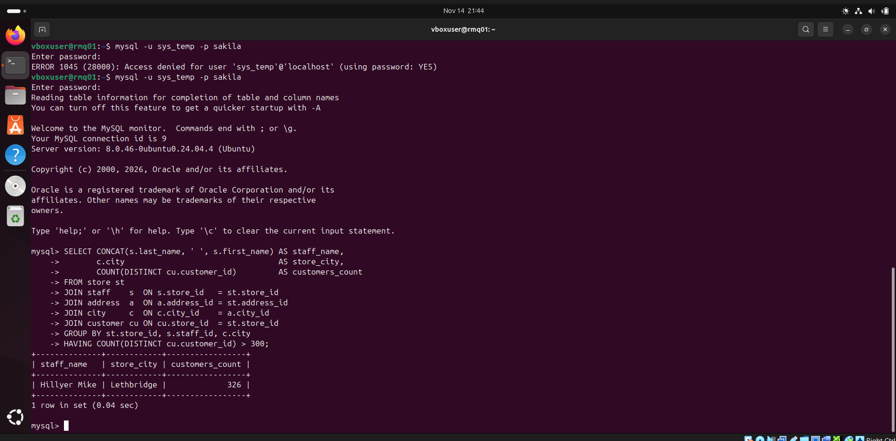
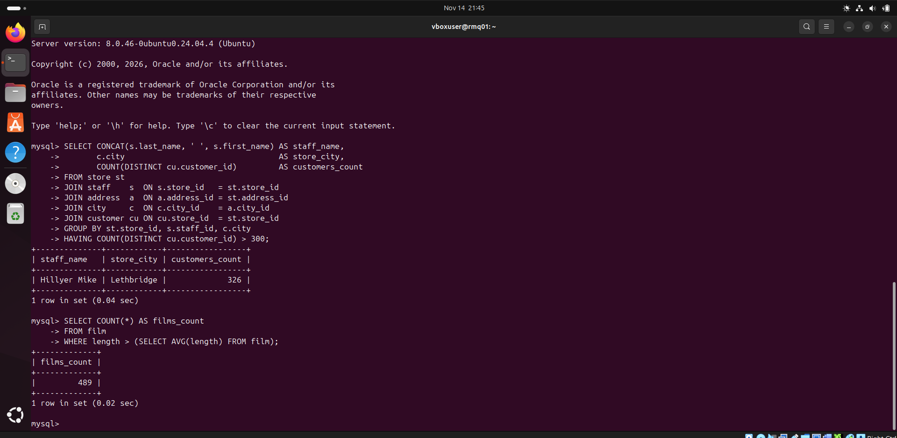
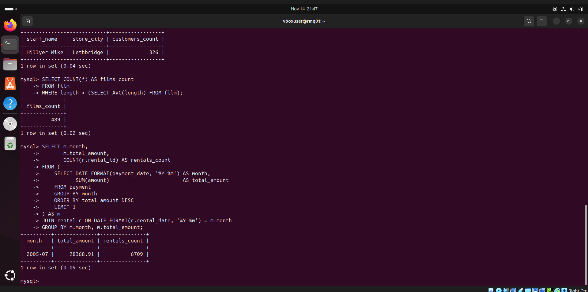
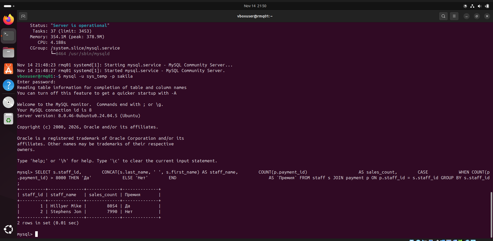
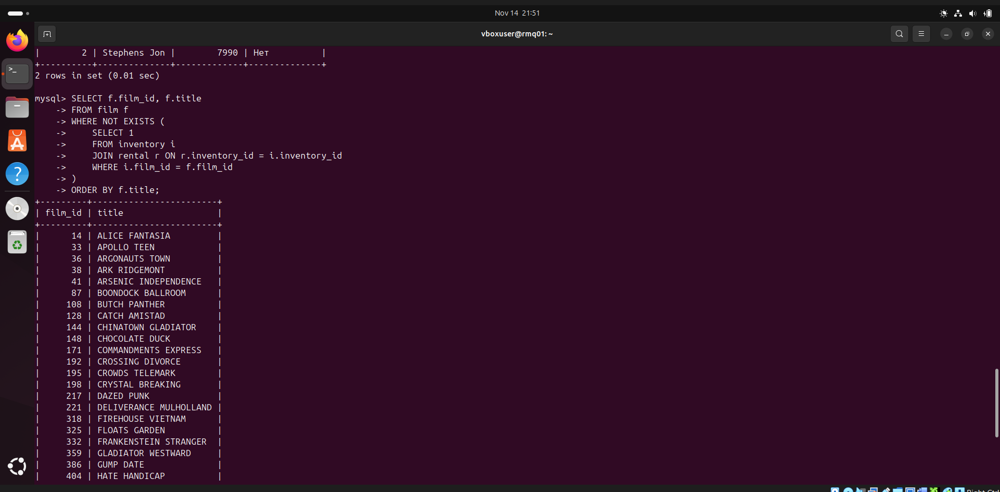

# Домашнее задание к занятию «SQL. Часть 2» — Илембетов Василь Ражапович

[English version](README_EN.md)

Запросы выполнены в командной строке MySQL 8.0 к базе `sakila`:

```bash
mysql -u sys_temp -p sakila
```

---

## Задание 1

Магазин, в котором обслуживается более 300 покупателей: сотрудник, город магазина и количество покупателей.

```sql
SELECT CONCAT(s.last_name, ' ', s.first_name) AS staff_name,
       c.city                                 AS store_city,
       COUNT(DISTINCT cu.customer_id)         AS customers_count
FROM store st
JOIN staff    s  ON s.store_id   = st.store_id
JOIN address  a  ON a.address_id = st.address_id
JOIN city     c  ON c.city_id    = a.city_id
JOIN customer cu ON cu.store_id  = st.store_id
GROUP BY st.store_id, s.staff_id, c.city
HAVING COUNT(DISTINCT cu.customer_id) > 300;
```

- Город магазина находится по цепочке `store → address → city`.
- Покупатели группируются по магазину и считаются через `COUNT`.
- Условие на количество задано в `HAVING`, так как оно применяется к уже сгруппированным данным. `WHERE` с агрегатными функциями не работает.
- `DISTINCT` исключает двойной подсчёт покупателей, если в магазине несколько сотрудников.

Результат: Hillyer Mike, Lethbridge, 326 покупателей.



---

## Задание 2

Количество фильмов, продолжительность которых больше средней:

```sql
SELECT COUNT(*) AS films_count
FROM film
WHERE length > (SELECT AVG(length) FROM film);
```

Подзапрос сначала вычисляет среднюю продолжительность всех фильмов (≈ 115.27 мин), затем внешний запрос считает фильмы длиннее неё.

Результат: 489 фильмов.



---

## Задание 3

Месяц с наибольшей суммой платежей и количество аренд за этот месяц:

```sql
SELECT m.month,
       m.total_amount,
       COUNT(r.rental_id) AS rentals_count
FROM (
    SELECT DATE_FORMAT(payment_date, '%Y-%m') AS month,
           SUM(amount)                        AS total_amount
    FROM payment
    GROUP BY month
    ORDER BY total_amount DESC
    LIMIT 1
) AS m
JOIN rental r ON DATE_FORMAT(r.rental_date, '%Y-%m') = m.month
GROUP BY m.month, m.total_amount;
```

- Подзапрос `m` группирует платежи по месяцам (`DATE_FORMAT(..., '%Y-%m')`), суммирует их и оставляет месяц с максимальной суммой (`ORDER BY ... DESC LIMIT 1`).
- Внешний запрос соединяет этот месяц с таблицей `rental` и считает аренды за него.

Результат: июль 2005 года (`2005-07`), сумма платежей 28 368.91, аренд 6709.



---

## Задание 4*

Количество продаж каждого продавца и вычисляемая колонка «Премия»:

```sql
SELECT s.staff_id,
       CONCAT(s.last_name, ' ', s.first_name) AS staff_name,
       COUNT(p.payment_id)                    AS sales_count,
       CASE
           WHEN COUNT(p.payment_id) > 8000 THEN 'Да'
           ELSE 'Нет'
       END                                    AS `Премия`
FROM staff s
JOIN payment p ON p.staff_id = s.staff_id
GROUP BY s.staff_id;
```

- Продажей считается платёж, принятый продавцом (`payment.staff_id`).
- `CASE WHEN ... THEN ... ELSE ... END` формирует значение колонки «Премия» по условию.

Результат:

| staff_id | staff_name | sales_count | Премия |
|---|---|---|---|
| 1 | Hillyer Mike | 8054 | Да |
| 2 | Stephens Jon | 7990 | Нет |



---

## Задание 5*

Фильмы, которые ни разу не брали в аренду:

```sql
SELECT f.film_id, f.title
FROM film f
WHERE NOT EXISTS (
    SELECT 1
    FROM inventory i
    JOIN rental r ON r.inventory_id = i.inventory_id
    WHERE i.film_id = f.film_id
)
ORDER BY f.title;
```

Связь таблиц: `film` → `inventory` (копии фильма в магазинах) → `rental` (аренды копий). `NOT EXISTS` оставляет фильмы, у которых нет ни одной аренды ни одной копии.

Вариант через `LEFT JOIN ... WHERE r.rental_id IS NULL` даёт неверный результат: он находит не фильмы, а отдельные копии без аренд, и захватывает фильм ACADEMY DINOSAUR, у которого одна копия ни разу не выдавалась, хотя сам фильм в аренду брали.

Результат: 42 фильма (на скриншоте — начало списка).


