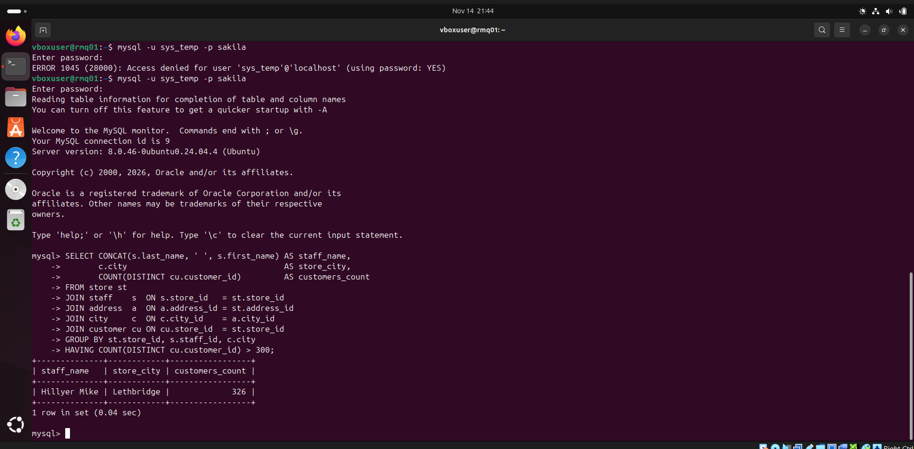
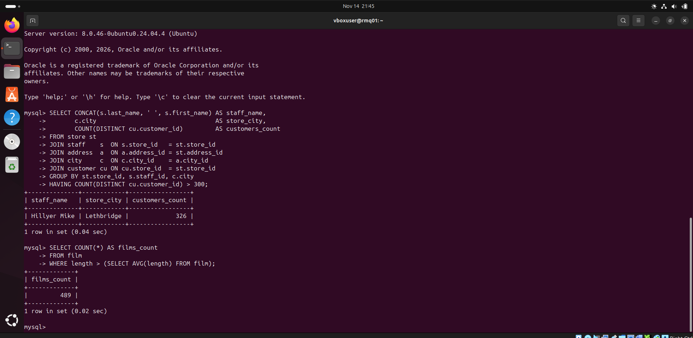
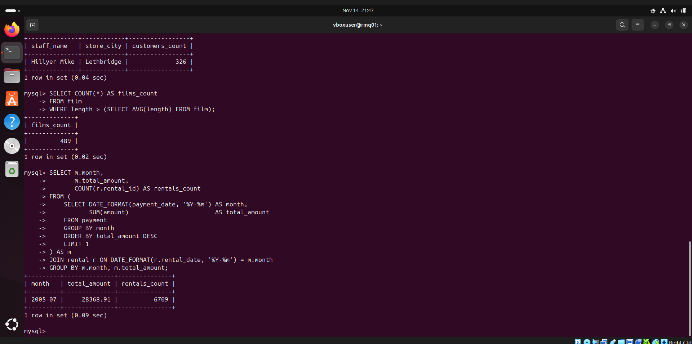
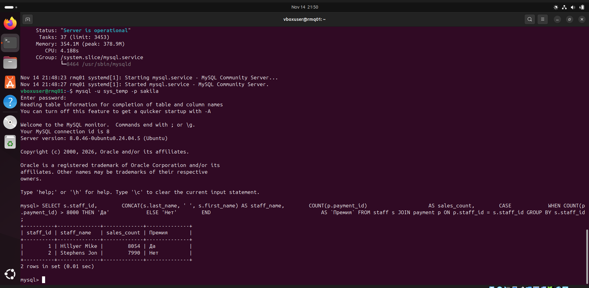
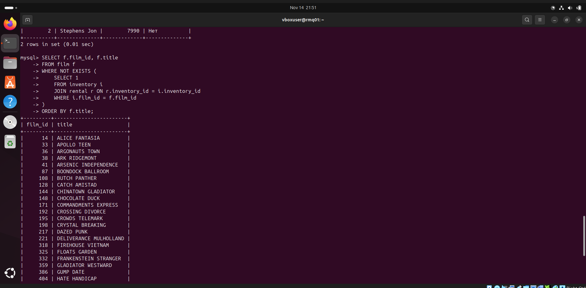

# Homework: SQL. Part 2 — Ilembetov Vasil Razhapovich

[Русская версия](README.md)

Queries were run in the MySQL 8.0 command-line client against the `sakila` database:

```bash
mysql -u sys_temp -p sakila
```

---

## Task 1

The store that serves more than 300 customers: staff member, store city and number of customers.

```sql
SELECT CONCAT(s.last_name, ' ', s.first_name) AS staff_name,
       c.city                                 AS store_city,
       COUNT(DISTINCT cu.customer_id)         AS customers_count
FROM store st
JOIN staff    s  ON s.store_id   = st.store_id
JOIN address  a  ON a.address_id = st.address_id
JOIN city     c  ON c.city_id    = a.city_id
JOIN customer cu ON cu.store_id  = st.store_id
GROUP BY st.store_id, s.staff_id, c.city
HAVING COUNT(DISTINCT cu.customer_id) > 300;
```

- The store's city is found through the chain `store → address → city`.
- Customers are grouped by store and counted with `COUNT`.
- The condition on the count is placed in `HAVING` because it applies to grouped data. `WHERE` cannot use aggregate functions.
- `DISTINCT` prevents counting customers twice if a store has several staff members.

Result: Hillyer Mike, Lethbridge, 326 customers.



---

## Task 2

Number of films longer than the average length:

```sql
SELECT COUNT(*) AS films_count
FROM film
WHERE length > (SELECT AVG(length) FROM film);
```

The subquery first calculates the average length of all films (≈ 115.27 min), then the outer query counts the films that are longer.

Result: 489 films.



---

## Task 3

The month with the highest total payments and the number of rentals in that month:

```sql
SELECT m.month,
       m.total_amount,
       COUNT(r.rental_id) AS rentals_count
FROM (
    SELECT DATE_FORMAT(payment_date, '%Y-%m') AS month,
           SUM(amount)                        AS total_amount
    FROM payment
    GROUP BY month
    ORDER BY total_amount DESC
    LIMIT 1
) AS m
JOIN rental r ON DATE_FORMAT(r.rental_date, '%Y-%m') = m.month
GROUP BY m.month, m.total_amount;
```

- Subquery `m` groups payments by month (`DATE_FORMAT(..., '%Y-%m')`), sums them and keeps the month with the highest total (`ORDER BY ... DESC LIMIT 1`).
- The outer query joins that month with the `rental` table and counts its rentals.

Result: July 2005 (`2005-07`), total payments 28,368.91, 6,709 rentals.



---

## Task 4*

Number of sales per staff member and a calculated "Bonus" column (`Премия`):

```sql
SELECT s.staff_id,
       CONCAT(s.last_name, ' ', s.first_name) AS staff_name,
       COUNT(p.payment_id)                    AS sales_count,
       CASE
           WHEN COUNT(p.payment_id) > 8000 THEN 'Да'
           ELSE 'Нет'
       END                                    AS `Премия`
FROM staff s
JOIN payment p ON p.staff_id = s.staff_id
GROUP BY s.staff_id;
```

- A sale is a payment accepted by the staff member (`payment.staff_id`).
- `CASE WHEN ... THEN ... ELSE ... END` sets the bonus value by condition: `Да` (yes) or `Нет` (no), as required by the task.

Result:

| staff_id | staff_name | sales_count | Премия (Bonus) |
|---|---|---|---|
| 1 | Hillyer Mike | 8054 | Да (yes) |
| 2 | Stephens Jon | 7990 | Нет (no) |



---

## Task 5*

Films that have never been rented:

```sql
SELECT f.film_id, f.title
FROM film f
WHERE NOT EXISTS (
    SELECT 1
    FROM inventory i
    JOIN rental r ON r.inventory_id = i.inventory_id
    WHERE i.film_id = f.film_id
)
ORDER BY f.title;
```

Table chain: `film` → `inventory` (copies of a film in stores) → `rental` (rentals of those copies). `NOT EXISTS` keeps the films with no rentals of any of their copies.

The `LEFT JOIN ... WHERE r.rental_id IS NULL` approach gives a wrong result: it finds individual copies without rentals rather than films, and wrongly includes ACADEMY DINOSAUR, which has one never-rented copy even though the film itself has been rented.

Result: 42 films (the screenshot shows the beginning of the list).


