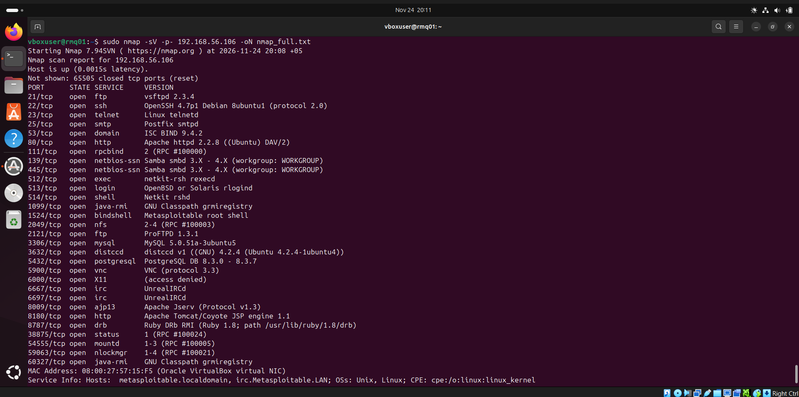
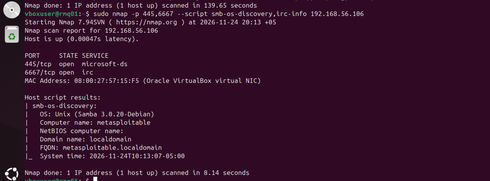
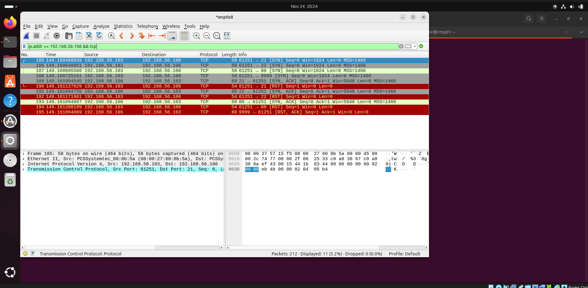
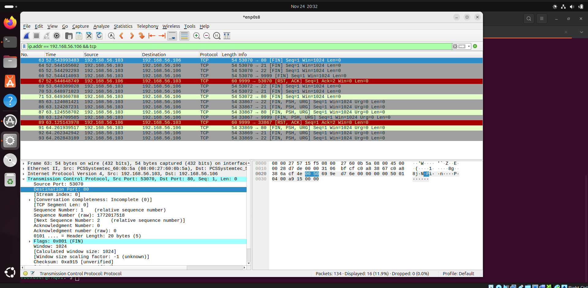
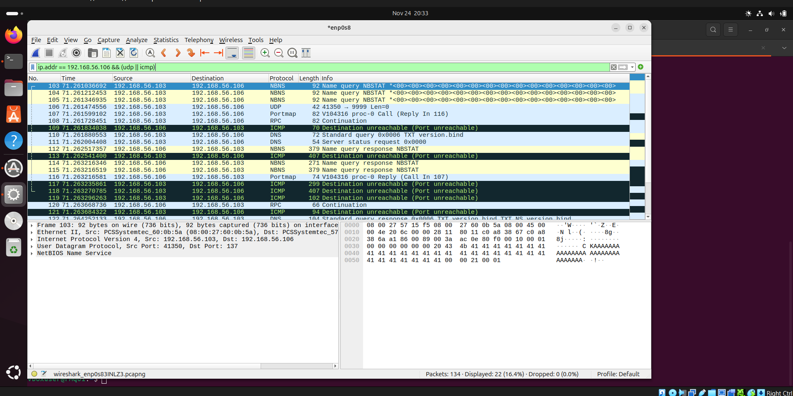

# Домашнее задание к занятию «Уязвимости и атаки на информационные системы» — Илембетов Василь Ражапович

[English version](README_EN.md)

## Стенд

Две виртуальные машины VirtualBox в изолированной сети host-only `192.168.56.0/24`. Metasploitable намеренно уязвима, поэтому к NAT и сетевому мосту она не подключена.

| ВМ | IP | Роль |
|---|---|---|
| rmq01 (Ubuntu 24.04) | 192.168.56.103 | сканер: nmap 7.94, Wireshark |
| Metasploitable 2 | 192.168.56.106 | цель сканирования |

---

## Задание 1

### Сканирование

Сканирование всех 65 535 TCP-портов с определением версий служб:

```bash
sudo nmap -sV -p- 192.168.56.106 -oN nmap_full.txt
```

- `-sV` — определение программы и её версии на каждом открытом порту;
- `-p-` — все порты, а не только 1000 популярных;
- `-oN` — сохранение результата в файл.



### Какие сетевые службы разрешены

Открыто 30 TCP-портов (остальные 65 505 закрыты):

| Порт | Служба | Версия |
|---|---|---|
| 21 | FTP | vsftpd 2.3.4 |
| 22 | SSH | OpenSSH 4.7p1 Debian 8ubuntu1 |
| 23 | Telnet | Linux telnetd |
| 25 | SMTP | Postfix smtpd |
| 53 | DNS | ISC BIND 9.4.2 |
| 80 | HTTP | Apache httpd 2.2.8 (Ubuntu) DAV/2 |
| 111 | RPC | rpcbind 2 |
| 139, 445 | SMB | Samba smbd 3.0.20-Debian |
| 512 | rexec | netkit-rsh rexecd |
| 513 | rlogin | OpenBSD or Solaris rlogind |
| 514 | rsh | Netkit rshd |
| 1099 | Java RMI | GNU Classpath grmiregistry |
| 1524 | bindshell | Metasploitable root shell |
| 2049 | NFS | 2–4 |
| 2121 | FTP | ProFTPD 1.3.1 |
| 3306 | MySQL | 5.0.51a-3ubuntu5 |
| 3632 | distccd | distccd v1 (GNU 4.2.4) |
| 5432 | PostgreSQL | 8.3.0 – 8.3.7 |
| 5900 | VNC | protocol 3.3 |
| 6000 | X11 | access denied |
| 6667, 6697 | IRC | UnrealIRCd |
| 8009 | AJP | Apache Jserv 1.3 |
| 8180 | HTTP | Apache Tomcat/Coyote JSP engine 1.1 |
| 8787 | DRb | Ruby DRb RMI (Ruby 1.8) |
| 38875, 54555, 59063, 60327 | RPC | status, mountd, nlockmgr, java-rmi |

Уже по списку видны серьёзные проблемы: открытые без шифрования Telnet, rlogin и rsh, а на порту 1524 — командная оболочка root без пароля.

Для Samba nmap показал только диапазон `3.X - 4.X`, поэтому точная версия уточнена скриптом:

```bash
sudo nmap -p 445,6667 --script smb-os-discovery,irc-info 192.168.56.106
```

Результат — **Samba 3.0.20-Debian**. Версию UnrealIRCd nmap не определил: сервер не успел ответить скрипту `irc-info`.



### Обнаруженные уязвимости

**1. vsftpd 2.3.4 — бэкдор (порт 21), CVE-2011-2523.**
Архив vsftpd 2.3.4, распространявшийся с 30 июня по 3 июля 2011 года, содержит бэкдор, который открывает командную оболочку на порту 6200/tcp. Версия на Metasploitable совпадает с уязвимой.
- https://www.exploit-db.com/exploits/49757
- https://www.exploit-db.com/exploits/17491

**2. Samba 3.0.20 — выполнение команд через «username map script» (порты 139/445), CVE-2007-2447.**
В Samba версий 3.0.20–3.0.25rc3 при включённой опции `username map script` имя пользователя с метасимволами командной оболочки приводит к выполнению произвольных команд. Аутентификация не нужна, так как опция обрабатывается до входа. Версия 3.0.20-Debian подтверждена скриптом `smb-os-discovery`.
- https://www.exploit-db.com/exploits/16320

**3. UnrealIRCd 3.2.8.1 — бэкдор (порты 6667/6697), CVE-2010-2075.**
В архив Unreal3.2.8.1.tar.gz, распространявшийся с ноября 2009 по июнь 2010 года, был встроен бэкдор, позволяющий удалённо выполнять команды. nmap обнаружил службу UnrealIRCd без номера версии; в Metasploitable 2 установлена именно версия 3.2.8.1.
- https://www.exploit-db.com/exploits/16922

---

## Задание 2

Каждый режим сканирования записан в Wireshark на интерфейсе `enp0s8` (сеть host-only). Для наглядности выбраны открытые порты 21, 22, 80 и закрытый 9999. Ключ `-Pn` отключает предварительную проверку доступности хоста, чтобы в записи были только пакеты самого сканирования.

```bash
sudo nmap -Pn -sS -p 21,22,80,9999 192.168.56.106     # SYN
sudo nmap -Pn -sF -p 21,22,80,9999 192.168.56.106     # FIN
sudo nmap -Pn -sX -p 21,22,80,9999 192.168.56.106     # Xmas
sudo nmap -Pn -sU -p 53,111,137,9999 192.168.56.106   # UDP
```

### SYN-сканирование

Сканер отправляет пакет с флагом `SYN` — как в начале обычного TCP-соединения, — но рукопожатие не завершает («полуоткрытое» сканирование).

- Открытые порты 21, 22, 80 отвечают `[SYN, ACK]`, после чего сканер сразу отправляет `[RST]` — соединение не устанавливается.
- Закрытый порт 9999 отвечает `[RST, ACK]`.



### FIN- и Xmas-сканирование

На скриншоте оба скана подряд: FIN (пакеты 63–71) и Xmas (пакеты 85–93).

- **FIN:** сканер отправляет пакет только с флагом `[FIN]` — как будто закрывает несуществующее соединение.
- **Xmas:** сканер отправляет пакет с флагами `[FIN, PSH, URG]` («горит как ёлка»).

Ответы сервера в обоих случаях одинаковые и соответствуют RFC 793:
- открытые порты 21, 22, 80 пакет молча отбрасывают — ответа нет, поэтому сканер через секунду повторяет запрос (пакеты 69–71 и 91–93), а nmap помечает порты как `open|filtered`;
- закрытый порт 9999 отвечает `[RST, ACK]` (пакеты 67 и 89).



### UDP-сканирование

Сканер отправляет UDP-датаграммы; для известных служб — с корректным запросом протокола.

- **53 (DNS)** — запрос `version.bind`, сервер присылает DNS-ответ — порт открыт;
- **111 (Portmap)** — запрос `Call` и ответ `Reply` — порт открыт;
- **137 (NetBIOS)** — запросы `NBSTAT` и ответы `Name query response` — порт открыт;
- **9999** — пустая датаграмма, в ответ ICMP `Destination unreachable (Port unreachable)` — порт закрыт.

Сообщения ICMP `Port unreachable`, идущие в обратную сторону — от сканера `192.168.56.103` к цели, — формирует ядро Ubuntu на сканере: nmap работает через «сырой» сокет, и система не знает, что ответы сервера ожидаются, поэтому отвечает на них «порт закрыт». На результат сканирования это не влияет.



### Чем отличаются режимы с точки зрения трафика

| Режим | Что отправляет сканер | Открытый порт | Закрытый порт | Результат nmap для открытого порта |
|---|---|---|---|---|
| SYN | `SYN` | `SYN, ACK` → сканер отвечает `RST` | `RST, ACK` | `open` |
| FIN | `FIN` | нет ответа | `RST, ACK` | `open\|filtered` |
| Xmas | `FIN, PSH, URG` | нет ответа | `RST, ACK` | `open\|filtered` |
| UDP | UDP-датаграмма | UDP-ответ службы | ICMP Port unreachable | `open` (или `open\|filtered`, если служба молчит) |

- **SYN** определяет состояние порта по явному ответу: `SYN, ACK` или `RST`. Это самый быстрый и надёжный режим, но попытки соединения заметны в журналах и системах обнаружения вторжений.
- **FIN и Xmas** не начинают соединение и поэтому менее заметны. Открытый порт у них определяется по отсутствию ответа, поэтому отличить открытый порт от отфильтрованного межсетевым экраном нельзя. Режимы работают только с системами, следующими RFC 793: например, Windows отвечает `RST` с любого порта.
- **UDP** работает без установления соединения и без флагов. Закрытый порт сообщает о себе через ICMP, а не через `RST`. Если служба не отвечает на пустой запрос, порт получает статус `open|filtered`. UDP-сканирование медленное: Linux ограничивает частоту ICMP-ответов.
