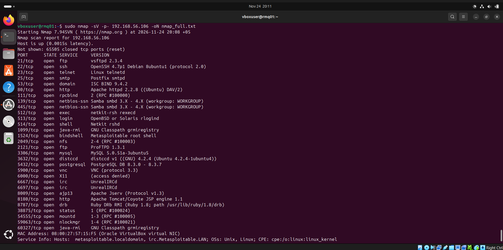
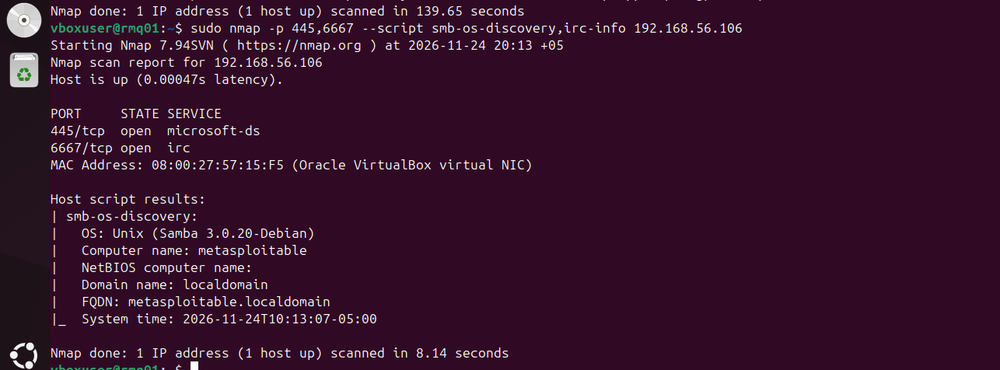
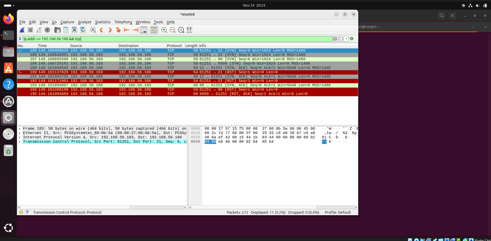
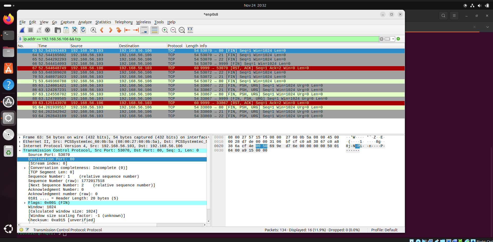
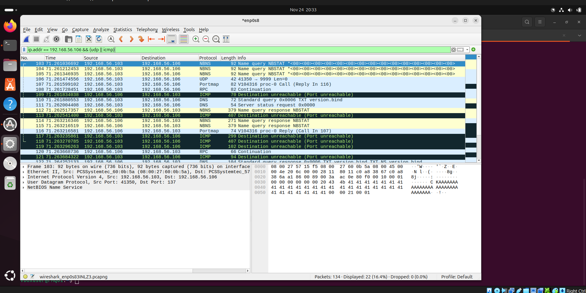

# Homework: Vulnerabilities and Attacks on Information Systems — Ilembetov Vasil Razhapovich

[Русская версия](README.md)

## Environment

Two VirtualBox virtual machines in an isolated host-only network `192.168.56.0/24`. Metasploitable is intentionally vulnerable, so it is not connected to NAT or a bridged network.

| VM | IP | Role |
|---|---|---|
| rmq01 (Ubuntu 24.04) | 192.168.56.103 | scanner: nmap 7.94, Wireshark |
| Metasploitable 2 | 192.168.56.106 | scan target |

---

## Task 1

### Scan

Scanning all 65,535 TCP ports with service version detection:

```bash
sudo nmap -sV -p- 192.168.56.106 -oN nmap_full.txt
```

- `-sV` — detect the software and its version on every open port;
- `-p-` — all ports, not just the 1,000 most common;
- `-oN` — save the result to a file.



### Which network services are allowed

30 TCP ports are open (the remaining 65,505 are closed):

| Port | Service | Version |
|---|---|---|
| 21 | FTP | vsftpd 2.3.4 |
| 22 | SSH | OpenSSH 4.7p1 Debian 8ubuntu1 |
| 23 | Telnet | Linux telnetd |
| 25 | SMTP | Postfix smtpd |
| 53 | DNS | ISC BIND 9.4.2 |
| 80 | HTTP | Apache httpd 2.2.8 (Ubuntu) DAV/2 |
| 111 | RPC | rpcbind 2 |
| 139, 445 | SMB | Samba smbd 3.0.20-Debian |
| 512 | rexec | netkit-rsh rexecd |
| 513 | rlogin | OpenBSD or Solaris rlogind |
| 514 | rsh | Netkit rshd |
| 1099 | Java RMI | GNU Classpath grmiregistry |
| 1524 | bindshell | Metasploitable root shell |
| 2049 | NFS | 2–4 |
| 2121 | FTP | ProFTPD 1.3.1 |
| 3306 | MySQL | 5.0.51a-3ubuntu5 |
| 3632 | distccd | distccd v1 (GNU 4.2.4) |
| 5432 | PostgreSQL | 8.3.0 – 8.3.7 |
| 5900 | VNC | protocol 3.3 |
| 6000 | X11 | access denied |
| 6667, 6697 | IRC | UnrealIRCd |
| 8009 | AJP | Apache Jserv 1.3 |
| 8180 | HTTP | Apache Tomcat/Coyote JSP engine 1.1 |
| 8787 | DRb | Ruby DRb RMI (Ruby 1.8) |
| 38875, 54555, 59063, 60327 | RPC | status, mountd, nlockmgr, java-rmi |

The list alone shows serious problems: unencrypted Telnet, rlogin and rsh are open, and port 1524 exposes a root shell with no password.

For Samba, nmap only showed the range `3.X - 4.X`, so the exact version was checked with a script:

```bash
sudo nmap -p 445,6667 --script smb-os-discovery,irc-info 192.168.56.106
```

The result is **Samba 3.0.20-Debian**. nmap did not determine the UnrealIRCd version: the server did not answer the `irc-info` script in time.



### Vulnerabilities found

**1. vsftpd 2.3.4 — backdoor (port 21), CVE-2011-2523.**
The vsftpd 2.3.4 archive distributed between June 30 and July 3, 2011 contains a backdoor that opens a command shell on port 6200/tcp. The version on Metasploitable matches the vulnerable one.
- https://www.exploit-db.com/exploits/49757
- https://www.exploit-db.com/exploits/17491

**2. Samba 3.0.20 — command execution via "username map script" (ports 139/445), CVE-2007-2447.**
In Samba 3.0.20 through 3.0.25rc3 with the `username map script` option enabled, a username containing shell metacharacters leads to arbitrary command execution. No authentication is needed because the option is processed before login. Version 3.0.20-Debian was confirmed with the `smb-os-discovery` script.
- https://www.exploit-db.com/exploits/16320

**3. UnrealIRCd 3.2.8.1 — backdoor (ports 6667/6697), CVE-2010-2075.**
A backdoor allowing remote command execution was embedded in the Unreal3.2.8.1.tar.gz archive distributed from November 2009 to June 2010. nmap detected the UnrealIRCd service without a version number; Metasploitable 2 ships version 3.2.8.1.
- https://www.exploit-db.com/exploits/16922

---

## Task 2

Each scan mode was captured in Wireshark on interface `enp0s8` (host-only network). Open ports 21, 22, 80 and closed port 9999 were chosen for clarity. The `-Pn` flag skips host discovery so the capture contains only the scan packets.

```bash
sudo nmap -Pn -sS -p 21,22,80,9999 192.168.56.106     # SYN
sudo nmap -Pn -sF -p 21,22,80,9999 192.168.56.106     # FIN
sudo nmap -Pn -sX -p 21,22,80,9999 192.168.56.106     # Xmas
sudo nmap -Pn -sU -p 53,111,137,9999 192.168.56.106   # UDP
```

### SYN scan

The scanner sends a `SYN` packet, as at the start of a normal TCP connection, but never completes the handshake ("half-open" scan).

- Open ports 21, 22, 80 reply with `[SYN, ACK]`, and the scanner immediately sends `[RST]` — no connection is established.
- Closed port 9999 replies with `[RST, ACK]`.



### FIN and Xmas scans

The screenshot shows both scans in a row: FIN (packets 63–71) and Xmas (packets 85–93).

- **FIN:** the scanner sends a packet with only the `[FIN]` flag, as if closing a connection that does not exist.
- **Xmas:** the scanner sends a packet with `[FIN, PSH, URG]` set ("lit up like a Christmas tree").

The server replies the same way in both cases, following RFC 793:
- open ports 21, 22, 80 silently drop the packet — there is no reply, so the scanner retries a second later (packets 69–71 and 91–93), and nmap marks the ports `open|filtered`;
- closed port 9999 replies with `[RST, ACK]` (packets 67 and 89).



### UDP scan

The scanner sends UDP datagrams; for known services it sends a valid protocol request.

- **53 (DNS)** — a `version.bind` query, and the server sends a DNS response — port open;
- **111 (Portmap)** — a `Call` request and a `Reply` — port open;
- **137 (NetBIOS)** — `NBSTAT` queries and `Name query response` replies — port open;
- **9999** — an empty datagram, answered with ICMP `Destination unreachable (Port unreachable)` — port closed.

The ICMP `Port unreachable` messages going the other way — from scanner `192.168.56.103` to the target — are generated by the Ubuntu kernel on the scanner: nmap works through a raw socket, so the OS does not know the server's replies are expected and answers them with "port closed". This does not affect the scan result.



### How the modes differ in terms of traffic

| Mode | Scanner sends | Open port | Closed port | nmap result for an open port |
|---|---|---|---|---|
| SYN | `SYN` | `SYN, ACK` → scanner replies `RST` | `RST, ACK` | `open` |
| FIN | `FIN` | no reply | `RST, ACK` | `open\|filtered` |
| Xmas | `FIN, PSH, URG` | no reply | `RST, ACK` | `open\|filtered` |
| UDP | UDP datagram | service's UDP reply | ICMP Port unreachable | `open` (or `open\|filtered` if the service stays silent) |

- **SYN** determines the port state from an explicit reply: `SYN, ACK` or `RST`. It is the fastest and most reliable mode, but the connection attempts show up in logs and intrusion detection systems.
- **FIN and Xmas** never start a connection and are therefore less noticeable. An open port is detected by the absence of a reply, so an open port cannot be told apart from one filtered by a firewall. These modes work only against systems that follow RFC 793: Windows, for example, replies with `RST` from any port.
- **UDP** is connectionless and has no flags. A closed port reports itself via ICMP, not `RST`. If a service does not answer an empty request, the port gets `open|filtered`. UDP scanning is slow because Linux rate-limits ICMP replies.
